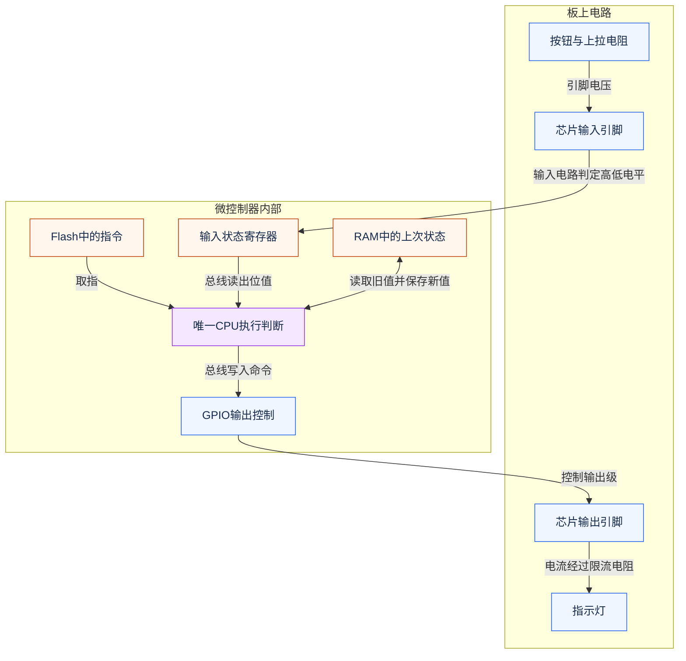

<!-- SPDX-License-Identifier: Apache-2.0 -->

# 第1章\_程序怎样把电信号变成一次操作

一个带按钮、温度显示和指示灯的控制面板，实际上在不断完成两次翻译：先把电压解释成状态，再把计算结果变成输出电压。只懂 `if` 语句还不能解释这两次翻译。本专题只要求能读懂简单 C 条件语句；图中的输入、存储和输出分别是电路、保存状态的器件和执行动作的电路。

图例：**蓝色节点表示一般参与者，紫色突出处理或决策，橙色表示保存的数据或状态。** 实线箭头上的文字说明传递对象；双向箭头是两种先后发生的访问，不表示两个 CPU 同时执行。`CPU(Central Processing Unit-中央处理器)：执行指令。` `GPIO(General Purpose Input/Output-通用输入输出)：连接数字引脚与软件。` `RAM(Random Access Memory-随机存取存储器)：保存运行时数据。` Flash 是非易失闪存，断电后可以保留程序。

**沿输入方向看：按钮并不发送一条 C 语句。** 上拉电阻把松开时的电压拉高，按下时电路把它拉低，输入电路再形成一个位。CPU 读到的是这一位的数值。假设低电平表示按下，则 `pressed = (level == 0)` 完成电平到业务含义的转换。换成下拉接法后，这条转换规则必须重新确定。

沿输出方向看：程序写的是输出控制状态，真正供出或吸收电流的是输出级。灯是否亮还取决于灯的接法、电阻和电源。因此，调试器中变量变成 1，只能证明计算到达某一步，不能证明引脚电压与灯电流正确。图把这几个证据点分开，正是为了让排错有所依据。

同一个按下状态可能持续几百毫秒。若每轮检测到按下就切换灯，灯会反复翻转。要把“持续状态”变成“一次动作”，必须记住上次状态：这说明存储器不仅装程序，还让程序具有历史。电气抖动可能制造多次变化，后续消抖还需增加稳定时间判据。

继续：[原理与实现](P002_原理与实现.md)。返回：[专题大纲](大纲.md)。
