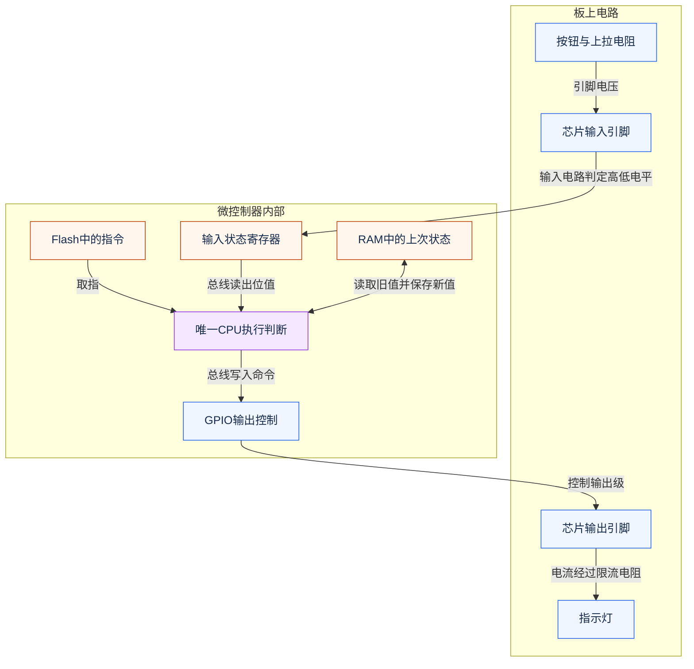

<!-- SPDX-License-Identifier: Apache-2.0 -->

# 第1章\_电平怎样变成一次按键操作

> [P01 总目录](../大纲.md) / [P001 从按键和指示灯认识计算机](大纲.md) / 第 1 篇（共 3 篇）

一个带按钮、温度显示和指示灯的控制面板，实际上在不断完成两次翻译：先把电压解释成状态，再把计算结果变成输出电压。只懂 `if` 语句还不能解释这两次翻译。本专题只要求能读懂简单 C 条件语句；图中的输入、存储和输出分别是电路、保存状态的器件和执行动作的电路。

图例：**蓝色节点表示一般参与者，紫色突出处理或决策，橙色表示保存的数据或状态。** 实线箭头上的文字说明传递对象；双向箭头是两种先后发生的访问，不表示两个 CPU 同时执行。`CPU(Central Processing Unit-中央处理器)：执行指令。` `GPIO(General Purpose Input/Output-通用输入输出)：连接数字引脚与软件。` `RAM(Random Access Memory-随机存取存储器)：保存运行时数据。` Flash 是非易失闪存，断电后可以保留程序。

**沿输入方向看：按钮并不发送一条 C 语句。** 上拉电阻把松开时的电压拉高，按下时电路把它拉低，输入电路再形成一个位。CPU 读到的是这一位的数值。假设低电平表示按下，则 `pressed = (level == 0)` 完成电平到业务含义的转换。换成下拉接法后，这条转换规则必须重新确定。

沿输出方向看：程序写的是输出控制状态，真正供出或吸收电流的是输出级。灯是否亮还取决于灯的接法、电阻和电源。因此，调试器中变量变成 1，只能证明计算到达某一步，不能证明引脚电压与灯电流正确。图把这几个证据点分开，正是为了让排错有所依据。

同一个按下状态可能持续几百毫秒。若每轮检测到按下就切换灯，灯会反复翻转。要把“持续状态”变成“一次动作”，必须记住上次状态：这说明存储器不仅装程序，还让程序具有历史。电气抖动可能制造多次变化，后续消抖还需增加稳定时间判据。

## 1.1\_从电平到事件，程序还需要时间

设按钮松开时读数为1，按下时读数为0。第一次读到0，能确定的只是“这次采样时输入为低”；还不能确定用户已经完成一次有效按键，也不能确定前一次读取之后发生了几次变化。程序要识别用户动作，必须把采样值和时间联系起来。

一种可解释的消抖方案是保存“候选状态、候选开始时间、已确认状态”。发现采样值与候选不同，就替换候选并重记时间；候选持续达到规定时间后，才修改已确认状态。若已确认状态从松开变为按下，产生一条按下事件。持续按住时，候选与确认状态都保持按下，不会每轮重新产生事件。

| 观察时刻（教学假设） | 原始输入 | 候选变化 | 已确认状态 |
| --- | --- | --- | --- |
| 0 ms | 松开 | 初始松开 | 松开 |
| 1 ms | 按下 | 候选按下，开始计时 | 松开 |
| 3 ms | 松开 | 候选回到松开 | 松开 |
| 5 ms | 按下 | 重新开始按下计时 | 松开 |
| 15 ms | 仍按下 | 已持续10 ms | 确认按下，发出一次事件 |

10 ms 只是用于本表的判据，不是所有开关的通用参数。真实选择要兼顾开关抖动与允许的响应延迟。程序也没有真的“暂停10 ms”：每轮只比较当前时间，其余时间仍可处理测量和显示。到这里，输入采样、状态记忆、时间判断和业务事件才分别有了明确职责。

---

[← P01 总目录](../大纲.md) · [本专题目录](大纲.md) · [输入存储执行与输出的完整路径 →](P002_输入存储执行与输出的完整路径.md)
