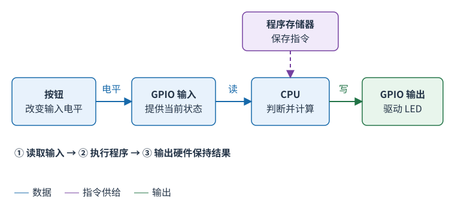

<!-- SPDX-License-Identifier: Apache-2.0 -->

# 第2章\_从按键和指示灯认识计算机

按下设备面板上的按钮，状态灯亮起。这个动作很普通，却足以把一台计算机的主要组成串起来：外部世界怎样进入芯片，芯片怎样作出判断，程序放在哪里，判断结果又怎样回到外部世界。

本专题从这个小控制面板开始。先用图和纸面推演建立计算机的工作模型，再把它落实到 STM32H743，最后读懂汇编、启动代码和中断现场。STM32H743 是 STMicroelectronics（意法半导体，ST）的一种微控制器型号；现在只把它看成面板中能够运行程序的芯片即可。本章不要求安装工具或接上开发板，也不假设读者已经有 Zephyr 源码。

<a id="1.1_先区分电路直接控制与程序控制"></a>

## 2.1\_先区分电路直接控制与程序控制

一个按钮、一只限流电阻和一颗发光二极管，接成合适的回路，已经能够做到“按下就亮”。其中没有程序：开关闭合改变了电流通路，灯随之发光。**发光二极管（Light-Emitting Diode，LED）** 是电流通过时发光的器件，限流电阻用来限制电流，不能把 LED 当作可以随意跨接电源的普通导线。

现在改变需求：第一次按下打开灯，第二次按下关闭灯；长按两秒则恢复默认状态。直接连接的按钮只表示“此刻按着还是松开”，它没有记录上一次按键结果，也没有计时。要实现新需求，系统必须保存状态、判断条件，并随着时间推进操作。

可以专门设计满足这些规则的电路。另一种方式是在电路中放入一个能够执行指令的处理器，把“读取按钮、判断状态、改变灯”的顺序写成程序。以后修改规则，主要修改程序及其保存的数据，基本硬件可以继续使用。可编程并不意味着脱离电路：每一步读写和计算，仍由电路完成。

<a id="1.2_一次按键经过哪些部件"></a>

## 2.2\_一次按键经过哪些部件

处理器需要三个方向的协作。它要从存储器取到“下一步做什么”，从输入接口取得按钮状态，再通过输出接口改变灯的驱动状态。

**中央处理器（Central Processing Unit，CPU）** 是取出并执行指令的硬件。**存储器（Memory）** 保存指令和数据；**输入输出（Input/Output，I/O）** 则把计算系统与外部信号连接起来。这里的“输入”和“输出”以芯片为观察中心：按钮状态进入芯片，灯的控制信号离开芯片。



图例：**蓝色实线是数据读写，紫色虚线是指令供给，绿色实线是输出动作**。箭头表示本次事务的方向，图中连线不是电路板布线图。

名称注释：`CPU（Central Processing Unit－中央处理器）：执行程序规定的读写、计算与跳转。` `GPIO（General-Purpose Input/Output－通用输入输出）：把引脚电平与可由程序访问的状态连接起来。` `LED（Light-Emitting Diode－发光二极管）：把输出电流变化变成可观察的光。`

沿图中的蓝线读一次按钮：按钮改变输入端的电压，GPIO 输入电路把满足低、高电平条件的电压识别为数字状态。CPU 执行一条读取操作后，才取得这份状态。CPU 并不靠“看见一根导线”知道用户按了哪个按钮；是电路连接、接口配置与程序访问位置共同建立了对应关系。

随后沿绿色线写一次输出：CPU 根据程序算出应该点亮灯，把对应控制值写入 GPIO。输出电路保持这个值所要求的驱动状态，使灯的电流通路发生变化。**输出状态通常能够由硬件保持，CPU 不必每个时钟都重新写一次“亮”。** 这会成为后面理解外设独立工作的第一块基础。

紫色线解释程序的作用。按钮输入相同，换一段程序，灯的行为就可能不同。程序可以选择跟随按钮、翻转状态或延迟关闭。存储器中的指令决定 CPU 执行哪些操作，输入数据决定程序走哪条条件分支。

<a id="1.3_指令与数据为什么都需要保存"></a>

## 2.3\_指令与数据为什么都需要保存

假设我们希望一次完整的按下、松开只翻转灯一次。程序至少要记住两个值：上一轮按钮是否按下、当前灯是否点亮。下面是便于理解的 C 风格伪代码；`read_button()` 和 `write_led()` 是尚未实现的动作名称，本章不要求编译。

```c
bool previous_pressed = false;
bool led_on = false;

for (;;) {
    bool pressed = read_button();
    if (pressed && !previous_pressed) {
        led_on = !led_on;
    }
    previous_pressed = pressed;
    write_led(led_on);
}
```

**`previous_pressed` 保存历史，`pressed` 表示当前采样，`led_on` 保存输出决策。** 这三种状态不能混成“按钮数据”。程序在每轮比较当前与历史，只有“上次未按、这次按下”才翻转灯。如果只写 `if (pressed) led_on = !led_on;`，一次持续按住会使每轮都翻转，最终看到的行为取决于循环速度。

用纸和笔跟踪五次采样，不需要任何软件工具：

| 本轮采样 | 上轮状态 | 是否发现新的按下 | 更新后的灯状态 |
| --- | --- | --- | --- |
| 松开 | 松开 | 否 | 灭 |
| 按下 | 松开 | 是 | 亮 |
| 按下 | 按下 | 否 | 亮 |
| 松开 | 按下 | 否 | 亮 |
| 按下 | 松开 | 是 | 灭 |

这张表说明了保存状态的必要性。相同的“当前按下”，因为历史不同，可以产生不同结果。程序中的变量最终必须落到处理器内部或存储器中的某个真实保存位置；后面会看到寄存器和 SRAM 分别怎样承担这些保存工作。

机械按键还可能在一次按下时短暂反复接通和断开，称为**触点抖动（Contact Bounce）**。上表假设已经取得稳定采样，不能据此认为真实按钮只会产生一次边沿。后面的定时器与中断章节会继续处理这个问题。

<a id="1.4_cpu、微控制器和开发板分别是什么"></a>

## 2.4\_CPU、微控制器和开发板分别是什么

如果只拿到一个 CPU，它未必具备保存程序、读取按钮和驱动灯所需要的全部部件。把处理器、存储器以及常用外设集成在一颗芯片中，便形成了适合控制任务的**微控制器（Microcontroller Unit，MCU）**。STM32H743 就属于这一类产品。

芯片要实际工作，还需要供电、复位条件、符合要求的外部连接，有些配置还需要外部时钟。把这些电路、连接器和芯片安装在印制电路板上，才得到一块具体的开发板或产品板。同一型号芯片可以装在不同板子上；同一引脚在不同板上也可能接了不同器件。

| 层次 | 在按钮控制灯的例子中做什么 | 改变这一层可能影响什么 |
| --- | --- | --- |
| CPU | 执行读取、判断、写入指令 | 可执行指令、执行效率和异常机制 |
| MCU 芯片 | 集成 CPU、存储器、GPIO 等外设 | 寄存器地址、存储容量、引脚复用 |
| 开发板 | 给芯片供电并接入按钮、灯、调试接口 | 按钮接哪个脚、按下是高还是低、灯的有效电平 |
| 固件程序 | 规定采样与输出规则 | 翻转、长按、闪烁及错误处理行为 |

**固件（Firmware）** 是设备中运行的软件，通常存放在可保持内容的存储器中。固件也可以包含操作系统，但完成当前例子并不要求先有操作系统。读者此时先抓住 CPU、芯片、板和程序四层关系，后面就不会把“Cortex-M7”“STM32H743”和某块开发板当成三个同类芯片名称。

官方对照：ST [DS12110 Rev 11](https://www.st.com/resource/en/datasheet/stm32h743zi.pdf) 的 **Features、Description 与 Block diagram** 展示了 H743 芯片内部集成的部件。阅读时先找处理器、存储器和 GPIO 三类对象，不需要现在记住整张产品框图中的全部外设。

<a id="1.5_为什么一颗芯片能同时照顾多个设备"></a>

## 2.5\_为什么一颗芯片能同时照顾多个设备

面板以后还会接入温度传感器和显示器。CPU 仍然按程序执行，但 GPIO 可以保持输出，串行接口可以移出已经交给它的数据，定时器可以继续计数。这些硬件各自保有状态，能够在 CPU 做别的工作时推进特定动作。

因此，后面讨论“并行”时一定要说明是谁在同时工作：可能是 CPU 与外设同时工作，也可能是多个外设同时工作；操作系统中的多个线程则可能轮流使用同一个 CPU。三种情况在屏幕上都可能表现得很流畅，内部机制却不同。

先做一个预测：CPU 点亮灯后进入一个很长的计算循环，灯会不会因为 CPU 没继续写 GPIO 而立即熄灭？按照输出由硬件保存的模型，只要外设仍供电、配置未变、没有其他写入，灯应保持原状态。会变慢的是下一次输入的处理，而不是已经保存的输出自动失效。

后一专题进一步拆开这些保存和计算动作：一段电压如何被当作 0 或 1，一组 0、1 怎样表示数量，电路又怎样把结果保存到下一次操作。

阅读导航：[专题大纲](../大纲.md) · [后一专题：二进制与数字电路](../P002_digital_logic/P002_原理与实现.md)


专题内阅读：[关系与模型](P001_关系与模型.md) → 本篇原理与实现 → [案例与推演](P003_案例与推演.md)。返回：[本专题大纲](大纲.md)。
