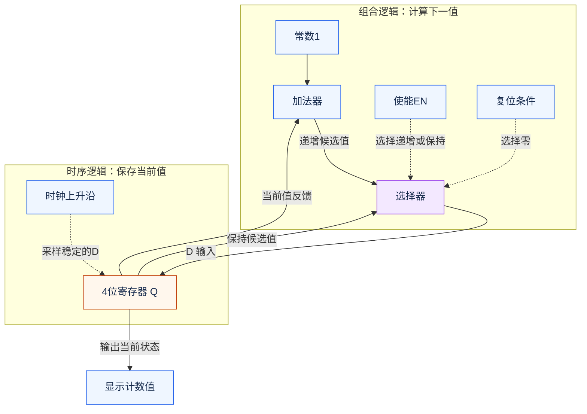

<!-- SPDX-License-Identifier: Apache-2.0 -->

# 第1章\_位、组合逻辑和时钟怎样构成状态机

本专题从二进制加法出发，建立“当前状态怎样决定下一状态”的模型。位是对两种逻辑状态的编码；组合逻辑根据此刻输入计算输出，寄存器则把某次计算结果保留下来。二者接在一起，才可能形成可持续工作的计数器。

图例：**蓝色节点表示一般参与者，紫色突出处理或决策，橙色表示保存的数据或状态。** 实线是数值，虚线是采样或选择条件。`EN(Enable-使能)：决定本次是否计数。` D 和 Q 是触发器输入、输出端的惯用名称，不是两块 RAM。

先遮住时钟箭头，设 Q=3，加法器会算出 4，但 Q 仍然是 3；组合逻辑得到候选值不等于状态已经更新。到有效时钟沿，寄存器采样 D，Q 才变成 4。随后反馈使加法器算出 5，为下一次采样做准备。**时钟将“计算中”与“已接受的状态”分开。**

实际电路存在传播时间。数据需要在采样沿前后保持稳定，这分别对应建立时间与保持时间要求。把时钟加快到超过整条计算路径允许的速度，可能采到尚未稳定的值。因此不能只用软件中一次加法的表达式来推断最高频率。异步按钮也不应未经处理就被当作可靠时钟域内状态；同步降低亚稳态传播风险，消抖处理的是机械触点反复变化，两者解决的问题不同。

4 位寄存器只保存低四位。15 加 1 得到二进制 `1 0000`，截取低四位后为 0，而额外的一位表示进位。相同位串的有符号解释是另一个问题：`0111+0001=1000` 从 7 跳到 -8，发生有符号溢出，却没有最高位之外的进位。

继续：[原理与实现](P002_原理与实现.md)。返回：[专题大纲](大纲.md)。
