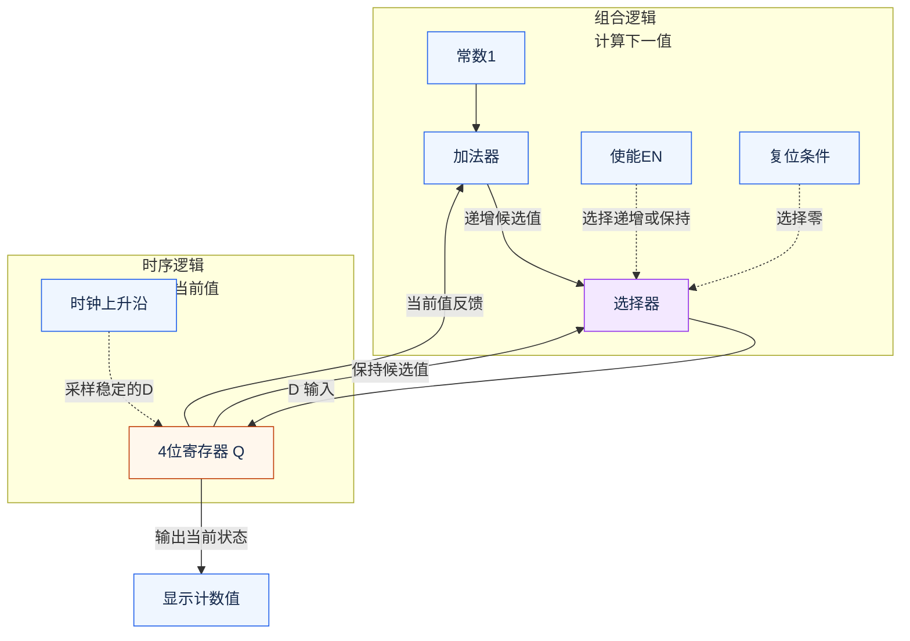

<!-- SPDX-License-Identifier: Apache-2.0 -->

# 第1章\_组合逻辑怎样接受和保存状态

> [P01 总目录](../大纲.md) / [P002 二进制与数字电路](大纲.md) / 第 1 篇（共 3 篇）

本专题从二进制加法出发，建立“当前状态怎样决定下一状态”的模型。位是对两种逻辑状态的编码；组合逻辑根据此刻输入计算输出，寄存器则把某次计算结果保留下来。二者接在一起，才可能形成可持续工作的计数器。

图例：**蓝色节点表示一般参与者，紫色突出处理或决策，橙色表示保存的数据或状态。** 实线是数值，虚线是采样或选择条件。`EN(Enable-使能)：决定本次是否计数。` D 和 Q 是触发器输入、输出端的惯用名称，不是两块 RAM。

先遮住时钟箭头，设 Q=3，加法器会算出 4，但 Q 仍然是 3；组合逻辑得到候选值不等于状态已经更新。到有效时钟沿，寄存器采样 D，Q 才变成 4。随后反馈使加法器算出 5，为下一次采样做准备。**时钟将“计算中”与“已接受的状态”分开。**

实际电路存在传播时间。数据需要在采样沿前后保持稳定，这分别对应建立时间与保持时间要求。把时钟加快到超过整条计算路径允许的速度，可能采到尚未稳定的值。因此不能只用软件中一次加法的表达式来推断最高频率。异步按钮也不应未经处理就被当作可靠时钟域内状态；同步降低亚稳态传播风险，消抖处理的是机械触点反复变化，两者解决的问题不同。

4 位寄存器只保存低四位。15 加 1 得到二进制 `1 0000`，截取低四位后为 0，而额外的一位表示进位。相同位串的有符号解释是另一个问题：`0111+0001=1000` 从 7 跳到 -8，发生有符号溢出，却没有最高位之外的进位。

## 1.1\_一个全加器为什么仍然不是计数器

把一位的输入记作 a、b，来自低位的进位记作 c。和位是 `a XOR b XOR c`；输出进位在三个输入中至少有两个为1时为1。这里 XOR 表示异或：两个输入不同时输出1。把多个一位加法器按进位方向连接，就可以对更宽数值进行加法。

以四位 `0111+0001` 为例，从最低位看，1+1产生和0与进位1；下一位的1加进位又产生和0与进位；这个过程向高位传播，最终得到1000。进位穿过多个逻辑级需要时间，这解释了组合电路为什么不能被抽象成“瞬间已经算好”。真实处理器可以采用更复杂的加法结构，本例只说明依赖。

组合电路没有“这是第几次计算”的历史。如果输入一直保持0111与0001，输出会保持1000，不会自行接着变成1001。要计数，必须把已算出的值在时钟沿存入寄存器，再反馈成为下一次输入。存储元件因此不是附加装饰，而是让结果进入下一轮因果链的必要角色。

观察计数器时要分清三个量：当前寄存器 Q、组合逻辑算出的 D、采样时钟。Q 与 D 不同完全可能是正常状态；只有到了有效采样沿且条件满足，D 才成为新的 Q。这个区分会直接迁移到 CPU：计算出一个候选结果，不等于所有后续状态已经完成提交。

---

[← 边沿检测与按键消抖推演](../P001_input_output/P003_边沿检测与按键消抖推演.md) · [本专题目录](大纲.md) · [二进制编码与数字电路基础 →](P002_二进制编码与数字电路基础.md)
