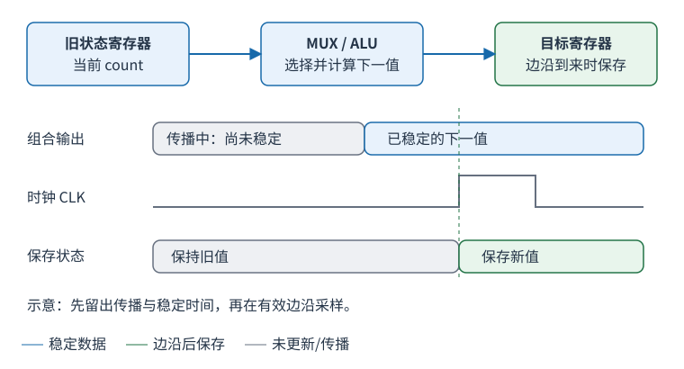

<!-- SPDX-License-Identifier: Apache-2.0 -->

# 第2章\_二进制与数字电路

前一专题用“按下、松开”和“亮、灭”描述状态。芯片内部需要一种统一表示，才能保存它们、比较它们，还能把同一组电路用于计数和地址计算。这就是从电压状态走向二进制的原因。

本章只建立后面读寄存器和汇编必需的数字电路基础：位、数值解释、组合逻辑和状态保存。我们不会把某幅简单门电路当作 Cortex-M7 的真实晶体管实现图；它们是用于说明职责的教学模型。

<a id="2.1_0-和-1-是解释结果，不是两种神奇电压"></a>

## 2.1\_0 和 1 是解释结果，不是两种神奇电压

数字输入电路把符合条件的一段低电压范围解释为 0，把另一段高电压范围解释为 1。两者之间留有不应当作为稳定逻辑输入使用的区域。因此，“1 等于 3.3 V”只在非常粗略的口语里成立；真实判断应根据芯片的数据手册、供电条件和具体引脚类型确定。

一个二值状态称为**位（Binary Digit，bit）**。八个位组成一个**字节（Byte）**。一根 GPIO 输入可以提供一个有用的二值状态，32 位寄存器则能够保存 32 个这样的位。不过这 32 位可能表示一个数，也可能分别控制 32 件互不相同的事，必须看使用规则。

一个没有上拉、下拉且未被外部电路可靠驱动的输入可能悬空。此时程序读取到变化的 0、1，不表示 CPU 在随机数生成，而可能是电气输入没有被确定。**上拉、下拉电阻的作用是给未主动驱动时的电平提供确定方向**；能否使用内部电阻、需要多大外部电阻，要由连接和电气要求决定。

<a id="2.2_同一串位可以怎样解释"></a>

## 2.2\_同一串位可以怎样解释

二进制按位置赋予权值。四位 `1010` 表示 `1×8 + 0×4 + 1×2 + 0×1 = 10`。十六进制用一个字符表示四位：`0xA` 对应 `1010`，`0x2D` 对应 `0010 1101`。因此读寄存器时常用十六进制，它便于按四位分组看状态，并不表示硬件内部另用一种“十六进制电路”。

对于八位无符号数，最小值为 0，最大值为 `2^8−1=255`。`1111 1111 + 1` 产生九位结果 `1 0000 0000`；只保留八位时得到 0，最左边那一位成为进位。位宽限制是真实存在的，不能因为 C 源码写了加法就获得无限精度。

如果需要负数，可以使用**二进制补码（Two's Complement）**。八位补码把最高位的权值解释为 −128，其余七位仍为正权值。因此 `1111 1111` 表示 −1，`1000 0000` 表示 −128，`0111 1111` 表示 127。同样的 `0xFF`，解释为无符号数是 255，解释为八位补码是 −1；位本身没有附带“有符号”标签。

| 八位加法 | 截断后的八位结果 | 无符号解释 | 有符号解释 |
| --- | --- | --- | --- |
| `0xFF + 0x01` | `0x00` | 255+1 超出范围，产生进位 | −1+1=0，没有有符号溢出 |
| `0x7F + 0x01` | `0x80` | 127+1=128，未超出范围 | 127+1 超过最大值，发生有符号溢出 |

这就是后面汇编中需要分别观察进位标志与溢出标志的原因。CPU 可以保留不同解释所需的信息，具体采用哪种比较方式由指令决定。C 语言的无符号算术按相应位宽取模；普通有符号整数溢出则不能当作可移植的回绕技巧。不要把处理器能产生某种位结果，直接等同于 C 标准保证程序可以依赖它。

还有一种常见解释是浮点数。**浮点表示（Floating-Point Representation）** 使用符号、指数和有效数字编码近似数值。以常见的 IEEE 754 单精度格式为例，32 位分为 1 位符号、8 位指数、23 位尾数字段。它扩大了可表达的数量级，但不能精确表示所有实数；`0.1` 就不是有限二进制小数。浮点加法需要不同于整数加法的对阶、舍入等动作，后面会解释 H743 中浮点单元与异常现场的关系。

<a id="2.3_怎样用逻辑门构造计算"></a>

## 2.3\_怎样用逻辑门构造计算

**逻辑门（Logic Gate）** 根据输入的逻辑状态产生输出。与运算（AND）要求两个输入都是 1，或运算（OR）要求至少一个是 1，异或运算（Exclusive OR，XOR）要求两个输入不同，非运算（NOT）则反转状态。这些规则可以组合成更大的电路。

看一位加法。把两个一位输入信号命名为 `a`、`b`，把来自低一位的进位信号命名为 `carry_in`；输出信号 `sum` 表示本位结果，`carry_out` 表示送给高一位的进位。它们分别满足：

```text
sum       = a XOR b XOR carry_in
carry_out = (a AND b) OR (carry_in AND (a XOR b))
```

例如 `a=1、b=1、carry_in=0`，总和为二进制 `10`：本位结果 0，向高位进位 1。把低位的 `carry_out` 接到高位的 `carry_in`，就能形成多位加法器。真实高性能处理器会使用更复杂的进位结构减少延迟，但仍要兑现相同的数值规则。

CPU 还要决定这次做加法还是逻辑运算。**多路选择器（Multiplexer，MUX）** 根据选择信号，把某一路输入送到输出。**算术逻辑单元（Arithmetic Logic Unit，ALU）** 把若干算术、逻辑功能与选择机制组合起来。程序中不同指令，最终会使控制电路选择不同的数据来源和运算功能。

这里已经可以解释位掩码：`value & (1u << 3)` 用只有第 3 位为 1 的数过滤其他位，结果只保留原值第 3 位。`value | mask` 可置位，`value & ~mask` 可清位。但这只描述普通数值运算；硬件寄存器是否允许“先读、再改、再写”，还需要看它的读写副作用。

<a id="2.4_为什么只有计算电路还不够"></a>

## 2.4\_为什么只有计算电路还不够

加法器随输入变化产生输出。如果上一刻的输入消失，它不会替程序记住上一次算出的答案。能够保存历史状态的部件必须加入系统。

**触发器（Flip-Flop）** 能在指定时钟边沿采样输入并保持输出。多个触发器组合起来可以保存一个多位数，这样的状态部件称为**寄存器（Register）**。处理器寄存器用来暂存运算数据，外设寄存器用来保存配置或反映状态；两者都有“保存/呈现多位状态”的共同点，但访问方法和所在位置不同。



图例：**蓝色表示数据经过组合逻辑，绿色表示时钟边沿后的已保存状态；灰色区间表示数据仍在传播、尚未满足本例采样条件**。本图是功能示意，不按实际纳秒比例绘制。

名称注释：`ALU（Arithmetic Logic Unit－算术逻辑单元）：根据控制信号进行加减或逻辑运算。` `MUX（Multiplexer－多路选择器）：从多个输入中选择一个。` `CLK（Clock－时钟）：为同步状态更新提供边沿。`

沿蓝色路径，旧寄存器输出进入组合逻辑，经过传播延迟后得到稳定的新值；到绿色标出的采样边沿，目标寄存器保存新值。**时钟不是每跳一下就让所有计算瞬间完成。** 设计必须给数据传播留下足够时间，并满足采样前后的稳定条件，也就是建立时间和保持时间。

这解释了频率不能任意提高：周期缩短到电路来不及稳定，下一拍可能采到错误状态。CPU、总线和外设可以采用不同的时钟，也可能需要在时钟域之间同步信号。按钮边沿与处理器时钟没有天然对齐关系，输入同步电路可以降低异步采样导致不稳定状态传播的概率；它与消除机械抖动是两项不同工作。

<a id="2.5_用一次计数把计算与保存连起来"></a>

## 2.5\_用一次计数把计算与保存连起来

设一个四位寄存器 `count` 初始为 0，加法器始终计算 `count+1`，每个时钟边沿把结果写回 `count`。于是它依次保存 0、1、2……15，再回到 0。计算电路决定下一状态，寄存器保存当前状态，时钟决定何时更新。

如果增加一个使能信号，只有使能为 1 的边沿才写入新值，便能做到“允许时计数，否则保持”。后面的定时器就是把这一类状态更新规则、比较逻辑和配置接口组织成专门硬件。CPU 不必执行一条加法指令，定时器也可以增加自己的计数值。

练习：四位 `count=14`，连续三个有效计数边沿后是多少？另一个问题：将 `count` 从四位扩展到八位后，是否也必须把时钟频率提高两倍？

解答：状态依次是 15、0、1。增加位宽扩大保存范围，不直接要求增加时钟频率；不过电路规模和传播路径可能变化，最高可用频率要由实际实现决定。这也提示我们不要混淆“每次处理多少位”与“每秒更新多少次”。

官方对照：后面使用的 Cortex-M7 条件标志与数据类型见 [PM0253 Rev 6，2.1.3 Core registers、2.2 Memory model](https://www.st.com/resource/en/programming_manual/DM00237416.pdf)。这里的门电路与四位计数器是原创教学模型，用来推导功能，未声称它们就是 M7 的内部实现。

阅读导航：[前一专题](../P001_input_output/P002_原理与实现.md) · [专题大纲](../大纲.md) · [后一专题：CPU 执行指令](../P003_cpu_execution/P002_原理与实现.md)


专题内阅读：[关系与模型](P001_关系与模型.md) → 本篇原理与实现 → [案例与推演](P003_案例与推演.md)。返回：[本专题大纲](大纲.md)。
