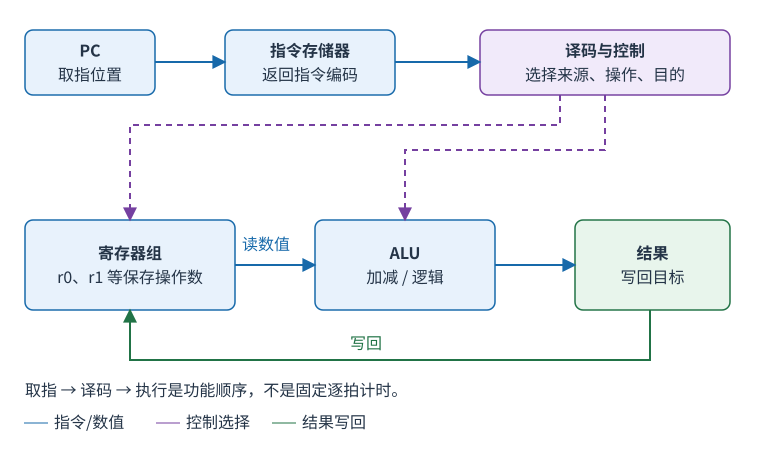
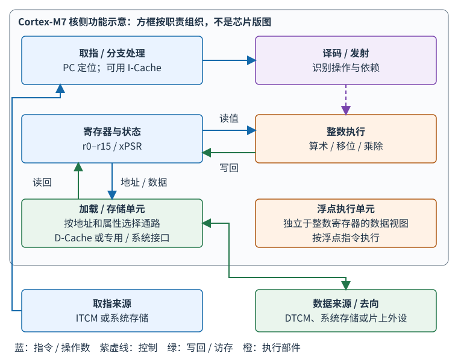
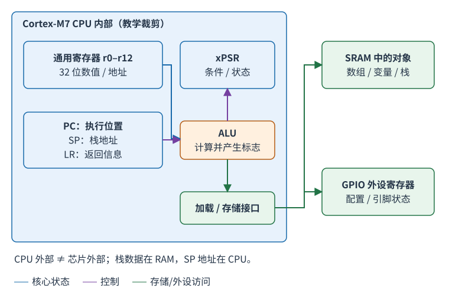
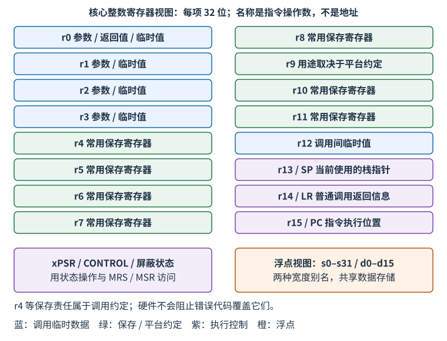
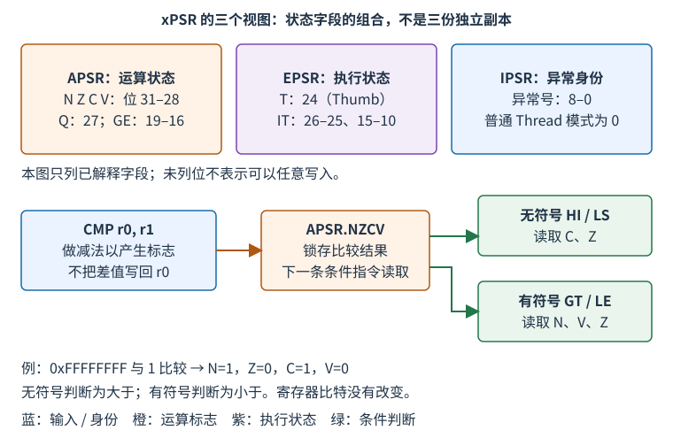
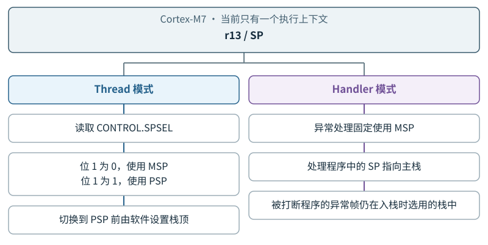
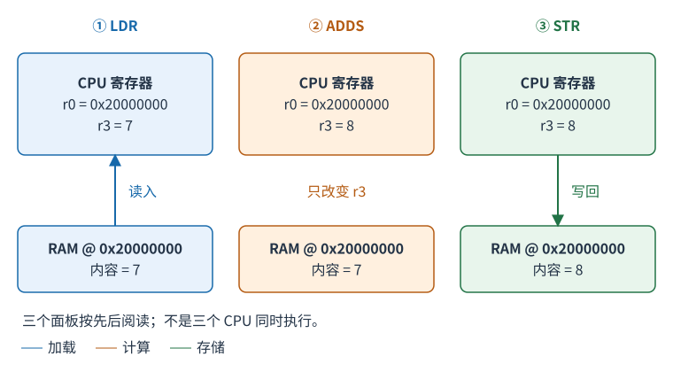

<!-- SPDX-License-Identifier: Apache-2.0 -->

# 第3章\_CPU怎样执行指令

上一章已经能用加法器和寄存器构造一个计数器，但它永远按接好的规则计数。CPU 的特别之处在于：同一组运算和保存部件，可以根据存储器里的指令，依次执行不同操作。程序因此成为可以更换的控制规则。

我们先从数据通路认识 CPU，再把 Cortex-M7 的寄存器和真实 Arm 指令放进同一张图。随后用一个简化按钮程序手工推演控制流。标为“教学指令”的部分只用于推演；标为“GNU 编译结果”的部分来自实际编译，两者不能混成同一套指令。

## 3.1\_下一条操作从哪里来

存储器里的指令是位编码。CPU 需要知道去哪里取下一条，所以内部保存一个表示指令位置的值，称为**程序计数器（Program Counter，PC）**。取回指令后，**译码（Decode）** 电路识别其中的操作和操作数，再产生控制信号。

设教学指令 `ADD r2, r0, r1` 的意义是把寄存器 r0、r1 的值相加，结果写到 r2。它不是让硬件寻找三个叫作 r0、r1、r2 的文本字符串。汇编器在构建时把文字编码为位，CPU 在运行时按位字段选择寄存器、ALU 功能和写回目的地。



图例：**蓝色实线承载指令或数值，紫色虚线表示控制选择，绿色线表示结果写回**。图中把一次操作拆成职责步骤，不表示每个方框必定占用一个时钟周期。

名称注释：`PC（Program Counter－程序计数器）：标识指令执行位置。` `ALU（Arithmetic Logic Unit－算术逻辑单元）：计算结果与相关状态。` `CPU（Central Processing Unit－中央处理器）：把取指、译码和执行组织起来。`

先沿蓝线看数据从哪里来，再沿紫线看为什么这次选择它。即使 ALU 同时具备多种功能，本条指令也只要求相应结果写入目标位置。**数据通路回答“值怎样流动”，控制通路回答“此刻允许哪条路径产生可见效果”。** 只画 ALU 而不画控制关系，就难以解释同一硬件为何能执行不同程序。

### 3.1.1\_把简单数据通路放回 Cortex-M7

上图已经解释一条加法，但控制面板还要取指令、读输入、算结果、写输出。真实处理器怎样把这些职责组合起来？下面以 STM32H743 使用的 Cortex-M7 为对象，先看核侧功能组织，再逐条追踪访问。



图例：**蓝线表示指令或操作数，紫色虚线表示控制选择，绿线表示结果写回或访存，橙框表示执行部件；双向绿线概括读写请求与返回。** 外层灰框限定核侧功能；方框是功能分组，不是晶体管布局，也不表示每组只用一个周期。图中省略了缓存内部连接、浮点控制线和异常控制线。

名称注释：`I-Cache（Instruction Cache－指令缓存）：保留近期取用的指令副本。` `D-Cache（Data Cache－数据缓存）：保留按缓存策略访问的数据副本。` `TCM（Tightly Coupled Memory－紧耦合存储器）：通过专用接口连接处理器的存储器；ITCM 面向指令，DTCM 面向数据。` `FPU（Floating-Point Unit－浮点运算单元）：执行浮点运算，不替代整数寄存器和整数 ALU。`

读 `LDR r3,[r0]` 时，沿图中三段关系走：**取指/译码**知道这次是加载；**寄存器**提供 r0 中的地址；**加载/存储单元**按地址、宽度和属性选择存储通路，取得内容后写入 r3。下一条 `ADDS` 可以使用已经到达的 r3。数据尚未到达时，即便整数 ALU 空闲，依赖它的加法也不能凭空得到正确结果。

读 `STR r3,[r0]` 时，寄存器同时提供地址和待写数值。地址属于普通存储、紧耦合存储还是外设区域，影响后面的访问路径。**缓存不是另一个变量，也不是所有访问必经的一层**：外设访问不能随意当作可缓存 RAM，TCM 走专用接口。第 4、5 章建立地址地图，第 17 章再解释缓存与 DMA 的数据可见性。

这里有两个不同层面的“架构”。**指令集架构（Instruction Set Architecture，ISA）** 规定软件能依赖的寄存器、指令和异常行为；Cortex-M7 实现 Armv7E-M 架构。**微架构（Microarchitecture）** 是实现这些规则的内部组织，例如流水线、发射和缓存。STM32H743 则把 M7 核与 Flash、RAM、总线和外设集成到一颗芯片中。不能把 Armv7E-M、Cortex-M7 和 STM32H743 当成三个同层的芯片型号。

M7 的取指和数据访问具有分开的内部通路，而软件仍使用统一的地址空间来定位对象，这常被概括为**改进型哈佛结构（Modified Harvard Architecture）**。它不表示任何两次访问都能同时完成：最终可能争用同一存储器或总线，也可能存在前后数据依赖。“指令通路与数据通路分开”和“所有内存访问零等待”是不同结论。

官方对照：[PM0253 Rev 6，§1.3 About the Cortex-M7 processor and core peripherals、§2.2 Cortex-M7 configurations](https://www.st.com/resource/en/programming_manual/DM00237416.pdf) 用于核对核侧功能、分离接口和配置边界；本图依据这些职责原创组织，不复制厂商框图布局。缓存容量、片上存储地址和总线路由须继续查具体芯片资料。

## 3.2\_CPU 寄存器在哪里，里面究竟放什么

上一图中的寄存器组位于 **CPU 内部**，是运算电路直接使用的状态保存位置。它不等于 SRAM（Static Random-Access Memory－静态随机存取存储器）中的一块数组，也不同于通过地址访问的 GPIO 配置寄存器。指令里的 `r0` 是寄存器编号，不是一个需要通过总线查找的内存地址。



图例：**蓝框是 CPU 内部的数据与执行状态，紫线表示控制选择，绿线表示经过加载/存储接口访问 CPU 外部的存储或外设**。外侧的 RAM 和 GPIO 仍可在同一颗 MCU 芯片内，“CPU 外部”不等于“芯片外部”。

名称注释：`SP（Stack Pointer－栈指针）：保存当前栈位置的地址。` `LR（Link Register－链接寄存器）：普通函数调用中保存返回信息。` `xPSR（Program Status Register 组合名称－程序状态寄存器）：包含条件标志、执行状态和异常编号等信息。` `RAM（Random-Access Memory－随机存取存储器）：提供按地址访问的工作存储空间。`

在 M7 的基础整数模型中，r0–r12 是 32 位通用寄存器；r13 表示 SP，r14 表示 LR，r15 对应 PC。SP、LR、PC 参与执行控制，不能把它们当作随意占用的普通临时槽位。处理器还有权限、屏蔽、浮点等状态，本节先把普通整数程序必需的关系看清。

| 状态位置 | 例如保存什么 | 谁会改变它 |
| --- | --- | --- |
| r0–r12 | 数值 7、某个变量地址、计算中间值 | 执行相应指令的 CPU |
| PC | 指令执行位置 | 顺序取指、跳转、调用或异常控制 |
| LR | 调用完成后应继续的位置 | 调用指令及保存/恢复代码 |
| SP | 当前栈边界地址 | 栈分配、保存/恢复及异常机制 |
| xPSR | 零、进位等标志和执行状态 | 运算指令与处理器控制机制 |
| SRAM 中的变量 | 程序要求保存的数据 | CPU 存储指令，或有访问能力的其他硬件 |
| GPIO 寄存器 | 引脚模式、输入状态、输出控制 | 软件访问与外设自身硬件 |

**一个寄存器可以放地址，也可以放普通数值，含义由使用它的指令决定。** r0 中有 `0x20000000`，执行加法时它可以被当作数，执行 `LDR r1,[r0]` 时才被用作访问地址。把指针放进 r0，并没有把指针指向的整个数组也搬进 r0。

### 3.2.1\_把寄存器窗口中的每一组名字放对位置

如果调试器同时显示 r0、r7、SP、xPSR，它们不是十几个可以任意互换的变量槽。先看下面的完整整数视图，再区分硬件规定的特殊角色与函数之间约定的保存责任。



图例：**蓝色是调用时常用的参数、结果与临时寄存器，绿色是保存或平台约定相关寄存器，紫色是执行控制状态，橙色是浮点视图。** 颜色说明本教程的使用角色，不是硬件给通用寄存器加了不同的读写权限。

名称注释：`Register File（寄存器组）：由指令编号选择的核心数据存储位置。` `MRS（Move from Special Register－读取特殊寄存器）：把指定状态读到通用寄存器。` `MSR（Move to Special Register－写入特殊寄存器）：按架构允许的字段和权限更新状态。`

先沿左列看 r0–r7，再接右列 r8–r15。**r0–r12 的硬件基本身份都是 32 位通用寄存器**；“参数寄存器”和“被调用者保存”来自软件调用约定。这类规则属于 **ABI（Application Binary Interface－应用二进制接口）**，让分别编译的函数可以按同一规则交接。例如函数使用 r4 计算新值，必须按约定在返回前恢复原值，硬件不会自动替它保存。r9 的角色取决于平台约定，不能一概当成可随意破坏的临时寄存器。完整保存规则和可编译调用例子见 [第 14 章](P014_函数调用与栈.md)。

沿右列向下，r13、r14、r15 才遇到与控制流绑定的特殊角色。普通 `BL` 调用更新 LR；`BX LR` 用返回信息改变执行位置。读 PC 也有架构语义：在常见 Thumb 数据处理指令中读到的是当前指令地址加 4，有些寻址还会按字边界调整，不能把它与调试器高亮的“当前指令地址”机械等同。不是每条指令都允许 SP、PC 作为任意操作数。

底部两框补齐调试器里常见的其他状态：**xPSR 和 CONTROL 不占 r0–r15 的编号**；某些状态通过专门的寄存器访问指令读取，不存在一个可随便交给 `LDR` 的 RAM 地址。H743 的浮点数据寄存器可以显示为 32 个 32 位单精度视图 s0–s31，或 16 个 64 位双精度视图 d0–d15。d0 与 s0/s1 共享那 64 位存储，并不是另外加出一份数据。浮点状态与控制由 **FPSCR（Floating-Point Status and Control Register－浮点状态与控制寄存器）** 管理。当前整数实验未启用或使用浮点运算。

### 3.2.2\_比较结果如何留给下一条指令

执行 `CMP r0,r1` 后，两个输入寄存器都可以保持不变。那么下一条分支怎样知道“相等还是不相等”？答案在程序状态中。



图例：**蓝色表示比较输入和异常身份，橙色表示运算标志，紫色表示执行状态，绿色表示读取标志后的判断。** 上排是同一组合状态的不同字段视图，下排是先比较、再判断的执行过程。

名称注释：`APSR（Application Program Status Register－应用程序状态寄存器）：提供运算标志。` `EPSR（Execution Program Status Register－执行程序状态寄存器）：包含 Thumb 与条件执行相关状态。` `IPSR（Interrupt Program Status Register－中断程序状态寄存器）：表示当前异常编号。` 图中 Q 是饱和运算累计标志，GE 是部分并行运算的比较标志；基础示例暂不使用它们。

顺着橙线，CMP 内部按减法产生 N、Z、C、V，并将结果状态留下。沿绿线，后续条件分支读取这些位；中间若插入另一条会改标志的运算，分支看到的就可能不再是原比较的结果。**标志也有生产者和使用者，不能把它们当成永远对应某个 C 表达式的标签。**

下面涉及两个后续会实际读到的指令名称：`SUBS（Subtract and update flags－减法并更新标志）` 在保存差值时更新相关标志；`IT（If-Then－条件执行控制）` 为后续有限条指令建立条件执行状态。`IRQ（Interrupt Request－中断请求）` 则是外设向处理器请求响应的事件，表中的异常号记录当前处理身份。

| 视图与字段 | 位号 / 取值 | 本章怎样观察或改变 |
| --- | --- | --- |
| APSR.N / Z / C / V | 31 / 30 / 29 / 28 | CMP、ADDS、SUBS 等按指令规则更新；MRS 可读取 APSR |
| EPSR.T | 24；M7 正常执行 Thumb 时为 1 | 执行状态由架构机制维护；不当作普通可写变量 |
| EPSR.IT | 26–25 与 15–10 | 保存条件执行相关状态；IT 指令与执行推进按规则维护 |
| IPSR 异常号 | 8–0；普通程序为 0，外部 IRQ 对应异常号为 IRQ 编号加 16 | MRS 可读取 IPSR；进入和退出异常由硬件更新 |

表只列本节解释的字段，不是允许整字随意写入的清单。xPSR 可以在调试器和异常保存现场中看到；其中执行状态的专用软件读取/写入限制，要按相应指令查询，不能假定 `MRS` 能直接提供调试器显示的所有 EPSR 位。

手算图中两操作数值为 `0xFFFFFFFF` 和 1 的 CMP：减法结果为 `0xFFFFFFFE`，N=1、Z=0、C=1、V=0。按无符号解释，前者更大；按有符号补码解释，前者是 −1，反而更小。寄存器里没有“有符号类型标签”，是编译器选择了不同的条件判断。第 13 章给出对应的分支条件表。

### 3.2.3\_为什么有两个栈指针和几组控制寄存器

普通程序与中断处理共用一个 CPU。如果它们需要使用不同的栈，单有一个 SP 名称还不够。Cortex-M7 为 r13 提供两份可选择的指针状态：主栈指针和进程栈指针。



图例：**蓝色是普通程序执行，橙色是异常处理执行，紫色是选择规则和当前 SP 视图，绿色是两份实际栈指针状态。** 两条路径代表同一 CPU 在不同模式下的选择，不是两颗 CPU 同时运行。

名称注释：`MSP（Main Stack Pointer－主栈指针）：复位后和异常处理使用的栈指针。` `PSP（Process Stack Pointer－进程栈指针）：普通执行模式可选择的另一份栈指针。` `Thread mode（线程模式）：执行普通程序的处理器模式，裸机 main 也可处于此模式。` `Handler mode（处理模式）：执行异常处理的模式。` “Process”这个名称并不表示芯片自动实现了操作系统进程。

沿紫线看普通程序：CONTROL 的 SPSEL 位决定 r13 选择 MSP 还是 PSP。沿橙线看异常处理：Handler 模式使用 MSP。**两根指针只提供栈选择能力，不会自动创建线程、分配栈或调度。** 复位启动、栈内数据和异常压栈分别在第 6、7、16 章展开；此处先明确这些状态位于 CPU 内部。

当系统还需要限制普通代码权限，或暂时阻止某些异常抢占，就会用到下表中的控制状态。它们通过 MRS/MSR 等专门方式访问，不能将名称当成外设基址。

| 32 位状态视图 | 本节相关有效位 | 功能与访问边界 |
| --- | --- | --- |
| CONTROL | nPRIV 位 0；SPSEL 位 1；FPCA 位 2 | 普通模式权限、栈选择和浮点上下文活动状态；Handler 始终特权执行，非特权程序不能自行写回特权身份 |
| PRIMASK | 位 0 | 为 1 时阻止可配置优先级异常被激活；不会屏蔽 NMI 和 HardFault |
| BASEPRI | 位 7–0 中实现的优先级位 | 非零时按优先级阈值屏蔽；0 表示不使用此阈值，不是屏蔽所有异常 |
| FAULTMASK | 位 0 | 为 1 时阻止除 NMI 外的异常被激活，范围比 PRIMASK 更广 |
| MSP / PSP | 指针值；低两位为 0 | 保存对齐的栈地址；公共函数调用的八字节对齐还由 ABI 约束 |

名称注释：`PRIMASK（Priority Mask－优先级屏蔽寄存器）`、`BASEPRI（Base Priority－基础优先级屏蔽寄存器）`、`FAULTMASK（Fault Mask－故障屏蔽寄存器）` 分别保存不同范围的屏蔽状态；`NMI（Non-Maskable Interrupt－不可屏蔽中断）` 和 `HardFault（硬故障异常）` 是架构定义的异常类别。屏蔽影响 CPU 的异常响应，不等于外设停止采样或事件消失。

例如特权代码中的 `MRS r0,CONTROL` 读取当前控制值；假设结果为 2，则本例 nPRIV=0、SPSEL=1、FPCA=0，表示特权 Thread 模式选择 PSP、没有活动浮点上下文。这个读数本身不能证明 PSP 指向的 RAM 已正确准备。修改栈选择前必须先建立合法栈；本章只读和推演，不让读者复制一个未初始化 PSP 的切换动作。

官方对照：[PM0253 Rev 6，§2.1.1 Processor mode and privilege levels、§2.1.2 Stacks、§2.1.3 Core registers](https://www.st.com/resource/en/programming_manual/DM00237416.pdf) 核对以上视图和权限；浮点寄存器视图见该手册 §4.7 Floating-point unit。调用保存责任属于 [AAPCS32 §6.1 Machine Registers](https://github.com/ARM-software/abi-aa/blob/2025Q1/aapcs32/aapcs32.rst)，不把软件约定写成硬件自动动作。

## 3.3\_先看一段 C 怎样变成真实 Arm 指令

面板程序要把一个计数值加一。下面是本专题自有的完整函数，`count` 指向一个 32 位无符号对象。`volatile` 要求保留相应实际读写，便于我们观察，不提供并发保护。本节先阅读已生成的结果，工具安装和自行生成在第 12 章进行。



图例：**蓝色为加载，橙色为 CPU 内部计算，绿色为存储；三个面板是同一颗 CPU 的先后状态**。RAM 方框画出变量的内容，r0 方框画出它的地址，两者不能互换。

名称注释：`LDR（Load Register－加载寄存器指令）：把存储位置的内容取入寄存器。` `STR（Store Register－存储寄存器指令）：把寄存器内容写到存储位置。` `ALU（Arithmetic Logic Unit－算术逻辑单元）：完成中间的加法。`

```c
#include <stdint.h>

void increment_word(volatile uint32_t *count)
{
    *count = *count + 1u;
}
```

本机 GNU Arm GCC 10.3.1、Cortex-M7、Thumb、`-O1` 的相关输出如下，省去目标文件地址列：

```asm
increment_word:
    ldr  r3, [r0, #0]
    adds r3, #1
    str  r3, [r0, #0]
    bx   lr
```

**汇编助记符（Mnemonic）** 是人读的指令名称：LDR（Load Register）加载，STR（Store Register）存储，ADD 加法；这里 ADDS 还更新条件标志。`#1` 是指令直接表达的常数，`[r0,#0]` 表示访问 r0 所保存的地址加零偏移处的内容。BX 使用寄存器中的目标转移，本例 `BX LR` 回到调用者。CPU 最终读取的是这些指令的机器编码，而非字母文本。

为什么参数在 r0？编译器遵循 **调用约定（Calling Convention）**，约定这个例子的首个指针参数由 r0 传入。约定让分别编译的调用者与被调函数能交接；不是 CPU 硬件看到了 C 参数名称。第 14 章再完整展开函数保存责任，本章先追踪数据。

令 r0=`0x20000000`，该处内容为 7。沿蓝色加载线，r3 得到 7，内存不变；橙色加法使 r3 变成 8，内存仍是 7；沿绿色存储线，内存才变成 8。最后返回时 r0 仍保存原地址，控制流已经回到调用者。**一行 C 并不等于一个不可分割的硬件动作。**

读者现在可以手算一个变化：把内存初值改成 20，执行到 ADDS 后停下，分别读 r0、r3 和内存会看到什么？答案是原地址、21、20；再执行 STR，内存才成为 21。以后中断插进加载与存储之间时，正是这种中间状态决定是否会丢更新。

## 3.4\_把一次输入输出拆成可执行步骤

教学 CPU 设有 r0、r1 等临时寄存器。把按钮输入位置的符号命名为 `BUTTON_STATE`，把灯输出控制位置的符号命名为 `LED_CONTROL`，它们不是 C 变量或真实 H743 寄存器名。先假定读按钮得到 0 或 1，写 1 点亮灯、写 0 关闭灯。下面使用四个教学指令名称：`LOAD` 读取、`AND` 按位与、`STORE` 写出、`JUMP` 跳转。

```text
loop:
    LOAD  r0, [BUTTON_STATE]
    AND   r0, r0, 1
    STORE r0, [LED_CONTROL]
    JUMP  loop
```

`LOAD` 把外部可访问位置中的值读入 CPU 寄存器；`AND` 只保留最低位；`STORE` 把寄存器里的结果写到输出控制位置；`JUMP` 改变后续取指位置，使程序返回开头。方括号表示访问某位置的内容，不是对地址本身进行计算。

按钮由 0 变成 1 后，CPU 下一次执行 `LOAD` 才看到新状态。执行 `AND` 时，结果只在 CPU 内部变化；执行 `STORE` 时，输出接口才收到写入。若在 `LOAD` 和 `STORE` 之间暂停 CPU，可以出现“按钮已经按下、r0 已为 1、灯尚未改变”的中间状态。理解这种中间状态，是以后读调试器寄存器窗口和单步执行的基础。

| 已完成的操作 | CPU 内部 r0 | 输出控制位置 | 外部灯 |
| --- | --- | --- | --- |
| 尚未再次读取 | 旧值 0 | 0 | 灭 |
| 读取按钮 | 1 | 0 | 灭 |
| 完成按位与 | 1 | 0 | 灭 |
| 写入输出 | 1 | 1 | 按电气通路变亮 |

这里没有使用中断。程序自己不断返回读取位置，主动检查输入，这种策略称为**轮询（Polling）**。轮询的读取和写入并不特殊，仍是普通指令触发的访问；以后改成中断，也不会取消实际的数据读取与结果写入。

## 3.5\_顺序执行如何变成条件判断

如果只会依次执行，程序无法根据按钮状态改变行为。CPU 因此需要比较结果和改变控制流的能力。比较可以由减法等运算产生状态，例如结果是否为零；条件分支再根据这些状态决定是否改写 PC。

教学程序“按钮未按时跳过翻转”，可以拆成读取、比较和条件跳转。C 中一条 `if` 因而可能对应多条机器指令，也可能在优化后采用另一种等价表示。源代码的一行和机器指令不存在固定一对一关系。

PC 的正常推进也不能永远写成“加 4”。指令编码宽度由指令集决定；后面使用的 Thumb 指令流包含 16 位与 32 位指令。一条指令占 2 字节还是 4 字节，会影响下一条指令的地址，但不直接告诉我们它执行几个时钟周期。

## 3.6\_为什么频率不能直接换算成程序速度

设一段教学程序实际执行 1000 条指令，平均每条占用 2 个 CPU 周期，CPU 时钟为 100 MHz。忽略其他开销时，总时间是 `1000×2/100000000=20 μs`。这个计算使用了三个不同量：指令条数、平均周期数和时钟频率。

**每指令周期数（Cycles Per Instruction，CPI）** 是用于分析一段实际指令序列的平均指标，不是每种处理器永远不变的常数。访存等待、分支、数据依赖和缓存命中情况都会改变它。把频率翻倍，也未必让等待外设完成的时间减半。

真实 CPU 为了提高吞吐量，会让不同指令的不同阶段重叠，称为**流水线（Pipeline）**。就像第一条正在执行时，后续指令的取指或译码可能已经进行。但如果第二条需要第一条尚未得到的结果，就必须处理这种依赖；遇到分支，还要处理下一条位置的不确定性。

Cortex-M7 使用更复杂的流水线，并支持在符合条件时同周期发射多条指令。**同一 CPU 内部重叠推进指令，不等于操作系统获得了多个独立 CPU。** 对程序可见的寄存器、异常和存储规则仍必须符合架构要求。不能拿本章的顺序功能模型去数 M7 的实际流水线周期，也不能从“双发射”推出所有代码都快两倍。

官方对照：[PM0253 Rev 6，Introduction 与 1.3 About the Cortex-M7 processor and core peripherals](https://www.st.com/resource/en/programming_manual/DM00237416.pdf) 介绍 M7 的流水线、接口和处理器功能；编程模型在第 2 章。阅读时分清“程序可依赖的行为”和“实现用来提高效率的内部方法”。

## 3.7\_让模型经受一次变化

现在在循环里加入一个计算任务，计算完成前不再读取按钮。假设两次 `LOAD` 间隔由 10 μs 增长为 5 ms。按钮在刚读完后发生变化，最坏要接近 5 ms 才被下一次读取观察到；若高电平只保持 1 ms，还可能整个脉冲都落在两次读取之间。

这个问题不是 ALU 不会计算，也不是 GPIO 不能反映电平，而是程序的观察时机变稀疏了。后续中断机制会改变“CPU 何时转去处理事件”；外设锁存状态、捕获计数或缓存数据则解决“CPU 到来前怎样保留信息”。这两项职责需要分别理解。

练习：把同样的四条教学指令复制两遍、去掉其中一次 `JUMP`，是否一定能把按钮处理速度提高两倍？解答：不能。执行时间还取决于各操作的周期和访问等待，复制代码只减少了一部分跳转比例。应先统计真实指令与访存行为，再用计时或跟踪取得证据。

下一章把 `BUTTON_STATE` 这样的符号换成可以计算的地址，并说明 CPU 如何让存储器或外设响应一次访问。

阅读导航：[上一章](P002_二进制与数字电路.md) · [专题大纲](大纲.md) · [下一章：地址与总线](P004_地址总线与存储器映射.md)
