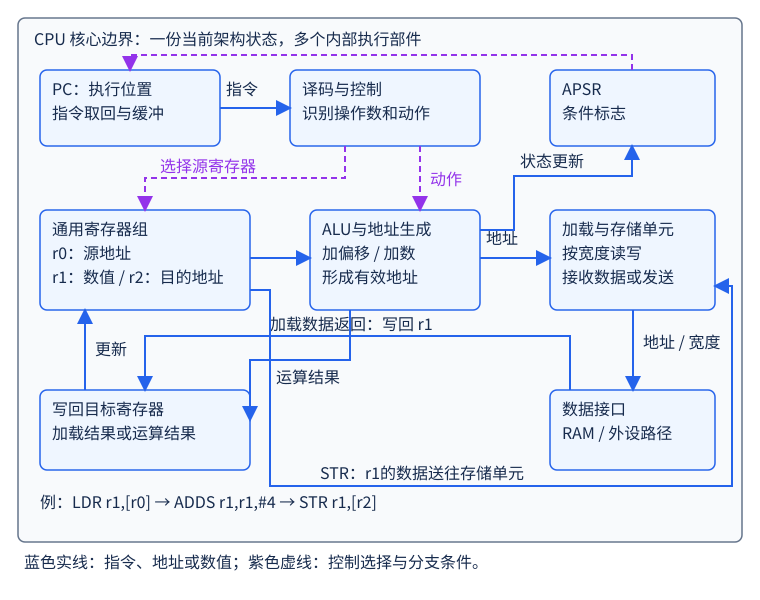

<!-- SPDX-License-Identifier: Apache-2.0 -->

# 第1章\_一条指令怎样穿过CPU的数据与控制通路

独立阅读本专题时，只需先知道：内存按地址保存数据，寄存器是 CPU 内部直接参与执行的小容量状态。这里选择 `读一个采样值 → 加偏移 → 保存结果`，同时跟踪指令位置、操作数和提交后的状态。图是教学数据通路，不能据此推断 Cortex-M7 内部每级流水线的周期数。

图例：实线携带地址或数据，虚线选择动作。`ALU(Arithmetic Logic Unit-算术逻辑单元)：算术与逻辑运算。` `APSR(Application Program Status Register-应用程序状态寄存器)：保留条件标志。` 加载与存储单元负责把寄存器世界与地址空间连接起来。

沿图执行 `LDR r1,[r0]` 时，r0 保存的是地址，目标内存保存的才是采样值。加载完成后 r1 接收数值；r0 不会因为被用作基址就自动变成该数值。随后 `ADDS r1,r1,#4` 从寄存器取得操作数，写回 r1 并更新标志；`STR r1,[r2]` 又以 r2 为地址，把新数值送向内存。三条指令分别改变不同的状态。

**程序计数器控制执行位置，通用寄存器保存本次运算材料。** 把二者画成同一种“变量”会掩盖分支的作用：改变 r1 通常只是改变数据；分支则改变接下来取哪段指令。流水线可能同时准备多条指令，缓存可能让某次加载更快，但程序应观察到的执行结果仍受指令语义与内存规则约束。

同样的加法，在寄存器中执行与等待慢速存储器取操作数，耗时可能不同。芯片频率说明单位时间有多少时钟，不说明每条 C 语句固定占多少时钟。要评价实际路径，应区分计算依赖、取指、数据访问和总线等待。

继续：[原理与实现](P002_原理与实现.md)。返回：[专题大纲](大纲.md)。
