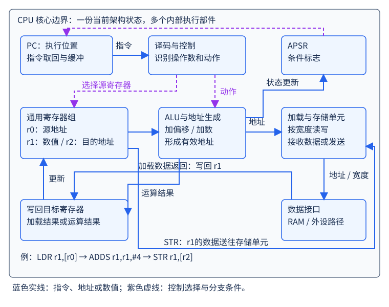

<!-- SPDX-License-Identifier: Apache-2.0 -->

# 第1章\_加载运算与存储的数据通路

> [P01 总目录](../大纲.md) / [P003 CPU怎样执行指令](大纲.md) / 第 1 篇（共 5 篇）

独立阅读本专题时，只需先知道：内存按地址保存数据，寄存器是 CPU 内部直接参与执行的小容量状态。这里选择 `读一个采样值 → 加偏移 → 保存结果`，同时跟踪指令位置、操作数和提交后的状态。图是教学数据通路，不能据此推断 Cortex-M7 内部每级流水线的周期数。

图例：实线携带地址或数据，虚线选择动作。`ALU(Arithmetic Logic Unit-算术逻辑单元)：算术与逻辑运算。` `APSR(Application Program Status Register-应用程序状态寄存器)：保留条件标志。` 加载与存储单元负责把寄存器世界与地址空间连接起来。

沿图执行 `LDR r1,[r0]` 时，r0 保存的是地址，目标内存保存的才是采样值。加载完成后 r1 接收数值；r0 不会因为被用作基址就自动变成该数值。随后 `ADDS r1,r1,#4` 从寄存器取得操作数，写回 r1 并更新标志；`STR r1,[r2]` 又以 r2 为地址，把新数值送向内存。三条指令分别改变不同的状态。

**程序计数器控制执行位置，通用寄存器保存本次运算材料。** 把二者画成同一种“变量”会掩盖分支的作用：改变 r1 通常只是改变数据；分支则改变接下来取哪段指令。流水线可能同时准备多条指令，缓存可能让某次加载更快，但程序应观察到的执行结果仍受指令语义与内存规则约束。

同样的加法，在寄存器中执行与等待慢速存储器取操作数，耗时可能不同。芯片频率说明单位时间有多少时钟，不说明每条 C 语句固定占多少时钟。要评价实际路径，应区分计算依赖、取指、数据访问和总线等待。

## 1.1\_逐条解释加载、运算与存储的状态交接

先把图中的字母变成可以核对的状态。设 r0=`0x24000000`，r2=`0x24000010`，源地址保存整数7。r0、r2是核心内的32位寄存器，两个地址对应的字节则在芯片 RAM 中。CPU 能用寄存器直接选择运算材料；要取得 RAM 中的值，还必须发起加载。

执行 `LDR r1,[r0]` 时，译码确定“以 r0 为基址进行字访问，并把返回值写入 r1”。地址生成得到 `0x24000000`，加载/存储通路处理请求；结果可用之后，r1 才得到7。紧接着的加法依赖这个结果，因此不能把“请求已经发出”当成“r1已经得到新值”。若命中适用缓存或经较快存储路径，等待可能较短；若需要总线访问，等待可能较长。

执行 `ADDS r1,r1,#4` 时，输入是 r1 中的7与指令编码表示的立即数4。ALU 得到11，写回 r1，并更新这条指令规定的条件标志。这里没有修改源 RAM：寄存器中的副本已经变成11，源地址仍保存7。最后 `STR r1,[r2]` 才把11交给目标地址。写指令的架构完成、写缓冲排空和某个外设最终产生效果也不是同一个完成点；普通教学例子先跟踪可见数值，涉及硬件交接时再核对顺序与屏障要求。

| 状态位置 | 初始 | 加载后 | 加法后 | 存储后 |
| --- | --- | --- | --- | --- |
| r0：源地址 | 0x24000000 | 不变 | 不变 | 不变 |
| r1：当前数值 | 未指定 | 7 | 11 | 11 |
| 源RAM内容 | 7 | 7 | 7 | 7 |
| 目标RAM内容 | 未指定 | 未改动 | 未改动 | 最终保存11 |

这个表还解释了调试器中的两种观察为什么会不同：寄存器窗口显示当前工作副本，内存窗口显示某个地址的内容。只在寄存器窗口看见11，就断言“变量已写回”是不成立的。反过来，编译器可能让某个不需要地址的局部值始终留在寄存器中，此时根本不存在每条 C 语句之后都要更新的固定 RAM 槽位。

---

[← 四位计数器与溢出推演](../P002_digital_logic/P003_四位计数器与溢出推演.md) · [本专题目录](大纲.md) · [取指译码与Cortex-M7执行部件 →](P002_取指译码与Cortex-M7执行部件.md)
