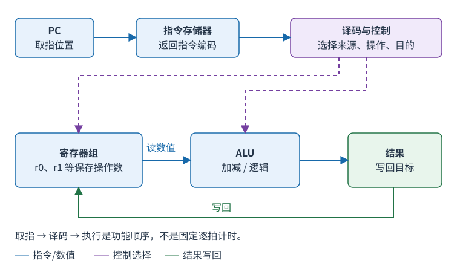
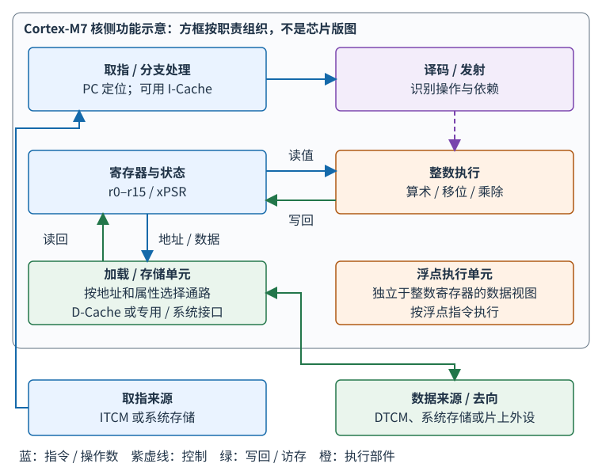

<!-- SPDX-License-Identifier: Apache-2.0 -->

# 第2章\_取指译码与Cortex-M7执行部件

> [P01 总目录](../大纲.md) / [P003 CPU怎样执行指令](大纲.md) / 第 2 篇（共 5 篇）

本篇细节：

- [2.1.1_把简单数据通路放回 Cortex-M7](#subsection-2-1-1)

前一专题已经能用加法器和寄存器构造一个计数器，但它永远按接好的规则计数。CPU 的特别之处在于：同一组运算和保存部件，可以根据存储器里的指令，依次执行不同操作。程序因此成为可以更换的控制规则。

我们先从数据通路认识 CPU，再把 Cortex-M7 的寄存器和真实 Arm 指令放进同一张图。随后用一个简化按钮程序手工推演控制流。标为“教学指令”的部分只用于推演；标为“GNU 编译结果”的部分来自实际编译，两者不能混成同一套指令。

## 2.1\_下一条操作从哪里来

存储器里的指令是位编码。CPU 需要知道去哪里取下一条，所以内部保存一个表示指令位置的值，称为**程序计数器（Program Counter，PC）**。取回指令后，**译码（Decode）** 电路识别其中的操作和操作数，再产生控制信号。

设教学指令 `ADD r2, r0, r1` 的意义是把寄存器 r0、r1 的值相加，结果写到 r2。它不是让硬件寻找三个叫作 r0、r1、r2 的文本字符串。汇编器在构建时把文字编码为位，CPU 在运行时按位字段选择寄存器、ALU 功能和写回目的地。

图例：**蓝色实线承载指令或数值，紫色虚线表示控制选择，绿色线表示结果写回**。图中把一次操作拆成职责步骤，不表示每个方框必定占用一个时钟周期。

名称注释：`PC（Program Counter－程序计数器）：标识指令执行位置。` `ALU（Arithmetic Logic Unit－算术逻辑单元）：计算结果与相关状态。` `CPU（Central Processing Unit－中央处理器）：把取指、译码和执行组织起来。`

先沿蓝线看数据从哪里来，再沿紫线看为什么这次选择它。即使 ALU 同时具备多种功能，本条指令也只要求相应结果写入目标位置。**数据通路回答“值怎样流动”，控制通路回答“此刻允许哪条路径产生可见效果”。** 只画 ALU 而不画控制关系，就难以解释同一硬件为何能执行不同程序。

### 2.1.1\_把简单数据通路放回 Cortex-M7

上图已经解释一条加法，但控制面板还要取指令、读输入、算结果、写输出。真实处理器怎样把这些职责组合起来？下面以 STM32H743 使用的 Cortex-M7 为对象，先看核侧功能组织，再逐条追踪访问。

图例：**蓝线表示指令或操作数，紫色虚线表示控制选择，绿线表示结果写回或访存，橙框表示执行部件；双向绿线概括读写请求与返回。** 外层灰框限定核侧功能；方框是功能分组，不是晶体管布局，也不表示每组只用一个周期。图中省略了缓存内部连接、浮点控制线和异常控制线。

名称注释：`I-Cache（Instruction Cache－指令缓存）：保留近期取用的指令副本。` `D-Cache（Data Cache－数据缓存）：保留按缓存策略访问的数据副本。` `TCM（Tightly Coupled Memory－紧耦合存储器）：通过专用接口连接处理器的存储器；ITCM 面向指令，DTCM 面向数据。` `FPU（Floating-Point Unit－浮点运算单元）：执行浮点运算，不替代整数寄存器和整数 ALU。`

读 `LDR r3,[r0]` 时，沿图中三段关系走：**取指/译码**知道这次是加载；**寄存器**提供 r0 中的地址；**加载/存储单元**按地址、宽度和属性选择存储通路，取得内容后写入 r3。下一条 `ADDS` 可以使用已经到达的 r3。数据尚未到达时，即便整数 ALU 空闲，依赖它的加法也不能凭空得到正确结果。

读 `STR r3,[r0]` 时，寄存器同时提供地址和待写数值。地址属于普通存储、紧耦合存储还是外设区域，影响后面的访问路径。**缓存不是另一个变量，也不是所有访问必经的一层**：外设访问不能随意当作可缓存 RAM，TCM 走专用接口。第 4、5 章建立地址地图，第17专题再解释缓存与 DMA 的数据可见性。

这里有两个不同层面的“架构”。**指令集架构（Instruction Set Architecture，ISA）** 规定软件能依赖的寄存器、指令和异常行为；Cortex-M7 实现 Armv7E-M 架构。**微架构（Microarchitecture）** 是实现这些规则的内部组织，例如流水线、发射和缓存。STM32H743 则把 M7 核与 Flash、RAM、总线和外设集成到一颗芯片中。不能把 Armv7E-M、Cortex-M7 和 STM32H743 当成三个同层的芯片型号。

M7 的取指和数据访问具有分开的内部通路，而软件仍使用统一的地址空间来定位对象，这常被概括为**改进型哈佛结构（Modified Harvard Architecture）**。它不表示任何两次访问都能同时完成：最终可能争用同一存储器或总线，也可能存在前后数据依赖。“指令通路与数据通路分开”和“所有内存访问零等待”是不同结论。

官方对照：[PM0253 Rev 6，§1.3 About the Cortex-M7 processor and core peripherals、§2.2 Cortex-M7 configurations](https://www.st.com/resource/en/programming_manual/DM00237416.pdf) 用于核对核侧功能、分离接口和配置边界；本图依据这些职责原创组织，不复制厂商框图布局。缓存容量、片上存储地址和总线路由须继续查具体芯片资料。

---

[← 加载运算与存储的数据通路](P001_加载运算与存储的数据通路.md) · [本专题目录](大纲.md) · [通用寄存器状态寄存器与栈选择 →](P003_通用寄存器状态寄存器与栈选择.md)
