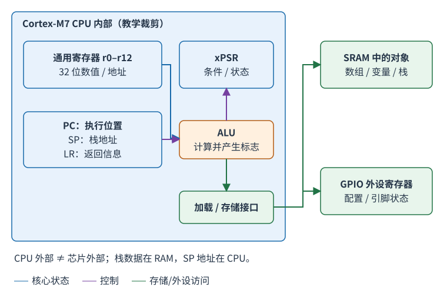
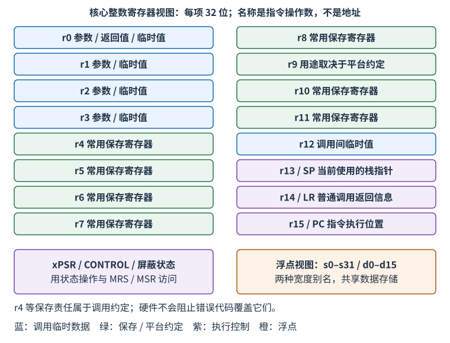
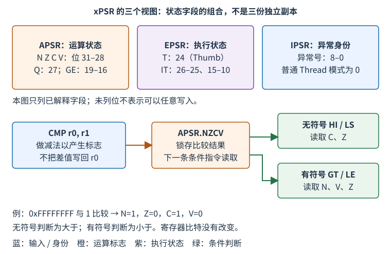
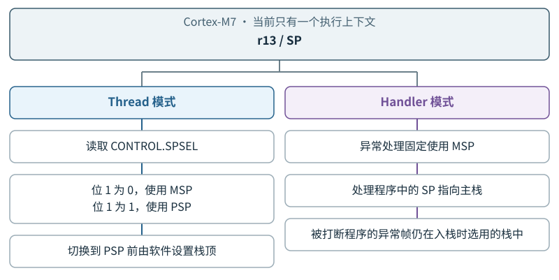

<!-- SPDX-License-Identifier: Apache-2.0 -->

# 第3章\_通用寄存器状态寄存器与栈选择

> [P01 总目录](../大纲.md) / [P003 CPU怎样执行指令](大纲.md) / 第 3 篇（共 5 篇）

本篇细节：

- [3.1.1_把寄存器窗口中的每一组名字放对位置](#subsection-3-1-1)
- [3.1.2_比较结果如何留给下一条指令](#subsection-3-1-2)
- [3.1.3_为什么有两个栈指针和几组控制寄存器](#subsection-3-1-3)

执行部件已经有了位置，但指令所操作的状态还没有完整展开。本篇分别解释通用寄存器、程序状态和栈选择，让调试器中的每一组名字都能落回CPU内部的具体职责。

## 3.1\_CPU 寄存器在哪里，里面究竟放什么

下图中的寄存器组位于 **CPU 内部**，是运算电路直接使用的状态保存位置。它不等于 SRAM（Static Random-Access Memory－静态随机存取存储器）中的一块数组，也不同于通过地址访问的 GPIO 配置寄存器。指令里的 `r0` 是寄存器编号，不是一个需要通过总线查找的内存地址。

图例：**蓝框是 CPU 内部的数据与执行状态，紫线表示控制选择，绿线表示经过加载/存储接口访问 CPU 外部的存储或外设**。外侧的 RAM 和 GPIO 仍可在同一颗 MCU 芯片内，“CPU 外部”不等于“芯片外部”。

名称注释：`SP（Stack Pointer－栈指针）：保存当前栈位置的地址。` `LR（Link Register－链接寄存器）：普通函数调用中保存返回信息。` `xPSR（Program Status Register 组合名称－程序状态寄存器）：包含条件标志、执行状态和异常编号等信息。` `RAM（Random-Access Memory－随机存取存储器）：提供按地址访问的工作存储空间。`

在 M7 的基础整数模型中，r0–r12 是 32 位通用寄存器；r13 表示 SP，r14 表示 LR，r15 对应 PC。SP、LR、PC 参与执行控制，不能把它们当作随意占用的普通临时槽位。处理器还有权限、屏蔽、浮点等状态，本节先把普通整数程序必需的关系看清。

| 状态位置 | 例如保存什么 | 谁会改变它 |
| --- | --- | --- |
| r0–r12 | 数值 7、某个变量地址、计算中间值 | 执行相应指令的 CPU |
| PC | 指令执行位置 | 顺序取指、跳转、调用或异常控制 |
| LR | 调用完成后应继续的位置 | 调用指令及保存/恢复代码 |
| SP | 当前栈边界地址 | 栈分配、保存/恢复及异常机制 |
| xPSR | 零、进位等标志和执行状态 | 运算指令与处理器控制机制 |
| SRAM 中的变量 | 程序要求保存的数据 | CPU 存储指令，或有访问能力的其他硬件 |
| GPIO 寄存器 | 引脚模式、输入状态、输出控制 | 软件访问与外设自身硬件 |

**一个寄存器可以放地址，也可以放普通数值，含义由使用它的指令决定。** r0 中有 `0x20000000`，执行加法时它可以被当作数，执行 `LDR r1,[r0]` 时才被用作访问地址。把指针放进 r0，并没有把指针指向的整个数组也搬进 r0。

### 3.1.1\_把寄存器窗口中的每一组名字放对位置

如果调试器同时显示 r0、r7、SP、xPSR，它们不是十几个可以任意互换的变量槽。先看下面的完整整数视图，再区分硬件规定的特殊角色与函数之间约定的保存责任。

图例：**蓝色是调用时常用的参数、结果与临时寄存器，绿色是保存或平台约定相关寄存器，紫色是执行控制状态，橙色是浮点视图。** 颜色说明本教程的使用角色，不是硬件给通用寄存器加了不同的读写权限。

名称注释：`Register File（寄存器组）：由指令编号选择的核心数据存储位置。` `MRS（Move from Special Register－读取特殊寄存器）：把指定状态读到通用寄存器。` `MSR（Move to Special Register－写入特殊寄存器）：按架构允许的字段和权限更新状态。`

先沿左列看 r0–r7，再接右列 r8–r15。**r0–r12 的硬件基本身份都是 32 位通用寄存器**；“参数寄存器”和“被调用者保存”来自软件调用约定。这类规则属于 **ABI（Application Binary Interface－应用二进制接口）**，让分别编译的函数可以按同一规则交接。例如函数使用 r4 计算新值，必须按约定在返回前恢复原值，硬件不会自动替它保存。r9 的角色取决于平台约定，不能一概当成可随意破坏的临时寄存器。完整保存规则和可编译调用例子见 [第14专题](../P014_calling_convention/P002_AAPCS传参嵌套调用与栈对齐.md)。

沿右列向下，r13、r14、r15 才遇到与控制流绑定的特殊角色。普通 `BL` 调用更新 LR；`BX LR` 用返回信息改变执行位置。读 PC 也有架构语义：在常见 Thumb 数据处理指令中读到的是当前指令地址加 4，有些寻址还会按字边界调整，不能把它与调试器高亮的“当前指令地址”机械等同。不是每条指令都允许 SP、PC 作为任意操作数。

底部两框补齐调试器里常见的其他状态：**xPSR 和 CONTROL 不占 r0–r15 的编号**；某些状态通过专门的寄存器访问指令读取，不存在一个可随便交给 `LDR` 的 RAM 地址。H743 的浮点数据寄存器可以显示为 32 个 32 位单精度视图 s0–s31，或 16 个 64 位双精度视图 d0–d15。d0 与 s0/s1 共享那 64 位存储，并不是另外加出一份数据。浮点状态与控制由 **FPSCR（Floating-Point Status and Control Register－浮点状态与控制寄存器）** 管理。当前整数实验未启用或使用浮点运算。

### 3.1.2\_比较结果如何留给下一条指令

执行 `CMP r0,r1` 后，两个输入寄存器都可以保持不变。那么下一条分支怎样知道“相等还是不相等”？答案在程序状态中。

图例：**蓝色表示比较输入和异常身份，橙色表示运算标志，紫色表示执行状态，绿色表示读取标志后的判断。** 上排是同一组合状态的不同字段视图，下排是先比较、再判断的执行过程。

名称注释：`APSR（Application Program Status Register－应用程序状态寄存器）：提供运算标志。` `EPSR（Execution Program Status Register－执行程序状态寄存器）：包含 Thumb 与条件执行相关状态。` `IPSR（Interrupt Program Status Register－中断程序状态寄存器）：表示当前异常编号。` 图中 Q 是饱和运算累计标志，GE 是部分并行运算的比较标志；基础示例暂不使用它们。

顺着橙线，CMP 内部按减法产生 N、Z、C、V，并将结果状态留下。沿绿线，后续条件分支读取这些位；中间若插入另一条会改标志的运算，分支看到的就可能不再是原比较的结果。**标志也有生产者和使用者，不能把它们当成永远对应某个 C 表达式的标签。**

下面涉及两个后续会实际读到的指令名称：`SUBS（Subtract and update flags－减法并更新标志）` 在保存差值时更新相关标志；`IT（If-Then－条件执行控制）` 为后续有限条指令建立条件执行状态。`IRQ（Interrupt Request－中断请求）` 则是外设向处理器请求响应的事件，表中的异常号记录当前处理身份。

| 视图与字段 | 位号 / 取值 | 本章怎样观察或改变 |
| --- | --- | --- |
| APSR.N / Z / C / V | 31 / 30 / 29 / 28 | CMP、ADDS、SUBS 等按指令规则更新；MRS 可读取 APSR |
| EPSR.T | 24；M7 正常执行 Thumb 时为 1 | 执行状态由架构机制维护；不当作普通可写变量 |
| EPSR.IT | 26–25 与 15–10 | 保存条件执行相关状态；IT 指令与执行推进按规则维护 |
| IPSR 异常号 | 8–0；普通程序为 0，外部 IRQ 对应异常号为 IRQ 编号加 16 | MRS 可读取 IPSR；进入和退出异常由硬件更新 |

表只列本节解释的字段，不是允许整字随意写入的清单。xPSR 可以在调试器和异常保存现场中看到；其中执行状态的专用软件读取/写入限制，要按相应指令查询，不能假定 `MRS` 能直接提供调试器显示的所有 EPSR 位。

手算图中两操作数值为 `0xFFFFFFFF` 和 1 的 CMP：减法结果为 `0xFFFFFFFE`，N=1、Z=0、C=1、V=0。按无符号解释，前者更大；按有符号补码解释，前者是 −1，反而更小。寄存器里没有“有符号类型标签”，是编译器选择了不同的条件判断。第13专题给出对应的分支条件表。

### 3.1.3\_为什么有两个栈指针和几组控制寄存器

普通程序与中断处理共用一个 CPU。如果它们需要使用不同的栈，单有一个 SP 名称还不够。Cortex-M7 为 r13 提供两份可选择的指针状态：主栈指针和进程栈指针。

在普通程序里读 SP，要结合 CONTROL.SPSEL 判断；进入异常处理后，处理程序看到的是 MSP。两份栈指针属于同一颗核。

名称注释：`MSP（Main Stack Pointer－主栈指针）：复位后和异常处理使用的栈指针。` `PSP（Process Stack Pointer－进程栈指针）：普通执行模式可选择的另一份栈指针。` `Thread mode（线程模式）：执行普通程序的处理器模式，裸机 main 也可处于此模式。` `Handler mode（处理模式）：执行异常处理的模式。` “Process”这个名称并不表示芯片自动实现了操作系统进程。

**两根指针只提供栈选择能力，不会自动创建线程、分配栈或调度。** 复位启动、栈内数据和异常压栈分别在第 6、7、16 专题展开；此处先明确这些状态位于 CPU 内部。

当系统还需要限制普通代码权限，或暂时阻止某些异常抢占，就会用到下表中的控制状态。它们通过 MRS/MSR 等专门方式访问，不能将名称当成外设基址。

| 32 位状态视图 | 本节相关有效位 | 功能与访问边界 |
| --- | --- | --- |
| CONTROL | nPRIV 位 0；SPSEL 位 1；FPCA 位 2 | 普通模式权限、栈选择和浮点上下文活动状态；Handler 始终特权执行，非特权程序不能自行写回特权身份 |
| PRIMASK | 位 0 | 为 1 时阻止可配置优先级异常被激活；不会屏蔽 NMI 和 HardFault |
| BASEPRI | 位 7–0 中实现的优先级位 | 非零时按优先级阈值屏蔽；0 表示不使用此阈值，不是屏蔽所有异常 |
| FAULTMASK | 位 0 | 为 1 时阻止除 NMI 外的异常被激活，范围比 PRIMASK 更广 |
| MSP / PSP | 指针值；低两位为 0 | 保存对齐的栈地址；公共函数调用的八字节对齐还由 ABI 约束 |

名称注释：`PRIMASK（Priority Mask－优先级屏蔽寄存器）`、`BASEPRI（Base Priority－基础优先级屏蔽寄存器）`、`FAULTMASK（Fault Mask－故障屏蔽寄存器）` 分别保存不同范围的屏蔽状态；`NMI（Non-Maskable Interrupt－不可屏蔽中断）` 和 `HardFault（硬故障异常）` 是架构定义的异常类别。屏蔽影响 CPU 的异常响应，不等于外设停止采样或事件消失。

例如特权代码中的 `MRS r0,CONTROL` 读取当前控制值；假设结果为 2，则本例 nPRIV=0、SPSEL=1、FPCA=0，表示特权 Thread 模式选择 PSP、没有活动浮点上下文。这个读数本身不能证明 PSP 指向的 RAM 已正确准备。修改栈选择前必须先建立合法栈；本章只读和推演，不让读者复制一个未初始化 PSP 的切换动作。

官方对照：[PM0253 Rev 6，§2.1.1 Processor mode and privilege levels、§2.1.2 Stacks、§2.1.3 Core registers](https://www.st.com/resource/en/programming_manual/DM00237416.pdf) 核对以上视图和权限；浮点寄存器视图见该手册 §4.7 Floating-point unit。调用保存责任属于 [AAPCS32 §6.1 Machine Registers](https://github.com/ARM-software/abi-aa/blob/2025Q1/aapcs32/aapcs32.rst)，不把软件约定写成硬件自动动作。

---

[← 取指译码与Cortex-M7执行部件](P002_取指译码与Cortex-M7执行部件.md) · [本专题目录](大纲.md) · [从C语句追踪指令与执行开销 →](P004_从C语句追踪指令与执行开销.md)
