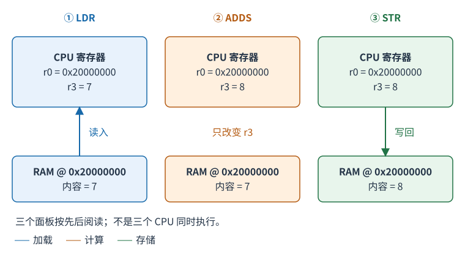

<!-- SPDX-License-Identifier: Apache-2.0 -->

# 第4章\_从C语句追踪指令与执行开销

> [P01 总目录](../大纲.md) / [P003 CPU怎样执行指令](大纲.md) / 第 4 篇（共 5 篇）

本篇路线：

- [4.1_先看一段 C 怎样变成真实 Arm 指令](#section-1)
- [4.2_把一次输入输出拆成可执行步骤](#section-2)
- [4.3_顺序执行如何变成条件判断](#section-3)
- [4.4_为什么频率不能直接换算成程序速度](#section-4)
- [4.5_让模型经受一次变化](#section-5)


知道寄存器保存什么之后，可以把一段C程序逐步落成加载、计算、分支和存储。本篇用同一输入输出任务追踪这些动作，再解释频率为什么不能直接换算成程序速度。

<a id="3.3_先看一段-c-怎样变成真实-arm-指令"></a>

<a id="section-1"></a>

## 4.1\_先看一段 C 怎样变成真实 Arm 指令

面板程序要把一个计数值加一。下面是本专题自有的完整函数，`count` 指向一个 32 位无符号对象。`volatile` 要求保留相应实际读写，便于我们观察，不提供并发保护。本节先阅读已生成的结果，工具安装和自行生成在第12专题进行。



图例：**蓝色为加载，橙色为 CPU 内部计算，绿色为存储；三个面板是同一颗 CPU 的先后状态**。RAM 方框画出变量的内容，r0 方框画出它的地址，两者不能互换。

名称注释：`LDR（Load Register－加载寄存器指令）：把存储位置的内容取入寄存器。` `STR（Store Register－存储寄存器指令）：把寄存器内容写到存储位置。` `ALU（Arithmetic Logic Unit－算术逻辑单元）：完成中间的加法。`

```c
#include <stdint.h>

void increment_word(volatile uint32_t *count)
{
    *count = *count + 1u;
}
```

本机 GNU Arm GCC 10.3.1、Cortex-M7、Thumb、`-O1` 的相关输出如下，省去目标文件地址列：

```asm
increment_word:
    ldr  r3, [r0, #0]
    adds r3, #1
    str  r3, [r0, #0]
    bx   lr
```

**汇编助记符（Mnemonic）** 是人读的指令名称：LDR（Load Register）加载，STR（Store Register）存储，ADD 加法；这里 ADDS 还更新条件标志。`#1` 是指令直接表达的常数，`[r0,#0]` 表示访问 r0 所保存的地址加零偏移处的内容。BX 使用寄存器中的目标转移，本例 `BX LR` 回到调用者。CPU 最终读取的是这些指令的机器编码，而非字母文本。

为什么参数在 r0？编译器遵循 **调用约定（Calling Convention）**，约定这个例子的首个指针参数由 r0 传入。约定让分别编译的调用者与被调函数能交接；不是 CPU 硬件看到了 C 参数名称。第14专题再完整展开函数保存责任，本章先追踪数据。

令 r0=`0x20000000`，该处内容为 7。沿蓝色加载线，r3 得到 7，内存不变；橙色加法使 r3 变成 8，内存仍是 7；沿绿色存储线，内存才变成 8。最后返回时 r0 仍保存原地址，控制流已经回到调用者。**一行 C 并不等于一个不可分割的硬件动作。**

读者现在可以手算一个变化：把内存初值改成 20，执行到 ADDS 后停下，分别读 r0、r3 和内存会看到什么？答案是原地址、21、20；再执行 STR，内存才成为 21。以后中断插进加载与存储之间时，正是这种中间状态决定是否会丢更新。

<a id="3.4_把一次输入输出拆成可执行步骤"></a>

<a id="section-2"></a>

## 4.2\_把一次输入输出拆成可执行步骤

教学 CPU 设有 r0、r1 等临时寄存器。把按钮输入位置的符号命名为 `BUTTON_STATE`，把灯输出控制位置的符号命名为 `LED_CONTROL`，它们不是 C 变量或真实 H743 寄存器名。先假定读按钮得到 0 或 1，写 1 点亮灯、写 0 关闭灯。下面使用四个教学指令名称：`LOAD` 读取、`AND` 按位与、`STORE` 写出、`JUMP` 跳转。

```text
loop:
    LOAD  r0, [BUTTON_STATE]
    AND   r0, r0, 1
    STORE r0, [LED_CONTROL]
    JUMP  loop
```

`LOAD` 把外部可访问位置中的值读入 CPU 寄存器；`AND` 只保留最低位；`STORE` 把寄存器里的结果写到输出控制位置；`JUMP` 改变后续取指位置，使程序返回开头。方括号表示访问某位置的内容，不是对地址本身进行计算。

按钮由 0 变成 1 后，CPU 下一次执行 `LOAD` 才看到新状态。执行 `AND` 时，结果只在 CPU 内部变化；执行 `STORE` 时，输出接口才收到写入。若在 `LOAD` 和 `STORE` 之间暂停 CPU，可以出现“按钮已经按下、r0 已为 1、灯尚未改变”的中间状态。理解这种中间状态，是以后读调试器寄存器窗口和单步执行的基础。

| 已完成的操作 | CPU 内部 r0 | 输出控制位置 | 外部灯 |
| --- | --- | --- | --- |
| 尚未再次读取 | 旧值 0 | 0 | 灭 |
| 读取按钮 | 1 | 0 | 灭 |
| 完成按位与 | 1 | 0 | 灭 |
| 写入输出 | 1 | 1 | 按电气通路变亮 |

这里没有使用中断。程序自己不断返回读取位置，主动检查输入，这种策略称为**轮询（Polling）**。轮询的读取和写入并不特殊，仍是普通指令触发的访问；以后改成中断，也不会取消实际的数据读取与结果写入。

<a id="3.5_顺序执行如何变成条件判断"></a>

<a id="section-3"></a>

## 4.3\_顺序执行如何变成条件判断

如果只会依次执行，程序无法根据按钮状态改变行为。CPU 因此需要比较结果和改变控制流的能力。比较可以由减法等运算产生状态，例如结果是否为零；条件分支再根据这些状态决定是否改写 PC。

教学程序“按钮未按时跳过翻转”，可以拆成读取、比较和条件跳转。C 中一条 `if` 因而可能对应多条机器指令，也可能在优化后采用另一种等价表示。源代码的一行和机器指令不存在固定一对一关系。

PC 的正常推进也不能永远写成“加 4”。指令编码宽度由指令集决定；后面使用的 Thumb 指令流包含 16 位与 32 位指令。一条指令占 2 字节还是 4 字节，会影响下一条指令的地址，但不直接告诉我们它执行几个时钟周期。

<a id="3.6_为什么频率不能直接换算成程序速度"></a>

<a id="section-4"></a>

## 4.4\_为什么频率不能直接换算成程序速度

设一段教学程序实际执行 1000 条指令，平均每条占用 2 个 CPU 周期，CPU 时钟为 100 MHz。忽略其他开销时，总时间是 `1000×2/100000000=20 μs`。这个计算使用了三个不同量：指令条数、平均周期数和时钟频率。

**每指令周期数（Cycles Per Instruction，CPI）** 是用于分析一段实际指令序列的平均指标，不是每种处理器永远不变的常数。访存等待、分支、数据依赖和缓存命中情况都会改变它。把频率翻倍，也未必让等待外设完成的时间减半。

真实 CPU 为了提高吞吐量，会让不同指令的不同阶段重叠，称为**流水线（Pipeline）**。就像第一条正在执行时，后续指令的取指或译码可能已经进行。但如果第二条需要第一条尚未得到的结果，就必须处理这种依赖；遇到分支，还要处理下一条位置的不确定性。

Cortex-M7 使用更复杂的流水线，并支持在符合条件时同周期发射多条指令。**同一 CPU 内部重叠推进指令，不等于操作系统获得了多个独立 CPU。** 对程序可见的寄存器、异常和存储规则仍必须符合架构要求。不能拿本章的顺序功能模型去数 M7 的实际流水线周期，也不能从“双发射”推出所有代码都快两倍。

官方对照：[PM0253 Rev 6，Introduction 与 1.3 About the Cortex-M7 processor and core peripherals](https://www.st.com/resource/en/programming_manual/DM00237416.pdf) 介绍 M7 的流水线、接口和处理器功能；编程模型在第2专题。阅读时分清“程序可依赖的行为”和“实现用来提高效率的内部方法”。

<a id="3.7_让模型经受一次变化"></a>

<a id="section-5"></a>

## 4.5\_让模型经受一次变化

现在在循环里加入一个计算任务，计算完成前不再读取按钮。假设两次 `LOAD` 间隔由 10 μs 增长为 5 ms。按钮在刚读完后发生变化，最坏要接近 5 ms 才被下一次读取观察到；若高电平只保持 1 ms，还可能整个脉冲都落在两次读取之间。

这个问题不是 ALU 不会计算，也不是 GPIO 不能反映电平，而是程序的观察时机变稀疏了。后续中断机制会改变“CPU 何时转去处理事件”；外设锁存状态、捕获计数或缓存数据则解决“CPU 到来前怎样保留信息”。这两项职责需要分别理解。

练习：把同样的四条教学指令复制两遍、去掉其中一次 `JUMP`，是否一定能把按钮处理速度提高两倍？解答：不能。执行时间还取决于各操作的周期和访问等待，复制代码只减少了一部分跳转比例。应先统计真实指令与访存行为，再用计时或跟踪取得证据。

后一专题把 `BUTTON_STATE` 这样的符号换成可以计算的地址，并说明 CPU 如何让存储器或外设响应一次访问。

---

[← 通用寄存器状态寄存器与栈选择](P003_通用寄存器状态寄存器与栈选择.md) · [本专题目录](大纲.md) · [寄存器和内存逐步推演 →](P005_寄存器和内存逐步推演.md)
