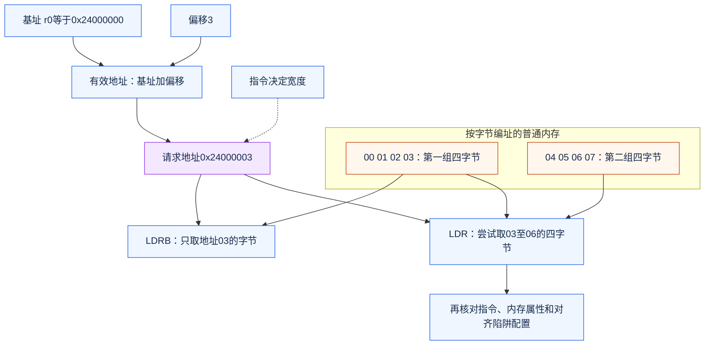

<!-- SPDX-License-Identifier: Apache-2.0 -->

# 第1章\_地址、访问宽度与对齐分别约束什么

这里从一块八字节的普通内存开始，不要求已掌握芯片寄存器。每个字节有自己的地址；一次操作取多少字节，由指令的访问宽度决定。“32 位 CPU”不意味着每个字节地址都必须是四的倍数。

图例：**蓝色节点表示一般参与者，紫色突出处理或决策，橙色表示保存的数据或状态。** 实线表示地址计算或所需数据，虚线表示操作选择。`LDRB(Load Register Byte-加载字节到寄存器)：读取一个字节并零扩展。` LDR 是加载指令，本例访问一个 32 位字；图中两组字节用于说明边界，不承诺真实总线一定拆成两笔。

将地址除以访问宽度，余数为零叫作自然对齐。字节访问宽度为 1，任意字节地址都自然对齐；半字和字访问分别看二和四的倍数。把四字节对象放到地址 03，会跨过 04 这一边界，硬件可能需要额外处理，也可能在某些指令或属性条件下触发故障。不能把普通 RAM 支持的部分未对齐访问推广到设备寄存器。

小端说明多字节值怎样排列。假设地址 00 到 03 保存 `78 56 34 12`，从 00 加载一个字得到 `0x12345678`，从 01 加载一个字节得到 `0x56`。地址始终递增，改变的是如何把相邻字节组合成数。处理网络数据时，先知道协议的字节顺序，再决定是否组合或转换。

**C 指针类型还决定步长。** `uint8_t *p` 的 `p+1` 前进一字节，`uint32_t *q` 的 `q+1` 前进四字节。指针强转不会把不合适的地址变得对齐，也不会自动把任意字节数组变成合法的另一类型对象。

继续：[原理与实现](P002_原理与实现.md)。返回：[专题大纲](大纲.md)。
