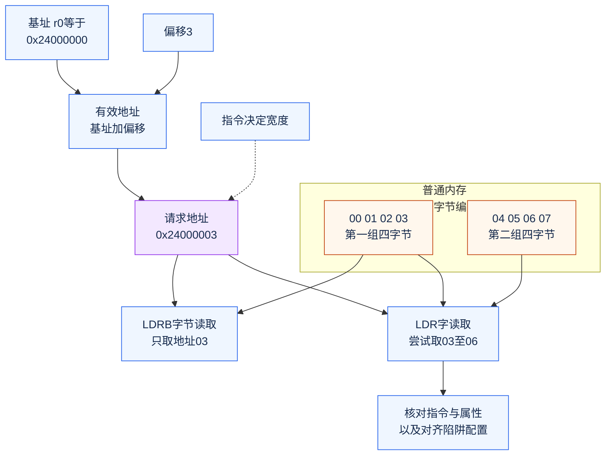

<!-- SPDX-License-Identifier: Apache-2.0 -->

# 第1章\_地址访问宽度与字节选择

> [P01 总目录](../大纲.md) / [P004 地址总线与存储器映射](大纲.md) / 第 1 篇（共 4 篇）

这里从一块八字节的普通内存开始，不要求已掌握芯片寄存器。每个字节有自己的地址；一次操作取多少字节，由指令的访问宽度决定。“32 位 CPU”不意味着每个字节地址都必须是四的倍数。

图例：**蓝色节点表示一般参与者，紫色突出处理或决策，橙色表示保存的数据或状态。** 实线表示地址计算或所需数据，虚线表示操作选择。`LDRB(Load Register Byte-加载字节到寄存器)：读取一个字节并零扩展。` LDR 是加载指令，本例访问一个 32 位字；图中两组字节用于说明边界，不承诺真实总线一定拆成两笔。

将地址除以访问宽度，余数为零叫作自然对齐。字节访问宽度为 1，任意字节地址都自然对齐；半字和字访问分别看二和四的倍数。把四字节对象放到地址 03，会跨过 04 这一边界，硬件可能需要额外处理，也可能在某些指令或属性条件下触发故障。不能把普通 RAM 支持的部分未对齐访问推广到设备寄存器。

小端说明多字节值怎样排列。假设地址 00 到 03 保存 `78 56 34 12`，从 00 加载一个字得到 `0x12345678`，从 01 加载一个字节得到 `0x56`。地址始终递增，改变的是如何把相邻字节组合成数。处理网络数据时，先知道协议的字节顺序，再决定是否组合或转换。

**C 指针类型还决定步长。** `uint8_t *p` 的 `p+1` 前进一字节，`uint32_t *q` 的 `q+1` 前进四字节。指针强转不会把不合适的地址变得对齐，也不会自动把任意字节数组变成合法的另一类型对象。

## 1.1\_一个字节写入如何避免破坏邻居

设地址00至03依次保存 `11 22 33 44`。执行字节存储，把地址01写成AA后，程序需要观察到 `11 AA 33 44`。指令已经明确访问宽度为一个字节，CPU 的32位寄存器只提供低八位作为待写数据，不能因寄存器宽度为32位就把相邻三个字节一起覆盖。

接口可以通过字节选通信号表达哪些字节有效，也可能在某些层次内部拆分或合并访问。重要的是区分架构承诺与内部实现：软件要求只改变指定字节，并不必然要求外部物理总线只具有八根数据线。对普通内存可成立的字节语义，也不能直接推广为任意外设寄存器都允许字节访问；外设手册可以要求固定访问宽度。

如果使用 `STR` 写入一个字，必须提供整个字的值。为了只改第二个字节而先读整个字、掩码修改、再写回，会引入一个可被其他执行者插入的窗口。另一个中断若在窗口里更新了同字其他字节，旧快照可能覆盖它。这里“对象大小”“指令宽度”“总线实现”“并发原子性”是四个不同维度，四字节对齐只能回答其中的地址条件，不能一并保证其余性质。

因此，阅读一条访问时依次写下：有效地址、访问宽度、该地址的内存或外设属性、谁还可能访问同一对象。四项明确后，再讨论性能或并发；只看地址末尾是0、4、8还是C，还不足以判断整个访问是否正确。

---

[← 寄存器和内存逐步推演](../P003_cpu_execution/P005_寄存器和内存逐步推演.md) · [本专题目录](大纲.md) · [有效地址总线事务与存储映射 →](P002_有效地址总线事务与存储映射.md)
