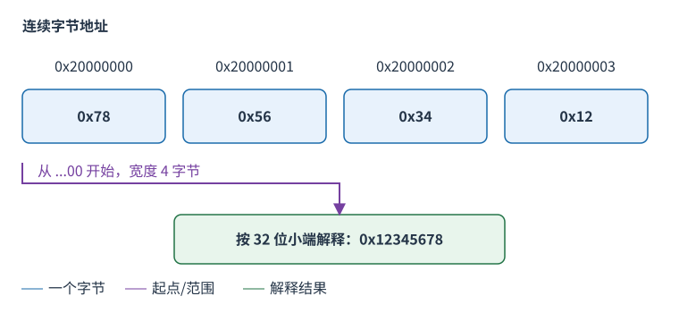
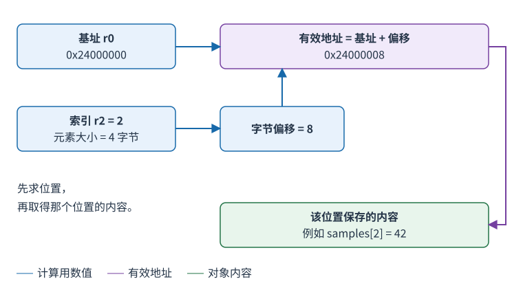
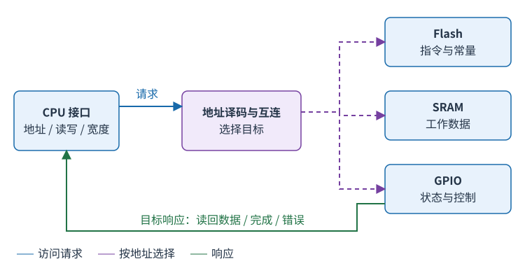

<!-- SPDX-License-Identifier: Apache-2.0 -->

# 第2章\_有效地址总线事务与存储映射

> [P01 总目录](../大纲.md) / [P004 地址总线与存储器映射](大纲.md) / 第 2 篇（共 4 篇）

本篇路线：

- [2.1_地址表示位置，内容表示保存的值](#section-1)
- [2.2_寻址怎样把表达式变成实际访问地址](#section-2)
- [2.3_一次总线访问必须带哪些信息](#section-3)
- [2.4_为什么读写外设看起来像访问内存](#section-4)
- [2.5_程序和变量为什么放在不同存储器](#section-5)

前一专题的 CPU 已经能够发出读取和写入，但还没有解释一个关键问题：同一颗芯片里同时存在程序存储器、数据存储器和 GPIO，CPU 怎样指定这次要找谁？答案涉及地址、地址译码和完成访问所需的总线协议。

本章先用一小块连续存储区建立地址模型，再把相同访问形式推广到外设。后一专题才把这些对象放进 H743 的真实地址地图，避免先背一串十六进制数。

## 2.1\_地址表示位置，内容表示保存的值

**地址（Address）** 是访问位置的编号。在本专题采用的字节寻址系统中，相邻地址对应相邻字节。设四个位置的内容如下：

图例：**蓝框是一字节存储位置，绿框是把四个字节按小端解释得到的数值，紫色表示访问起点**。图中每个格子都能被单独编号，四字节分组没有删除中间三个地址。

名称注释：`Byte（字节）：本例为 8 位。` `Word（字）：本篇 Arm 整数访问中指 32 位，即四字节；其他架构的术语约定需分别核对。`

| 地址 | 保存的一个字节 |
| --- | --- |
| `0x20000000` | `0x78` |
| `0x20000001` | `0x56` |
| `0x20000002` | `0x34` |
| `0x20000003` | `0x12` |

一个 32 位数占四个字节。把最低有效字节放在最低地址，称为**小端序（Little-Endian）**；按这种规则，上表保存的 32 位值是 `0x12345678`。H743 的处理器采用小端数据表示。若只从首地址读一个字节，则得到 `0x78`，不是整个 `0x12345678`。

**地址 `0x20000001` 完全存在。** 它不需要因为 CPU 是 32 位就变成 `0x20000004`。区别在于这次要从它开始访问几个字节：取一个字节，只需要它自己；取一个四字节对象，则会覆盖 `...01`、`...02`、`...03`、`...04`。对齐检查针对“起点与访问类型的组合”，不是判断地址这个数有没有资格存在。

“32 位处理器”也不表示每个地址只能保存 32 位。处理器的寄存器宽度、地址表示能力、访问宽度和总线数据宽度是不同维度；例如某条指令可以只访问一个字节，另一条访问一个 32 位字。

如果用 32 位表示字节地址，理论上可表示 `2^32` 个字节位置，即 4 GiB 的地址空间。**地址空间（Address Space）** 是可编号的范围，不等于芯片真的装有 4 GiB 存储器。许多范围可能未实现、保留或分配给外设。

## 2.2\_寻址怎样把表达式变成实际访问地址

**寻址（Addressing）** 是确定指令的操作数在哪里，以及访问时使用哪个地址的过程。寄存器中的数、指令内的常数、寄存器指向的内存，是三种不同来源。先假设 r0=`0x24000000`、r2=2，比较下面几种表达：

图例：**蓝色是地址计算用的数值，紫色是最终有效地址，绿色是读取的数据**。先算地址，再读该位置内容；得到地址不是已经得到数据。

名称注释：`Effective Address（有效地址）：本次内存操作最终使用的地址。` `Base（基址）：计算访问位置的起点。` `Offset（偏移）：在基址上增加的字节距离。`

表中的 MOV（Move，传送指令）复制数值，LDR（Load Register，加载寄存器指令）从地址取内容，LSL（Logical Shift Left，逻辑左移）参与计算偏移。先区分数值传送和内存访问，再比较方括号内的地址表达。

| 表达 | 实际动作 | 是否访问数据存储器 |
| --- | --- | --- |
| `MOV r1,#7` | 把常数 7 放入 r1 | 否 |
| `MOV r1,r0` | 复制 r0 的数值到 r1 | 否 |
| `LDR r1,[r0]` | 从地址 `0x24000000` 读取一个字 | 是 |
| `LDR r1,[r0,#4]` | 从地址 `0x24000004` 读取一个字 | 是 |
| `LDR r1,[r0,r2,LSL #2]` | 从 `r0+(r2×4)`，即 `0x24000008` 读取一个字 | 是 |

LSL（Logical Shift Left，逻辑左移）把位向左移动，这里移两位相当于在适用范围内乘 4。最后一个例子正好对应 32 位数组的第 2 号元素。C 的 `samples[2]` 先按元素大小计算偏移，CPU 执行的是算出的字节地址；硬件不认识源码中的数组名称。

Arm 还支持访问后更新基址等形式，例如 `LDR r1,[r0],#4` 先使用旧 r0，再令 r0 增加 4；`LDR r1,[r0,#4]` 使用加 4 后的位置，但不改变 r0。这个差别会在启动代码复制数据时直接出现。实际指令编码对寄存器和偏移范围有限制，不能把任意数学表达式塞进方括号。

练习：r0=`0x24000000`，数组元素是 `uint16_t`（16 位无符号整数，每个占两字节），第 3 号元素在哪里？答案是 `0x24000006`。索引是 3，字节偏移是 6；把偏移误写成 3，访问位置就变了。

## 2.3\_一次总线访问必须带哪些信息

**总线（Bus）** 是连接多个部件并按协议传递访问请求与响应的互连。为完成一次写入，系统至少需要表达目标地址、写入数据以及访问性质；读取则要把目标内容作为响应返回。

图例：**蓝色箭头表示请求，绿色箭头表示读回数据或完成响应，紫色虚线表示地址选择**。这是事务关系图，未画出具体协议的全部信号。

名称注释：`SRAM（Static Random-Access Memory－静态随机存取存储器）：在供电期间保存可反复读写的数据。` `GPIO（General-Purpose Input/Output－通用输入输出）：提供外部引脚状态与控制接口。` `MMIO（Memory-Mapped Input/Output－存储器映射输入输出）：用地址空间中的访问操作控制外设。`

沿蓝线发起读取时，CPU 或其访问接口给出地址。**地址译码（Address Decoding）** 根据地址范围选择目标，目标再根据内部偏移选中具体位置。等目标能够给出数据，绿色路径才带回响应。若目标还没准备好，协议可以让事务等待；若访问非法或目标报告错误，也可能返回错误而引发处理器故障。

这个模型解释了“读一条寄存器语句为什么不一定一个周期结束”。程序发出访问，目标完成访问，中间有互连、桥接和目标时序。外设不必与 CPU 处于相同频率。不同目标还可能走不同接口，因而相同的 `LOAD` 形式可能有不同延迟。

## 2.4\_为什么读写外设看起来像访问内存

给 GPIO 的状态和控制接口分配地址后，CPU 就可以用加载、存储指令访问它们，这称为 MMIO。地址与普通存储器一样承担定位职责，但读写效果由外设定义。

普通 SRAM 位置通常可以“写入一个数，以后再读回”。外设寄存器则可能具有不同规则：某位反映实时输入，只能读；某位写 1 表示清除已经锁存的事件；某个写入口把数据推入发送队列，读取同一位置可能根本没有意义。

| 访问属性 | 软件动作 | 需要保持的认识 |
| --- | --- | --- |
| 只读状态 | 读取当前硬件提供的状态 | 写入通常不能改变它，具体后果查手册 |
| 普通读写配置 | 读出配置，再按允许的字段修改 | 保留位与生效条件仍须遵守 |
| 写 1 清除 | 给指定状态位写 1 | 写入值不是要保存的新状态，而是清除命令 |
| 写数据入口 | 写入待发送数据 | 写入可能启动硬件工作，重复写会产生重复动作 |

因此，`reg |= mask` 不是通用的“只改一位”工具。它实际执行读取、CPU 运算和写回；若寄存器采用写 1 清除语义，读到的其他置位状态也会被写回为 1，从而被一并清除。必须从访问属性选择动作，不能只凭 C 语法判断效果。

## 2.5\_程序和变量为什么放在不同存储器

断电后程序仍应保留，但运行中的计数、缓存和栈又需要频繁更新。不同存储技术承担了不同需求。

**闪存（Flash Memory）** 适合保存断电后仍要保留的固件和常量；它的擦除、编程有专门粒度和流程，不能把普通变量赋值直接当作可靠的 Flash 更新。**RAM（Random-Access Memory－随机存取存储器）** 中的“随机存取”指可按地址选择位置，不是随机数；SRAM 是其中一种实现，适合运行期变量，读写方便，但一般在失去供电后不能保持内容。“静态”是其存储电路类型名称，不表示断电不丢数据。

处理器还可能配置更近的高速存储，例如缓存和紧耦合存储。此时程序可见的地址不一定告诉我们访问最终经过哪一级；先按正确地址与权限完成访问，再根据具体芯片的路径解释性能。

从结构上看，**冯·诺依曼结构（Von Neumann Architecture）** 强调指令与数据共享存储/访问组织；**哈佛结构（Harvard Architecture）** 强调指令与数据通路分离。现代处理器可能在内部拆分取指与数据路径，同时仍让程序使用统一地址地图。H743 不能被简化成“程序只准在 Flash，数据只准在 SRAM”的两条绝对规则；访问权限和实际实现决定哪些地址可以取指、读写。

---

[← 地址访问宽度与字节选择](P001_地址访问宽度与字节选择.md) · [本专题目录](大纲.md) · [自然对齐字节访问与结构体布局 →](P003_自然对齐字节访问与结构体布局.md)
