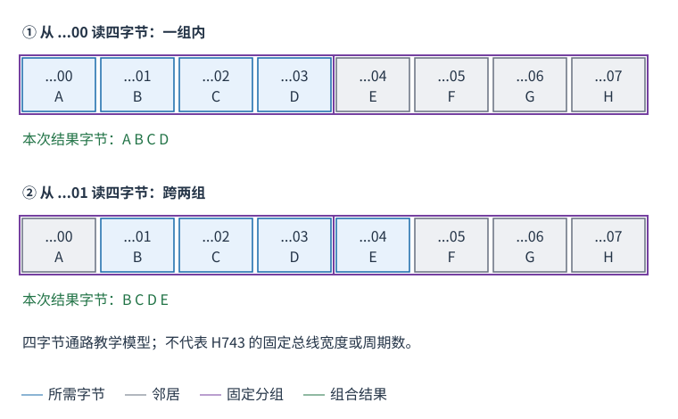
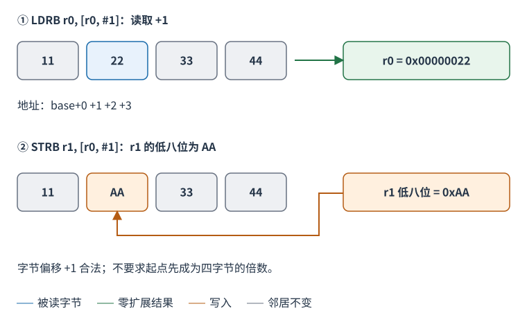
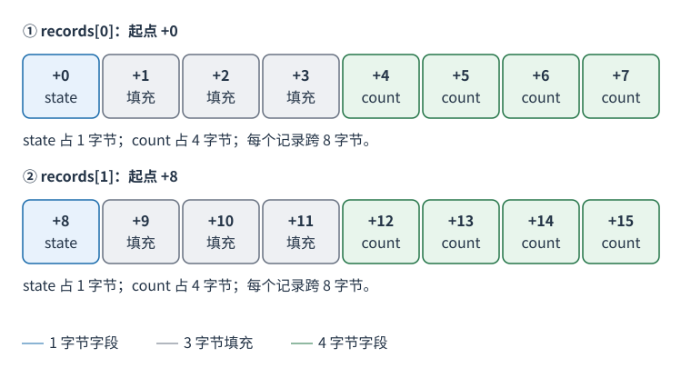

<!-- SPDX-License-Identifier: Apache-2.0 -->

# 第3章\_自然对齐字节访问与结构体布局

> [P01 总目录](../大纲.md) / [P004 地址总线与存储器映射](大纲.md) / 第 3 篇（共 4 篇）

本篇路线：

- [3.1_四字节对齐到底约束什么](#section-1)
- [3.2_硬件为什么偏好自然对齐](#section-2)
- [3.3_单字节在 32 位 CPU 上怎样读写](#section-3)
- [3.4_结构体填充把对齐变成可见的布局](#section-4)


前篇已经计算有效地址并确认访问目标。本篇进一步问：一次取几个字节、地址怎样与宽度配合、相邻对象如何排列。以四字节边界和字节加载为例，分清对齐、字节顺序和C对象布局。

<a id="4.6_四字节对齐到底约束什么"></a>

<a id="section-1"></a>

## 3.1\_四字节对齐到底约束什么

一个四字节值从能被 4 整除的地址开始，称为**四字节对齐（4-byte Alignment）**。用数值判断就是 `address % 4 == 0`；因为 4 是 2 的平方，也等价于地址最低两位为 `00`。十六进制末位为 0、4、8、C 的地址满足此条件，末位为 1、2、3 等则不满足四字节对齐，但仍可能是合法的字节地址。

| 访问或布局要求 | 判断方式 | 例子 |
| --- | --- | --- |
| 字节访问的自然对齐 | 任意字节地址 | `...00`、`...01` 都成立 |
| 半字的自然对齐 | 地址能被 2 整除 | `...02` 成立，`...03` 不成立 |
| 字的自然对齐 | 地址能被 4 整除 | `...04` 成立，`...02` 不成立 |
| 函数公共接口的栈对齐 | 本例 Arm 调用约定要求 SP 能被 8 整除 | 比普通字访问更严格 |
| 向量表整体基址对齐 | 按核心与表的覆盖大小决定 | 不能只因每项四字节就推断基址只需四字节对齐 |

最后两行来自软件协作或核心表定位规则，不能都归结为“CPU 是 32 位”。第6专题会认识栈和堆，第7专题再用向量表把两种不同的对齐约束分开计算。

<a id="4.7_硬件为什么偏好自然对齐"></a>

<a id="section-2"></a>

## 3.2\_硬件为什么偏好自然对齐

先用一条每次处理四个字节的简化通路观察代价。它把字节划分为边界固定的组：`...00` 到 `...03` 一组，`...04` 到 `...07` 下一组。一个四字节数从 `...00` 开始，恰好在一组内；从 `...01` 开始，则横跨两组。



图例：**蓝色是本次需要的字节，灰色是邻近但不属于本次对象的字节，紫色框表示教学通路中的固定四字节组，绿色表示组合结果**。上下是两种访问方案，不是两个 CPU 同时工作。

名称注释：`Alignment（对齐）：起始地址满足指定边界。` `Byte lane（字节通道）：宽数据通路中对应一个字节的位置。`

对齐的情况可以直接选取一组；跨组的情况可能需要取得两部分，再移位拼接，写入时也可能拆分并分别选择字节位置。这增加数据选择、访问组织和边界处理的成本。**这是解释成本的模型，不是 H743 每条 LDR 的固定总线拍数。** M7 还有缓存、不同宽度的内部接口、缓冲和多个存储目标，实际访问次数与延迟要看路径，不能把图中的两组直接报告为“两周期”。

硬件和指令对未对齐访问的支持不同。Cortex-M7 的部分普通加载/存储指令可在合适的普通存储区处理未对齐访问；也可以通过配置使其触发故障。LDM/STM（Load/Store Multiple，多寄存器加载/存储）、LDRD/STRD（Load/Store Register Doubleword，双字加载/存储）等有更严格的对齐要求，设备类型区域也不能任意做未对齐访问。**“处理器支持部分未对齐”不等于任意指针、任意指令、任意外设都合法。**

C 语言还要求指针满足所指对象类型的对齐条件。把 `bytes+1` 强转成 `uint32_t *` 并解引用，不会因一次硬件实验成功就成为可移植代码。需要从字节流解析整数时，可以逐字节组合，或在满足语言与库契约的前提下用复制方式取得对象；如果输入是 MMIO，还必须遵守外设允许的访问宽度，不能直接套普通 RAM 方法。

<a id="4.8_单字节在-32-位-cpu-上怎样读写"></a>

<a id="section-3"></a>

## 3.3\_单字节在 32 位 CPU 上怎样读写

32 位寄存器能容纳四个字节，并不要求每次都从内存取四个字节。下面三个自有函数的完整原件是 [access_width.c](../labs/access_width.c)。此处观察已生成的结果；可按[保留中间产物并核对读取宽度](../P012_assembly_tools/P002_安装工具并保留各阶段产物.md#section-5)重新编译。



图例：**蓝色是选中的一个字节，灰色是保持不变的邻居，绿色是加载结果，橙色是存储值**。上下两步分别演示读与写，所有地址均按字节编号。

名称注释：`LDRB（Load Register Byte－加载字节）：读取一个字节并零扩展。` `STRB（Store Register Byte－存储字节）：只更新目标字节。` `Zero extension（零扩展）：高位补零，保留无符号数值。`

```c
#include <stdint.h>

uint32_t read_byte(const volatile uint8_t *bytes)
{
    return bytes[1];
}

uint32_t read_word(const volatile uint32_t *words)
{
    return words[1];
}

void write_byte(volatile uint8_t *bytes, uint8_t value)
{
    bytes[1] = value;
}
```

GNU Arm GCC 10.3.1 对 Cortex-M7、Thumb、`-O1` 生成：

```asm
read_byte:
    ldrb r0, [r0, #1]
    bx   lr
read_word:
    ldr  r0, [r0, #4]
    bx   lr
write_byte:
    strb r1, [r0, #1]
    bx   lr
```

这里首个指针参数进入 r0，写入函数的第二参数进入 r1，返回值使用 r0。**LDRB/STRB 的 B 是 Byte，表示字节访问**；LDRB 将无符号字节零扩展到 32 位寄存器，STRB 只把源寄存器低八位写到指定位置。若使用有符号字节并做符号扩展，编译器可能选择 LDRSB，不能把两种扩展都解释成“高位补零”。

手推一次：首地址处四字节为 `11 22 33 44`，r0 指向首地址。`read_byte` 访问 `+1`，返回 `0x00000022`；`write_byte` 写入 `0xAA` 后，四字节成为 `11 AA 33 44`。后者不要求 C 程序先读出完整字、修改、再写回全部四字节。总线通常有访问大小和字节选择规则，缓存填充也可能取得更大的块；这些内部行为不能被混成“LDRB 在软件语义上读取四字节”。对 MMIO，是否允许字节访问仍由该寄存器规定。

再看两个数组：`bytes[1]` 走 `+1`，`words[1]` 走 `+4`。**改变步长的是元素类型，改变加载宽度的是生成的指令，两者都不是由变量名称决定。**

<a id="4.9_结构体填充把对齐变成可见的布局"></a>

<a id="section-4"></a>

## 3.4\_结构体填充把对齐变成可见的布局

一条面板记录既有单字节状态，又有四字节计数。先把两个相邻记录展开，观察下一条记录从哪里开始。



图例：**蓝色是一个字节的 state，灰色是填充，绿色是 count 的四个字节**。两行是同一数组中连续的两条记录，`+n` 都相对数组起点计算。

名称注释：`Padding（填充）：为满足布局约束而保留的间隔。` `Stride（步长）：相邻数组元素起点之间的字节距离。` `ABI（Application Binary Interface－应用二进制接口）：约定类型大小、对齐与二进制协作方式。`

设记录含 `uint8_t state` 和 `uint32_t count`。按本例 Arm ABI 的普通布局，state 在偏移 0，偏移 1–3 留作填充，count 在偏移 4，整体通常占八字节。编译器这样安排，使结构体数组中的下一个 count 仍能保持所需对齐；不是让 state 自身变成四字节类型。

如果协议线上规定只有五字节，就不能直接认定 `sizeof(record)==5`，更不能把内存对象原样发送当作通用序列化。紧凑布局会改变约束，字段访问可能需要不同代码；按协议逐字段编码能够明确字节序和宽度。用 [layout_checks.c](../labs/layout_checks.c) 的编译期断言核对这些偏移和大小，操作见[结构体布局实验](../P012_assembly_tools/P002_安装工具并保留各阶段产物.md#section-5)。

数组也可以据此计算。若 `uint32_t samples[4]` 从 `0x24000000` 开始，每个元素四字节，则 `samples[2]` 位于 `0x24000008`。C 表达式中的 `samples+2` 按元素大小推进，不是把字节地址简单加 2。后面的汇编地址计算会把这种大小关系展开出来。

练习：若从 `0x20000001` 起连续四字节为 `11 22 33 44`，按小端解释的数是什么？是否因此可以断定任意四字节加载指令都能合法读取它？解答：数值布局对应 `0x44332211`；布局解释成立，不代表某条指令在该地址、该存储类型和当前配置下的访问合法。数据表示与访问约束要分别判断。

官方对照：[PM0253 Rev 6](https://www.st.com/resource/en/programming_manual/DM00237416.pdf) 的 **2.3 Memory model、3.3.5 Address alignment、3.4.2 LDR and STR, immediate offset** 分别用于查存储属性、未对齐限制与字节/半字/字访问。H743 哪个地址实际连接哪块存储器，要继续查芯片参考手册；C 对象布局和公共接口栈对齐见 [AAPCS32 的 Data types and alignment、The Stack](https://github.com/ARM-software/abi-aa/blob/2025Q1/aapcs32/aapcs32.rst)。

---

[← 有效地址总线事务与存储映射](P002_有效地址总线事务与存储映射.md) · [本专题目录](大纲.md) · [小端解析与协议布局推演 →](P004_小端解析与协议布局推演.md)
