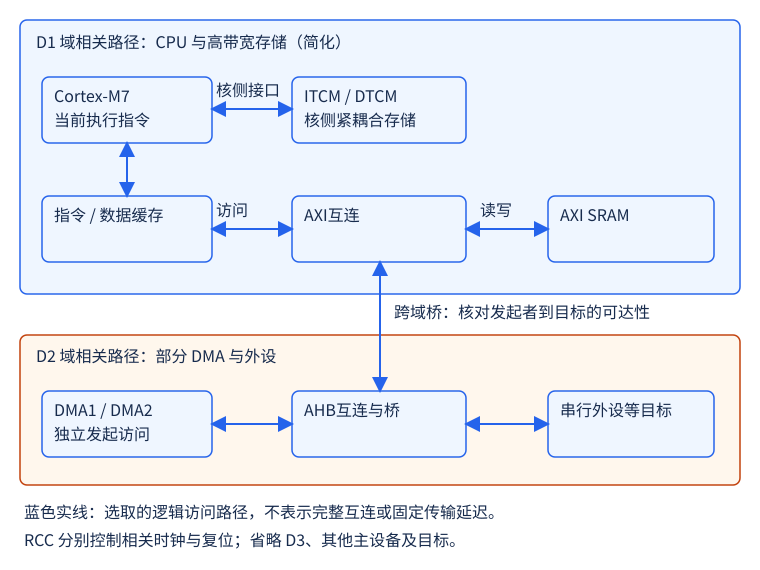

<!-- SPDX-License-Identifier: Apache-2.0 -->

# 第1章\_CPU与DMA怎样走到存储目标

> [P01 总目录](../大纲.md) / [P005 走进STM32H743芯片架构](大纲.md) / 第 1 篇（共 3 篇）

本专题把 CPU 看作能发起访问的执行者，把存储器与外设看作目标。要理解 H743，必须再加入连接二者的互连、桥和时钟域。能在地址地图上找到一块 RAM，不等于所有主设备都能以相同路径访问它。

图例：蓝色实线沿请求方向表示选取的逻辑访问路径，读取结果沿相应接口返回；D1蓝底与D2橙底表示不同域，不是完整芯片连线图。RCC配置依赖写在图下。省略 D3、其他主设备及若干存储目标，不据此推断被省略对象不存在。`TCM(Tightly Coupled Memory-紧耦合存储器)：通过核侧接口服务指令或数据。` `DMA(Direct Memory Access-直接存储器访问)：在配置后搬运数据。` `RCC(Reset and Clock Control-复位与时钟控制)：管理相关时钟与复位。` AXI、AHB 分别是 Advanced eXtensible Interface、Advanced High-performance Bus，属于互连协议。

从 CPU 访问 AXI SRAM 与从 DMA1 访问某缓冲区，是两次由不同主设备发起的事务。选择缓冲区时，要从**发起者**沿手册中的互连走向目标，不能只看 CPU 是否能读到。典型 H743 中 DMA1/2 不能像 CPU 一样直接使用 DTCM；把数组放入 DTCM 后，CPU 测试成功也不能证明 DMA 接入正确。MDMA 等其他主设备另查其路径，不把 DMA 当成一种完全相同的器件。

时钟域把频率与开关控制分开。CPU 核频率、总线频率、定时器输入和串口内核时钟并不一定相等。访问路径已经存在，却没有打开目标模块的时钟，外设也不能按预期工作。实际配置顺序应依据 RM0433 的 System architecture、Memory map 与 RCC 部分，而非在所有计算里直接代入 CPU 频率。

## 1.1\_同一根引脚为什么还需要时钟和复用选择

在板上看到一根引脚，不意味着 CPU 写一个串口寄存器就会从它发送数据。引脚单元可以连接不同内部功能，复用选择负责把指定外设的输入输出接到这个引脚。外设时钟则决定内部状态机能否推进，二者分别解决“连到哪里”与“是否工作”。

以一个串行发送输出为例，先从数据手册确认当前封装是否引出目标引脚，以及该引脚允许哪种复用功能。再从参考手册确认 GPIO 模式、复用选择和输出电气配置，随后配置串行控制器所需的内核时钟、波特率与发送使能。最终还要核对板上的连接是否真正通向接收器。型号、封装、芯片内部连接和板级连线在这里逐层交接。

如果寄存器显示数据已经提交而引脚没有变化，沿路径依次排查：控制器是否完成初始化、其时钟是否存在、复用是否选中、引脚是否由另一功能占用、输出是否接到正在测量的管脚。不能只因为“都叫TX”就认为芯片符号、板上丝印和接收器端口对应正确。

本专题的芯片结构图是查路径的入口。完整地址和功能选择仍要按 H743 的具体封装与修订核对；换到另一个 STM32，CPU 指令模型可能相近，复用表和时钟树却必须重新检查。

---

[← 小端解析与协议布局推演](../P004_addressing/P004_小端解析与协议布局推演.md) · [本专题目录](大纲.md) · [H743系统域存储地图与时钟树 →](P002_H743系统域存储地图与时钟树.md)
