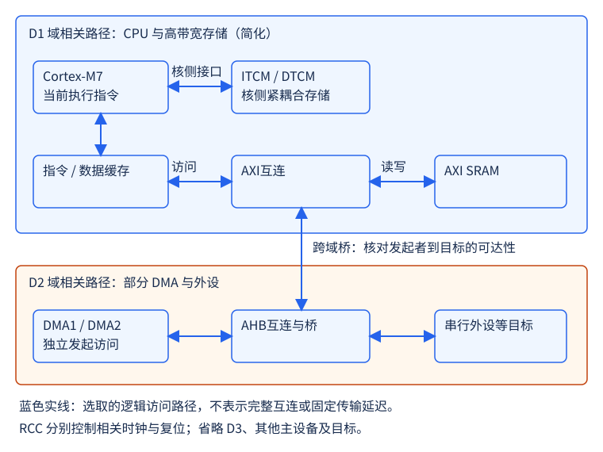

<!-- SPDX-License-Identifier: Apache-2.0 -->

# 第1章\_从CPU请求走到芯片中的目标模块

本专题把 CPU 看作能发起访问的执行者，把存储器与外设看作目标。要理解 H743，必须再加入连接二者的互连、桥和时钟域。能在地址地图上找到一块 RAM，不等于所有主设备都能以相同路径访问它。

图例：蓝色实线沿请求方向表示选取的逻辑访问路径，读取结果沿相应接口返回；D1蓝底与D2橙底表示不同域，不是完整芯片连线图。RCC配置依赖写在图下。省略 D3、其他主设备及若干存储目标，不据此推断被省略对象不存在。`TCM(Tightly Coupled Memory-紧耦合存储器)：通过核侧接口服务指令或数据。` `DMA(Direct Memory Access-直接存储器访问)：在配置后搬运数据。` `RCC(Reset and Clock Control-复位与时钟控制)：管理相关时钟与复位。` AXI、AHB 分别是 Advanced eXtensible Interface、Advanced High-performance Bus，属于互连协议。

从 CPU 访问 AXI SRAM 与从 DMA1 访问某缓冲区，是两次由不同主设备发起的事务。选择缓冲区时，要从**发起者**沿手册中的互连走向目标，不能只看 CPU 是否能读到。典型 H743 中 DMA1/2 不能像 CPU 一样直接使用 DTCM；把数组放入 DTCM 后，CPU 测试成功也不能证明 DMA 接入正确。MDMA 等其他主设备另查其路径，不把 DMA 当成一种完全相同的器件。

时钟域把频率与开关控制分开。CPU 核频率、总线频率、定时器输入和串口内核时钟并不一定相等。访问路径已经存在，却没有打开目标模块的时钟，外设也不能按预期工作。实际配置顺序应依据 RM0433 的 System architecture、Memory map 与 RCC 部分，而非在所有计算里直接代入 CPU 频率。

继续：[原理与实现](P002_原理与实现.md)。返回：[专题大纲](大纲.md)。
