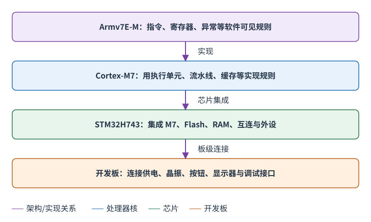
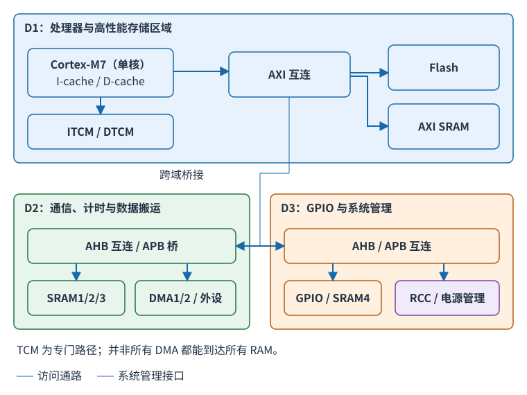

<!-- SPDX-License-Identifier: Apache-2.0 -->

# 第2章\_走进STM32H743芯片架构

前四章建立了 CPU、存储、I/O 和地址访问模型。现在把这些角色放到一颗实际芯片中。我们关心的不是把产品框图背下来，而是能够回答：一条指令从哪里取，变量放在哪里，按钮状态通过什么路径到 CPU，为什么有些操作需要等待。

本专题选 STM32H743 作为贯穿实例。涉及容量时以具有 2 MiB Flash 的 **STM32H743xI** 型号分支为例；封装、引脚数量和芯片修订仍需根据实物核对。H743 是单 Cortex-M7 核产品，不能把其他 H7 型号的双核配置直接套过来。

## 2.1\_先把指令架构、处理器核和芯片分开

先沿图从上往下看：每一层保留上一层的能力，并补上新的实现或连接条件。

图例：**紫色是架构规则，蓝色是处理器核，绿色是集成后的芯片，橙色是板级连接；箭头表示实现与集成关系，不是运行时的数据流。**

名称注释：`ISA（Instruction Set Architecture－指令集架构）：约定程序可见的指令和状态。` `MCU（Microcontroller Unit－微控制器）：集成处理器、存储和外设的芯片。` Cortex-M7、STM32H743 是产品名称，分别落在图中的核与芯片两层。

CPU 能执行哪些指令、寄存器怎样被程序观察、异常遵守什么规则，由**指令集架构（Instruction Set Architecture，ISA）** 规定。架构是一组软件与硬件之间的约定；一个具体处理器核用电路实现这些约定，并选择流水线、缓存接口等实现方式。

Arm 是架构与处理器 IP 的提供方；**Cortex-M7** 是处理器核名称，实现 Armv7E-M 架构；**STM32H743** 是 ST 将该处理器核与存储器、外设、互连等集成后的 MCU 型号。开发板再在芯片周围加上供电、时钟、连接器和外部器件。

这里的 **IP（Intellectual Property－知识产权模块）** 指可集成的硬件设计，而不是网络地址。框图中还会遇到两个新对象：**NVIC（Nested Vectored Interrupt Controller－嵌套向量中断控制器）** 管理中断请求与优先级，**DMA（Direct Memory Access－直接存储器访问）** 控制器按配置搬运数据。现在先把它们分别看成“通知仲裁者”和“数据搬运者”，后面的章节再逐步展开机制。

| 名称 | 身份 | 本专题怎样观察它 |
| --- | --- | --- |
| Armv7E-M | 架构规则 | Thumb 指令、寄存器、异常规则 |
| Cortex-M7 | 实现架构的处理器核 | 流水线、核心接口、缓存、NVIC |
| STM32H743 | 集成处理器与外设的 MCU | 地址地图、GPIO、时钟树、DMA 路径 |
| 某块 H743 开发板 | 具有具体连线的电路板 | 引脚对应按钮、LED、晶振和探针 |

换一颗同为 Cortex-M7 的 MCU，许多核心指令和异常规则仍然适用，但 GPIO 地址和外设时钟配置可能不同。换同型号芯片的另一块板，寄存器地址不变，灯连接的引脚却可能改变。这两个迁移场景说明了分层的实际价值。

## 2.2\_把芯片看成若干能协作的硬件区域

H743 内部不只有一条供所有部件排队使用的简单导线。它有不同的互连和时钟/电源域。**域（Domain）** 在这里表示芯片设计中划分出的管理区域，不表示独立 CPU。域可以具有自己的时钟和电源管理关系，跨域访问需要经过相应连接。

图例：**蓝色实线表示访问通路，紫色框标出 RCC 等系统管理接口；不同浅底色用于区分 D1、D2、D3 的归属**。图为依据 RM0433 的教学整理，省略了时钟分发线及未参与当前讲解的外设和接口，不表示芯片物理版图。共用的跨域连线只概括可达关系，不表示真实芯片仅有一条桥。

名称注释：`AXI（Advanced eXtensible Interface－高级可扩展接口）：用于高性能互连的总线协议。` `AHB（Advanced High-performance Bus－高级高性能总线）：连接处理器、存储器和外设等对象。` `APB（Advanced Peripheral Bus－高级外设总线）：为较简单的寄存器接口提供访问协议。` `RCC（Reset and Clock Control－复位与时钟控制）：配置芯片时钟源、分频与外设时钟使能。` `I-cache / D-cache（Instruction Cache / Data Cache－指令缓存/数据缓存）：保存近期使用内容的副本，减少处理器等待。` 图中的 DMA1/2 是两个 DMA 控制器实例；SRAM1/2/3/4 是不同存储块的芯片命名，并非容量倍数。

先看 D1：Cortex-M7、AXI SRAM、Flash 接口等参与程序执行和较高带宽访问。D2 中有 SRAM1/2/3、DMA1/2 和多种通信、定时外设。D3 中有 SRAM4、GPIO 所在的 AHB4 区域，以及复位、时钟和电源管理相关部件。三个域之间有桥接路径，所以“在不同域”并不意味着彼此无法通信。

再看 CPU 旁的两块紧耦合存储。**紧耦合存储器（Tightly Coupled Memory，TCM）** 通过专门接口接近处理器，适合对访问延迟有要求的代码和数据。ITCM 中的 I 指 Instruction，DTCM 中的 D 指 Data；它们与普通 AXI SRAM 的路径不同。这种路径差别也意味着其他总线主设备不一定能像 CPU 一样访问它们，后面 DMA 章会沿实际访问能力重新检查缓冲区位置。

**官方对照：** [RM0433](https://www.st.com/resource/en/reference_manual/dm00314099.pdf)，本章按 **Rev 7，2.1 System architecture、Figure 1** 核对结构，按 **2.4 Embedded SRAM** 核对存储划分。官网可能提供更新修订，查阅时用章节标题定位；不要把其他 H7 子系列的框图直接替换到 H743。

## 2.3\_把程序中的地址落到实际存储器

以下是后续例子会用到的区域，容量按 H743xI 分支整理，区间末端均包含在内。KiB 表示 1024 字节，MiB 表示 1024 KiB。

| 区域 | 起始地址 | 容量 | 末地址 | 当前用途 |
| --- | --- | --- | --- | --- |
| ITCM RAM | `0x00000000` | 64 KiB | `0x0000FFFF` | 适合低延迟取指的可用 RAM |
| 用户 Flash | `0x08000000` | 2 MiB | `0x081FFFFF` | 保存固件、向量表和常量 |
| DTCM RAM | `0x20000000` | 128 KiB | `0x2001FFFF` | CPU 数据和栈的可选位置 |
| AXI SRAM | `0x24000000` | 512 KiB | `0x2407FFFF` | D1 中的较大工作缓冲区 |
| SRAM1 | `0x30000000` | 128 KiB | `0x3001FFFF` | D2 中的数据区 |
| SRAM2 | `0x30020000` | 128 KiB | `0x3003FFFF` | D2 中的数据区 |
| SRAM3 | `0x30040000` | 32 KiB | `0x30047FFF` | D2 中的数据区 |
| SRAM4 | `0x38000000` | 64 KiB | `0x3800FFFF` | D3 中的数据区 |
| Backup SRAM | `0x38800000` | 4 KiB | `0x38800FFF` | 需按备份供电条件使用的保存区 |

**地址表不能只看总容量。** 假设一个 200 KiB 数组被放进 DTCM，即使芯片其他 RAM 还有空间，这一块 128 KiB 区域仍然装不下。编译器负责生成访问，链接器负责把程序段和对象放进指定区域；“芯片共有多少 RAM”不能替代链接布局。

用第一行检查区间计算：64 KiB=`0x10000` 字节，从 0 开始占据到 `0xFFFF`，因为首地址本身也占一个字节。很多内存越界错误来自把“长度”和“最后一个合法偏移”混为一谈。

官方对照：RM0433 Rev 7 **2.3.2 Memory map and register boundary addresses、2.4 Embedded SRAM**；产品容量与型号分支见 [DS12110 Rev 11，Features 与 Ordering information](https://www.st.com/resource/en/datasheet/stm32h743zi.pdf)。本表仅摘取本教程需要的区域，没有列出外部存储器窗口、全部外设或全部别名。

## 2.4\_时钟树为什么不是一个频率数

CPU 执行、总线访问、定时器计数和串口采样并不总需要相同频率。RCC 可以选择时钟源，经倍频、分频和选择后，把不同频率送到不同区域或外设。**锁相环（Phase-Locked Loop，PLL）** 是产生相关时钟的电路；其输入条件、倍频系数和输出范围必须符合芯片要求。

H743 的内部高速振荡器 **HSI（High-Speed Internal oscillator－内部高速振荡器）** 提供一个可用时钟来源；外部高速时钟路径称为 **HSE（High-Speed External oscillator－外部高速振荡器）**。外部路径究竟连接晶体还是外部时钟信号，要看板级电路与配置，不能看到 HSE 就统一写成某个晶振频率。

产品页面上的最高 CPU 频率是能力上限条件，**不是复位后已经配置好的工作频率**。要升频，还要核对器件修订、供电范围、电压档位、Flash 等待周期、总线分频及勘误。本专题的最小启动例子保留复位时钟环境，不用一串尚未解释的 PLL 设置来掩盖启动流程。

一个外设常有两个有关的时钟问题：寄存器接口是否得到时钟，内部功能使用哪个时钟源。使能访问并不自动保证串口的通信速率正确；CPU 主频也不能直接代入所有定时器计算。后一专题先解决 GPIO 寄存器接口的时钟门控，之后再研究功能时序。

## 2.5\_看手册时怎样选择证据

先认识引脚命名：GPIOB 表示 B 端口，PB0 表示该端口编号 0 的引脚；GPIOC 是 C 端口，PC7 则是 C 端口编号 7 的引脚。**这个逻辑编号不同于芯片封装上的物理脚号**，两者需查引脚表对应。

查“PB0 在某个封装对应哪只脚、能承受什么电气条件”，看数据手册和板原理图；查“GPIO 模式位、RCC 使能位怎样写”，看参考手册；查“加载指令、异常入栈和核心寄存器怎样工作”，看处理器编程手册；查“这批芯片有哪些已知硬件限制”，看勘误表。

这几类资料回答不同问题。参考手册可能覆盖多个型号，数据手册可能覆盖多个容量和封装，勘误又可能按硅片修订区分。一次正确配置需要把这些身份对齐，不是找到一个名称相似的例程就结束。

练习：把灯从 PB0 改接到另一颗 H743 的 PC7，只修改 C 变量名称是否足够？解答：需要核对 GPIOC 的时钟使能、端口基址、引脚对应的模式位、输出置位/复位位以及板级有效电平。处理器指令集没有变化，但程序访问目标和电路连接都变了。

在开始写外设程序前，还要把本章的 RAM、Flash 与程序中的对象对应起来：哪些区域放代码，哪些保存变量，栈和堆由谁管理。后一专题先完成这层软件布局，再解释 CPU 怎样找到复位与中断入口。

阅读导航：[前一专题](../P004_addressing/P002_原理与实现.md) · [专题大纲](../大纲.md) · [后一专题：程序内存与栈堆](../P006_memory_lifetime/P002_原理与实现.md)

专题内阅读：[关系与模型](P001_关系与模型.md) → 本篇原理与实现 → [案例与推演](P003_案例与推演.md)。返回：[本专题大纲](大纲.md)。
