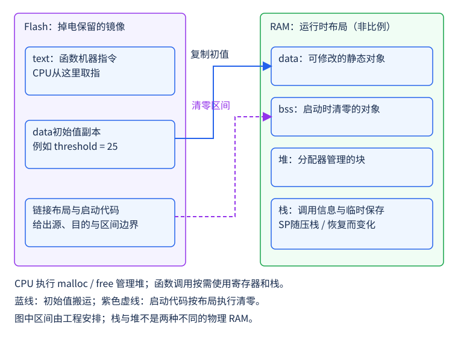

<!-- SPDX-License-Identifier: Apache-2.0 -->

# 第1章\_对象寿命如何落到段、栈和堆

本专题只要求知道函数可以调用函数、变量需要存储。先把两个问题分开：对象在程序语义中活多久，以及这些字节被链接器或分配器放到哪里。栈与堆都是 RAM 的组织方式，不是芯片中天然分开的两种存储器。

图例：箭头描述分配、初始化或执行关系，不表示这些动作同时发生。`SP(Stack Pointer-栈指针)：指示当前栈位置。` `.data`、`.bss` 是常见段名；对象最终位置须以该工程的链接结果为准。

静态对象的存储期贯穿程序运行；局部自动对象通常只在其作用域执行期间有效，可能在寄存器中，可能需要栈空间，也可能被优化消除。不能根据“它写在函数里”就断言一定能在 RAM 某地址找到它。动态对象的寿命由分配和释放控制，往往跨越函数返回，所以需要明确由谁释放。

**返回地址与局部数据必须一起遵守栈纪律。** 函数返回时通常只恢复栈位置，并不把刚才使用的每个字节擦除。调试器还能看到旧数值，不代表那个对象还活着。同样，free 之后看到原数据也不代表仍拥有该块；下一次分配可能把它交给其他用途。

嵌套调用深度、中断帧与局部大数组共同决定栈需求。堆则可能出现总空闲量足够、但没有足够大的连续空闲块。两种问题不能都归为“RAM 不够”：前者看最坏嵌套占用，后者看块分布与分配策略。

继续：[原理与实现](P002_原理与实现.md)。返回：[专题大纲](大纲.md)。
