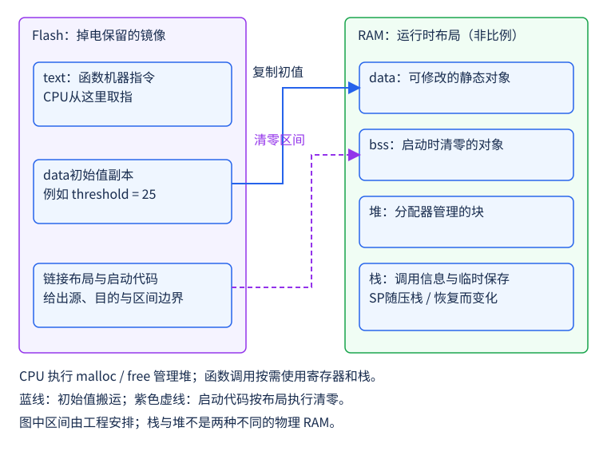

<!-- SPDX-License-Identifier: Apache-2.0 -->

# 第1章\_对象寿命怎样落到RAM布局

> [P01 总目录](../大纲.md) / [P006 程序内存布局与栈堆](大纲.md) / 第 1 篇（共 3 篇）

本专题只要求知道函数可以调用函数、变量需要存储。先把两个问题分开：对象在程序语义中活多久，以及这些字节被链接器或分配器放到哪里。栈与堆都是 RAM 的组织方式，不是芯片中天然分开的两种存储器。

图例：箭头描述分配、初始化或执行关系，不表示这些动作同时发生。`SP(Stack Pointer-栈指针)：指示当前栈位置。` `.data`、`.bss` 是常见段名；对象最终位置须以该工程的链接结果为准。

静态对象的存储期贯穿程序运行；局部自动对象通常只在其作用域执行期间有效，可能在寄存器中，可能需要栈空间，也可能被优化消除。不能根据“它写在函数里”就断言一定能在 RAM 某地址找到它。动态对象的寿命由分配和释放控制，往往跨越函数返回，所以需要明确由谁释放。

**返回地址与局部数据必须一起遵守栈纪律。** 函数返回时通常只恢复栈位置，并不把刚才使用的每个字节擦除。调试器还能看到旧数值，不代表那个对象还活着。同样，free 之后看到原数据也不代表仍拥有该块；下一次分配可能把它交给其他用途。

嵌套调用深度、中断帧与局部大数组共同决定栈需求。堆则可能出现总空闲量足够、但没有足够大的连续空闲块。两种问题不能都归为“RAM 不够”：前者看最坏嵌套占用，后者看块分布与分配策略。

## 1.1\_栈空间怎样随一次真实调用增加再回收

先忽略中断，设调用者开始时 SP=`0x20001000`。被调用函数保存两个32位寄存器，需要8字节，SP下降到 `0x20000FF8`；随后为局部数组预留16字节，下降到 `0x20000FE8`。这两次调整虽然都移动 SP，保存的内容却不同：前者服务于返回后恢复寄存器，后者服务于当前函数的局部数据。

函数结束时必须反向归还局部空间，再恢复保存的寄存器。如果先把 SP 一次加回最初位置，却仍从新 SP 执行恢复，就会读取错误位置。栈纪律不是“最终加减总量一样就行”，而是每次访问都必须对应当前正确的帧布局。

若函数内部又调用下一层，下一层继续在当前 SP 以下使用空间。最大占用取决于同一时刻仍未返回的整条调用链，而不是所有函数栈大小的简单总和。中断可以在深层调用期间进入，所以最坏栈需求还要叠加允许的异常嵌套和处理函数自身开销。

工程中可以先用编译器提供的栈使用报告与调用关系估算，再用适当的运行观测补充；递归、间接调用和数据相关路径会使静态估计更困难。观测到某次运行没越界，只能证明那次覆盖到的路径，不能替代最坏条件分析。

---

[← 缓冲位置与芯片迁移查证](../P005_stm32h743_system/P003_缓冲位置与芯片迁移查证.md) · [本专题目录](大纲.md) · [程序段调用栈与动态分配 →](P002_程序段调用栈与动态分配.md)
