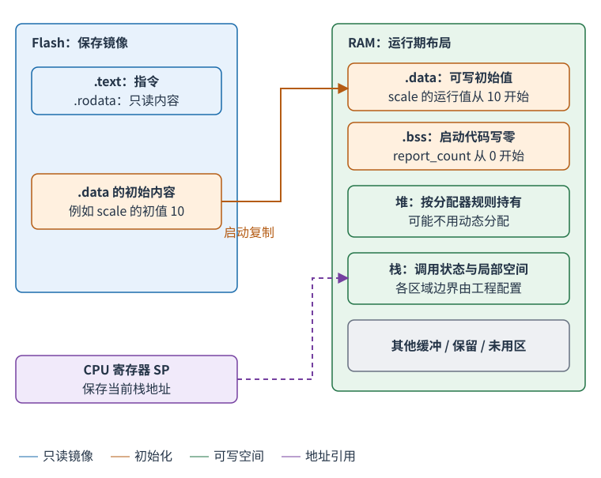
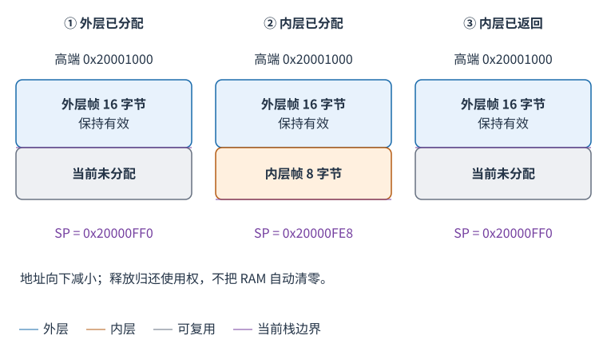
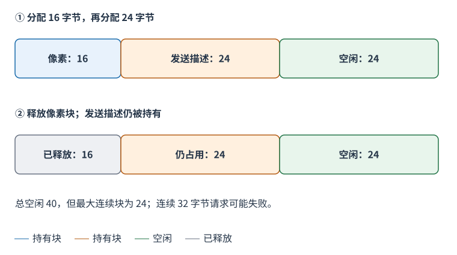

<!-- SPDX-License-Identifier: Apache-2.0 -->

# 第2章\_程序段调用栈与动态分配

> [P01 总目录](../大纲.md) / [P006 程序内存布局与栈堆](大纲.md) / 第 2 篇（共 3 篇）

本篇路线：

- [2.1_从一段 C 程序区分对象的寿命](#section-1)
- [2.2_把芯片存储地图和软件布局叠起来](#section-2)
- [2.3_栈怎样保存还没有完成的调用](#section-3)
- [2.4_堆为什么需要另一套管理规则](#section-4)
- [2.5_在真实 H743 工程里找栈和堆的依据](#section-5)


第5专题回答了 H743 有哪些存储器。现在换一个问题：程序中的函数、全局计数、局部变量和动态缓冲区，分别怎样占用这些空间？如果把“栈、堆、寄存器、RAM”并排当作四种芯片器件，后面的函数调用和启动过程就会失去落点。

先固定层次：寄存器是 CPU 内部的硬件状态位置；SRAM 是芯片提供的存储资源；栈与堆是软件组织可写存储空间的方式。它们可以使用同一种 SRAM，但管理规则不同。

<a id="6.1_从一段-c-程序区分对象的寿命"></a>

<a id="section-1"></a>

## 2.1\_从一段 C 程序区分对象的寿命

下面在 H743 的存储资源上画一份教学布局。这里只表示分配关系，具体区间大小由工程确定；图中的堆与栈采用分区方案，不假定它们可以无限向对方增长。



图例：**蓝色是代码和只读内容，橙色是需要初始化的可写数据，绿色是运行期可写空间，紫色虚线表示 CPU 寄存器保存的地址引用**。堆与栈的边界属于软件配置，不能从芯片总 RAM 容量自动推出来。

名称注释：`Stack（栈）：按后进先出方式保存调用状态与临时空间。` `Heap（堆）：由分配器管理、按请求分配和释放的存储区域。` `SP（Stack Pointer－栈指针）：指向当前栈位置，寄存器本身不装下整块栈。`

面板每收到一份测量结果就更新显示。下面是只用于观察对象身份的完整小例子；现在不需要运行它。

```c
#include <stdint.h>

uint32_t report_count;
uint32_t scale = 10u;
const uint32_t screen_width = 320u;

uint32_t convert_sample(uint32_t raw)
{
    uint32_t converted = raw * scale;
    report_count++;
    return converted;
}
```

`report_count` 与 `scale` 从程序开始到结束一直存在，具有静态存储期；`converted` 是一次函数调用中的自动对象，离开这次调用后不再保有该对象的有效生命周期。`screen_width` 不能通过普通赋值修改，通常适合放入只读区。函数 `convert_sample` 本身则是一段指令。

| 对象 | 典型链接组织 | 运行时在哪观察 |
| --- | --- | --- |
| 函数指令 | `.text` 代码段 | 通常从 Flash 取指，也可按工程设计放到 RAM |
| 保留下来的只读常量 | `.rodata` 只读数据段 | 常见于 Flash；优化也可能直接把数值编码进指令 |
| `scale=10` | `.data` 已初始化可写数据段 | RAM 中可修改，Flash 镜像另有初值 |
| `report_count` | `.bss` 零初始化数据段 | 启动时建立零值，随后在 RAM 中累计 |
| `raw`、`converted` | 寄存器或调用栈，取决于编译结果 | 不保证每个 C 局部变量都有固定 RAM 地址 |

**段（Section）** 是工具把具有相近用途的代码或数据组织起来的单位；`.text` 等是常见段名，不是另一种硬件。最终哪些地址分给它们，由链接布局决定。若某个对象根本没有被使用，优化还可能移除它，不能仅凭源码声明推断镜像里一定有同名空间。

<a id="6.2_把芯片存储地图和软件布局叠起来"></a>

<a id="section-2"></a>

## 2.2\_把芯片存储地图和软件布局叠起来

对照上一节的布局图，逐项找到代码、初值和运行时对象。

先看图左边的 Flash：它保存代码以及 `.data` 的初始内容。再看右边的 RAM：程序操作的是这里的可写对象。初始值“存在哪里”和变量“运行时在哪里”可以不同，所以启动代码需要复制；`.bss` 则需要清零。这一因果关系将在启动实验中落实到两个地址，而不把复制隐藏在“C 程序自然能运行”这句话里。

H743 有多块 RAM，栈可以放在 DTCM，另一个缓冲池可以放在 AXI SRAM。是否能这样放取决于访问者和工程约束。DMA 是否能到达某块 RAM，是另一项硬件能力；一个对象被叫作“堆内存”并不会自动赋予 DMA 可达性。

<a id="6.3_栈怎样保存还没有完成的调用"></a>

<a id="section-3"></a>

## 2.3\_栈怎样保存还没有完成的调用

假设显示更新函数调用数值格式化函数，内层返回后，外层仍要继续发送画面。外层尚未用完的数据和返回位置必须保留，不能被内层临时计算覆盖。

**栈帧（Stack Frame）** 是一次调用所使用的栈空间。Cortex-M 常用向低地址增长的栈：保存时降低 SP，恢复时提高 SP。下面假设外层需要 16 字节、内层需要 8 字节；这些大小是用于手算的布局，不是由函数名推导出的固定大小。



图例：**蓝色是外层仍然有效的帧，橙色是内层新增的帧，灰色是当前未分配的空间，紫线标出 SP 的位置**。三幅图是同一块 RAM 随调用变化，地址越往下越低。

名称注释：`Frame（帧）：一次调用需要保留的一组栈内状态。` `Allocate / release（分配/释放）：改变哪些地址可由当前调用使用，并不意味着创建或销毁 SRAM 硬件。`

| 动作 | SP | 当前应保留的空间 |
| --- | --- | --- |
| 尚未分配外层帧 | `0x20001000` | 此例的新帧还不存在 |
| 外层分配 16 字节 | `0x20000FF0` | `[0x20000FF0, 0x20001000)` |
| 内层再分配 8 字节 | `0x20000FE8` | 内层位于 `[0x20000FE8, 0x20000FF0)`，外层仍保留 |
| 内层返回 | `0x20000FF0` | 内层区域可复用，外层继续存在 |
| 外层返回 | `0x20001000` | 两层空间都归还 |

方括号含起点、圆括号不含终点，所以第一个区间确实长 16 字节。**释放后 RAM 里的位可能没变，但那已经不是一个仍存活的内层对象。** 返回局部数组地址之后“偶尔还能读到原值”，不构成对象仍然有效的证据；下一次调用可能立刻覆盖它。

编译器通常通过调整 SP、保存寄存器和普通加载/存储来组织这些空间。它也可以把局部量一直放在寄存器里，使一个简单函数不需要栈帧。因此“局部变量通常讨论栈”与“每个局部变量必定写入栈”是两种不同说法。

<a id="6.4_堆为什么需要另一套管理规则"></a>

<a id="section-4"></a>

## 2.4\_堆为什么需要另一套管理规则

显示接口需要一块长度由画面决定的临时缓冲区，而且缓冲区可能跨越创建它的函数返回。只靠该函数的自动局部数组就不够：函数返回会结束它的生命周期。可以使用预先分配的全局缓冲池，也可以向动态分配器请求空间。

配套的 [heap_example.c](../labs/heap_example.c) 把申请、使用和释放写在一个函数中。沿成功和失败两个返回路径读一遍，检查每条路径是否还有一块需要归还的内存。

**分配器（Allocator）** 维护可用块和已分配块等管理信息。`malloc(n)` 请求至少可供使用的 n 字节，成功时返回地址，失败时返回空指针；`free(p)` 按对应分配器规则归还这块空间。CPU 仍用普通存储指令访问数据，并没有一条“访问堆”的特殊指令。



图例：**蓝色和橙色是仍被持有的块，绿色是可分配空间，灰色标出被释放而可复用的块**。图中只按请求空间举例，省略分配器管理头与对齐开销；地址从左向右增加。

名称注释：`Fragmentation（碎片化）：可用空间被分割，使某些较大连续请求无法满足。` `Ownership（所有权）：当前由谁负责使用并最终归还对象的约定。`

手算一块 64 字节的简化堆：先请求 16 字节给像素缓冲，再请求 24 字节给发送描述，剩 24 字节。释放前面的 16 字节后，总空闲为 40 字节，但被中间仍占用的块隔开，最大连续块只有 24 字节；请求连续 32 字节仍可能失败。实际分配器还会有管理开销，所以不能把芯片“还有 40 字节空闲”直接当作任何 32 字节分配都能成功。

下面是带失败与释放路径的同步缓冲区示例，目的是观察生命周期；它需要 C 运行库和已配置的堆，不能直接塞进后面不链接标准库的最小固件后期待自动可用。

```c
#include <stddef.h>
#include <stdint.h>
#include <stdlib.h>

static uint32_t sum_bytes(const uint8_t *data, size_t length)
{
    uint32_t sum = 0u;
    for (size_t i = 0; i < length; ++i) {
        sum += data[i];
    }
    return sum;
}

int temporary_buffer_example(uint32_t *result)
{
    if (result == NULL) {
        return -1;
    }
    uint8_t *pixels = malloc(16u);
    if (pixels == NULL) {
        return -2;
    }
    for (size_t i = 0; i < 16u; ++i) {
        pixels[i] = (uint8_t)i;
    }
    *result = sum_bytes(pixels, 16u);
    free(pixels);
    return 0;
}
```

正常路径的结果是 `0+1+…+15=120`。局部指针变量 `pixels` 本身可能在寄存器或栈上，而它指向的 16 字节属于堆，两者不是同一个对象。`free` 后不再使用指向这块已归还内存的指针。若把同步求和换成 DMA 异步发送，启动发送就立刻 free 会破坏所有权，必须等传输完成再归还；后面的 DMA 章会展开这项交接。

<a id="6.5_在真实-h743-工程里找栈和堆的依据"></a>

<a id="section-5"></a>

## 2.5\_在真实 H743 工程里找栈和堆的依据

已核对的 MDK-ARM 工程中，`startup_stm32h743xx.s` 使用如下 Arm 汇编器声明。MDK（Microcontroller Development Kit－微控制器开发工具套件）是这份工程的工具环境；这里是来源文件的关键摘录，不是 GNU 汇编器可直接执行的语法：

```asm
Stack_Size      EQU     0x400
                AREA    STACK, NOINIT, READWRITE, ALIGN=3
Stack_Mem       SPACE   Stack_Size
__initial_sp

Heap_Size       EQU     0x200
                AREA    HEAP, NOINIT, READWRITE, ALIGN=3
__heap_base
Heap_Mem        SPACE   Heap_Size
__heap_limit
```

`EQU` 定义数值常量；`AREA` 声明一个区域；`SPACE` 保留指定字节数；标签标记当前地址。这里栈大小是 `0x400=1024` 字节，堆大小是 `0x200=512` 字节。`ALIGN=3` 的这个汇编器语法表示 `2³=8` 字节对齐，不是三字节对齐。`__initial_sp` 放在栈保留区末尾，适合向低地址增长的栈。

`STACK` 与 `HEAP` 是这份文件给区域起的名字；`READWRITE` 声明可读写属性，`NOINIT` 要求该区域不按通常的零初始化区处理。它们是工具语法和布局属性，不是运行时会被 CPU 执行的指令，也不表示 RAM 上电就有可用初值。

这些声明只保留区域和边界，**不会独自实现 malloc 算法**。运行库还需取得堆/栈范围，链接器再把区域安放到允许的 RAM。来源工程还提供 `__user_initial_stackheap` 给相应运行库配置返回堆与栈的边界；具体是否采用该分支要看库选项，不能只看到符号声明就断言所有配置都执行它。

另一个常见误解是“栈和堆必定从 RAM 两端相向增长”。有的实现这样组织，有的为它们划定独立区域，RTOS 还可能为每条线程分配独立栈。**先找分配规则，再画边界。** 本例的大小、区域和符号来自所核对的工程，不是 H743 出厂自带的“1024 字节硬件栈”。

官方机制对照：[AAPCS32，The Stack](https://github.com/ARM-software/abi-aa/blob/2025Q1/aapcs32/aapcs32.rst) 规定普通栈约束及公共接口八字节对齐。源码与工具链身份的核对方法见第8专题，最终可用[启动与镜像实验](../P015_reset_startup/P003_链接脚本启动汇编与镜像验证.md#section-3)核对变量的加载地址与运行地址。

练习：把芯片从 1 MiB RAM 换成更大容量型号，栈就会自动变大吗？解答：不会。需要检查链接布局、启动声明或 RTOS 栈配置。反过来，仅把 `Stack_Size` 改大，也不能保证链接目标 RAM 放得下或每次调用都不越界。

---

[← 对象寿命怎样落到RAM布局](P001_对象寿命怎样落到RAM布局.md) · [本专题目录](大纲.md) · [对象失效与堆碎片推演 →](P003_对象失效与堆碎片推演.md)
