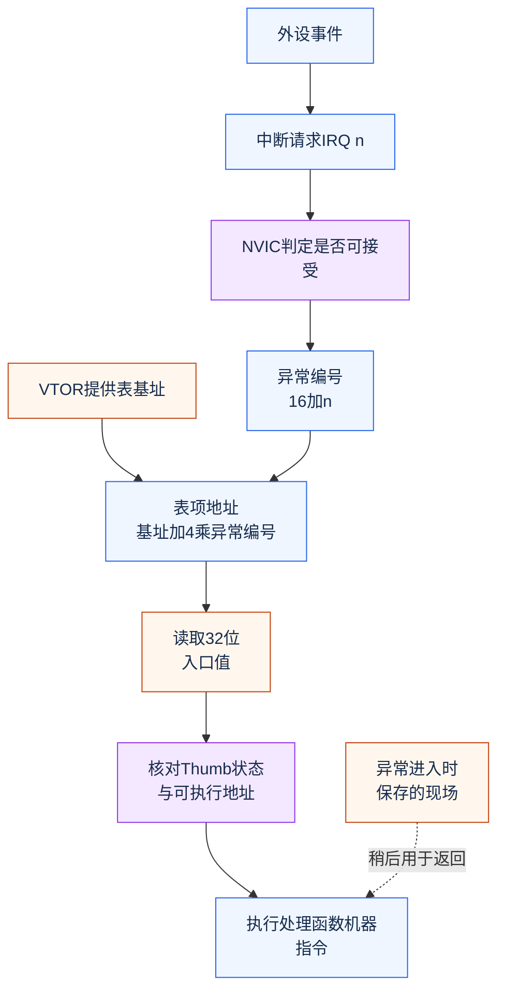

<!-- SPDX-License-Identifier: Apache-2.0 -->

# 第1章\_从IRQ号计算处理入口

> [P01 总目录](../大纲.md) / [P007 复位与中断向量表](大纲.md) / 第 1 篇（共 3 篇）

向量表是一组入口数据。先具备字节地址与四字节读取的概念，就能把“发生中断后跳到函数”拆成可计算步骤。下面使用一个普通外部 IRQ 的模型；实际 IRQ 号必须来自当前芯片的器件头与手册。

图例：**蓝色节点表示一般参与者，紫色突出处理或决策，橙色表示保存的数据或状态。** 实线是选择入口的依赖关系，虚线连接返回所需状态，图没有把向量查找与压栈画成逐周期时序。`NVIC(Nested Vectored Interrupt Controller-嵌套向量中断控制器)：管理中断挂起、优先级与接受条件。` `VTOR(Vector Table Offset Register-向量表偏移寄存器)：提供可重定位向量表的位置。`

假设 VTOR 为 `0x08000000`，IRQ 为 40，则异常编号为 56，槽位偏移为 `56×4=224=0xE0`。CPU 要读的地址是 `0x080000E0`。若其中保存 `0x08001235`，它包含 Thumb 入口状态，代码位置对应 `0x08001234`。表项地址与代码地址完全不同；把代码直接放进表项会把机器码误当作指针。

复位入口特殊：初始栈顶在第 0 项，复位处理入口在第 1 项。它不是外设 IRQ=-15 的普通处理过程，也不先替尚不存在的旧线程保存现场。建立初始栈与取复位入口，是从无当前程序现场走向执行的起点。

整表对齐也不同于每项四字节对齐。表基址需满足处理器及所用表规模的要求，不能只保证 `VTOR % 4 == 0`。重新放置向量表时，还需保证表内容完整、存储有效，并按体系结构要求完成更新与同步。

## 1.1\_一张正确的表怎样仍然跳进错误处理函数

向量槽位正确只是第一层。假设启动文件第56项引用 `EXTI15_10_IRQHandler`，应用却定义了 `EXTI15_10_IRQhandler`。C 符号区分大小写，后者是另一个名字；前者可能仍指向启动文件的弱默认实现。程序中“确实写了处理函数”与“向量表确实引用了它”因此可以同时一真一假。

查证时先从器件定义确认 IRQ 号，再计算向量索引，然后读取链接后表项的实际值；最后把入口值与最终符号地址对应。预处理宏、文件是否参加构建、强弱定义与链接垃圾回收都可能影响结果，所以最终 ELF 比编辑器里看到的文件名更接近实际执行事实。

还要区分表基址错误。即使新表中的槽位和值都正确，处理器若仍使用旧 VTOR，就不会读取新表。调试时同时观察“当前表基址”和“该基址加槽位偏移处的内容”，再谈函数是否执行。不要只打开自己以为被使用的那份数组。

---

[← 对象失效与堆碎片推演](../P006_memory_lifetime/P003_对象失效与堆碎片推演.md) · [本专题目录](大纲.md) · [向量槽位复位入口与整表对齐 →](P002_向量槽位复位入口与整表对齐.md)
