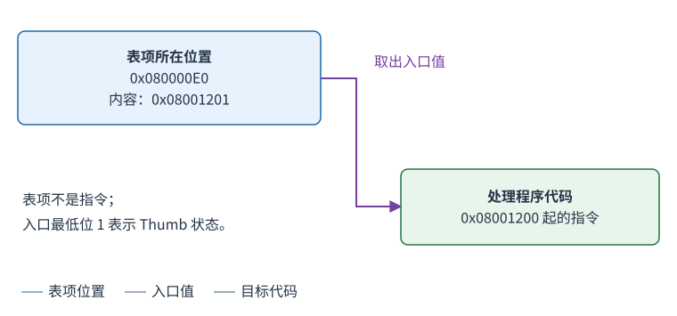
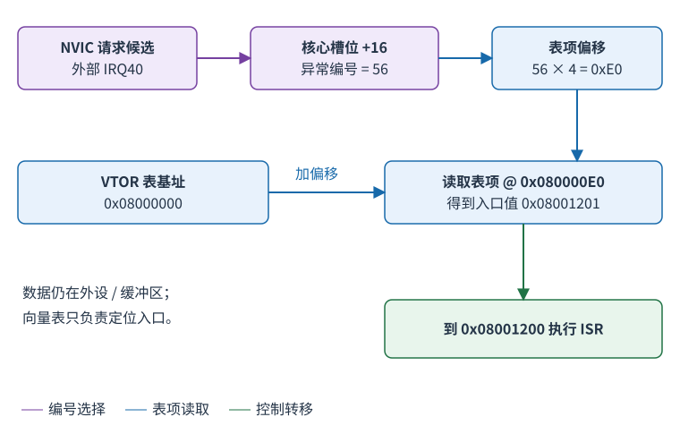
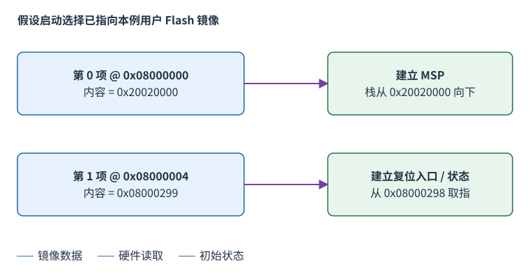

<!-- SPDX-License-Identifier: Apache-2.0 -->

# 第7章\_复位与中断向量表

CPU 已经有 PC、寄存器和可用的存储空间，但仍缺两个入口规则：刚复位时从哪里执行第一段代码？按钮提出处理请求后，从哪里找到按钮处理函数？函数名称只存在于源码和工具信息中，硬件必须得到能使用的地址。

**中断（Interrupt）** 是硬件等来源请求处理器暂时转去处理工作的机制；Cortex-M 把它与故障、系统服务等统一纳入异常机制。此处先解释“入口怎样定位”，第 11 章再展开请求允许、优先级和嵌套，第 16 章解释自动保存与返回。

## 7.1\_向量表保存的是入口信息，不是处理程序本体

**向量表（Vector Table）** 是按架构规定的编号排列的一组数据。第一项是初始栈指针值，第二项是复位入口，其余相应项是各异常的处理入口。Cortex-M7 的每项占一个 32 位字，所以相邻表项相隔四字节。



图例：**蓝色是表项所在位置，紫色是表项中保存的入口值，绿色是目标代码**。箭头表示根据入口值找到代码，不能把表项本身当作第一条处理指令。

名称注释：`Vector（异常向量）：用于定位处理入口的信息。` `Handler（处理程序）：发生相应异常时执行的代码。` `PC（Program Counter－程序计数器）：参与确定接下来执行的指令位置。`

例如一项放在 `0x080000E0`，内容为 `0x08001201`。前者是“表项在哪里”，后者是“入口是什么”。对应 Thumb 指令从 `0x08001200` 处开始，最低位的 1 表示所需的 Thumb 状态，不是要求从奇数字节地址错位解释代码。函数大小也不受四字节表项限制：表项只保存入口，函数可以有许多条指令。

如果调试器显示表项内容为 `Default_Handler` 对应的地址，说明它指向默认处理程序。CPU 不会再按 IRQ 名称去 C 文件里自动搜索另一个函数。

## 7.2\_用 IRQ40 算出按钮处理入口

H743 的 `EXTI15_10_IRQn` 是外部 IRQ 编号 40，多条外部输入线共享该入口。**IRQ（Interrupt Request－中断请求）** 的外部编号不包含最前面的核心异常槽位。外部 IRQ n 对应向量槽位 `16+n`；这里槽位编号为 56，字节偏移为 `56×4=224=0xE0`。

运行时，**VTOR（Vector Table Offset Register－向量表基址寄存器）** 提供表的基址。假设本例 VTOR=`0x08000000`，表项地址就是 `0x08000000+0xE0=0x080000E0`。这一步是地址计算，下一步才读取该表项内容作为处理入口。



图例：**紫色是中断编号与入口选择，蓝色是表项地址的计算和读取，绿色是随后执行处理程序**。NVIC 提交请求和选取候选，向量查找则提供入口；图只展开入口定位，未画自动保存现场的细节。

名称注释：`NVIC（Nested Vectored Interrupt Controller－嵌套向量中断控制器）：管理请求状态与优先级，参与异常响应。` `VTOR（Vector Table Offset Register－向量表基址寄存器）：规定运行期异常表在哪里。` `ISR（Interrupt Service Routine－中断服务程序）：CPU 响应中断后执行的代码。`

| 已知量 | 本例值 | 它不是哪一种量 |
| --- | --- | --- |
| 外部 IRQ 号 | 40 | 不是表内字节偏移 |
| 向量槽位/异常编号 | 56 | 不是函数地址 |
| 表内偏移 | `0xE0` | 不是表项保存的值 |
| 表项地址 | `0x080000E0` | 不是 ISR 第一条指令地址 |
| 表项内容 | 假设为 `0x08001201` | 不是中断接收的数据内容 |

按钮电平或 UART（Universal Asynchronous Receiver/Transmitter－通用异步收发器）的接收字节仍保存在相应外设或缓冲区中。UART 是把串行收发转换为程序可读写数据的外设，第 10 章再沿其传输过程展开。**向量表解决“去哪段代码”，不负责搬运按键/串口数据。** IRQ40 还可能代表多个共享来源，进入函数后仍要检查到底哪条线提出请求。

练习：外部 IRQ 号为 5，基址仍为 `0x08000000`，对应表项在哪里？答案是 `(16+5)×4=0x54`，表项地址 `0x08000054`。误写成 `base+5` 或 `base+5×4`，都会读错位置。

## 7.3\_复位为什么先需要栈顶，再需要代码入口

普通中断打断的是一个已经运行的程序；复位要建立最初执行状态，不能先依赖已有调用者帮它准备 SP。因此初始表的前两项具有特殊意义。



图例：**蓝色是镜像中的两个数据字，紫色是复位机制读取它们，绿色是建立后的 CPU 状态**。这里不是 CPU 先执行一条“栈顶指令”再执行“地址指令”，而是先由硬件把数据用于初始状态。

名称注释：`MSP（Main Stack Pointer－主栈指针）：处理器复位后使用的栈指针。` `Reset_Handler（复位处理函数符号）：用户启动代码的常见入口名称，具体名字由工程定义。`

假设用户 Flash 镜像前两个字分别为 `0x20020000` 和 `0x08000299`。复位机制据此建立栈顶和 Thumb 入口，随后从 `0x08000298` 的代码开始。`0x20020000` 是 DTCM 末端之后的边界，向下增长的栈在第一次保存前先降低 SP，才访问合法的内部字节。

**到哪片存储读取这两个字，由芯片的启动选择决定。** H743 的 BOOT 与启动选项可以选择用户 Flash 或系统启动程序等目标；不能把某份通用 Cortex-M 文档里的默认零地址视图，直接当成所有 H743 配置下都要把用户镜像烧录到零地址。运行期 VTOR、芯片复位选择、链接器安放的表地址，应分别核对。第 15 章再从供电复位一直跟到 `main`。

## 7.4\_表项四字节与整张表对齐是两条规则

每个表项四字节，所以第 k 项位于 `base+4k`。但整个 base 的对齐还受到 Cortex-M7 实现的向量覆盖范围约束。该核心最小对齐为 128 字节；需要更多槽位时，要按覆盖范围扩展到相应的二次幂边界，不能只把基址对齐到 4。

本专题 H743 最小固件保留 16 个核心槽位与 150 个外部槽位，共 166 项，即 664 字节。取能够覆盖它的二次幂边界为 1024 字节，因此使用 1024 字节对齐。`0x08000000` 满足这个边界；`0x08000004` 虽然是四字节对齐，却不满足这张表的基址要求。这里的 1024 不是每个处理函数需要占满的大小。

官方对照：[PM0253，2.4.4 Vector table 与 4.3 的 VTOR 条目](https://www.st.com/resource/en/programming_manual/DM00237416.pdf) 解释编号、状态位和基址约束；H743 具体启动区域见 [RM0433，Boot configuration](https://www.st.com/resource/en/reference_manual/dm00314099.pdf)。IRQ 编号要按 H743 器件头文件查，不能使用别的 Cortex-M7 芯片的列表。

## 7.5\_在启动源码里读到的是怎样一张表

所核对的 ST H743 MDK 启动文件使用 `DCD` 生成表项：

```asm
__Vectors       DCD     __initial_sp
                DCD     Reset_Handler
                DCD     NMI_Handler
                DCD     HardFault_Handler
```

这是开头四项的摘录，**后面还有其他槽位，不能将这四行单独当作完整向量表使用**。DCD（此 Arm 汇编器的 32 位数据定义指示语句）在这里生成一个四字节值；它不是 CPU 执行的跳转指令。GNU 汇编中本教程用 `.word` 承担相应数据定义，不能只改文件后缀就混用两套语法。

`__initial_sp` 由栈区域末尾标签提供，处理函数符号由汇编器和链接器解析为最终入口值。若 C 中提供了合法的强定义处理函数，它可以覆盖模板中的弱默认符号；如果符号名称或链接关系不匹配，表项仍可能留在默认处理函数。保留槽位也占位置，删除它们会使后面的 IRQ 全部错位。

现在可以解释两个不同故障：栈顶错误会让后续保存现场或函数调用访问不合法位置；处理入口错误则会让控制流转去错误代码。两者都可能表现为“启动后停住”，但需要检查的表项和状态完全不同。

阅读导航：[上一章](P006_程序内存布局与栈堆.md) · [专题大纲](大纲.md) · [下一章：源码到镜像](P008_从C源码到芯片镜像.md)
