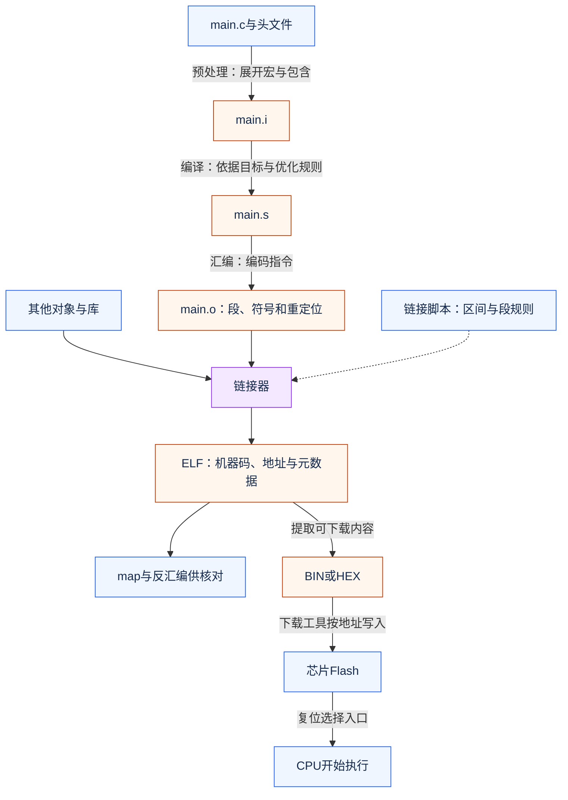

<!-- SPDX-License-Identifier: Apache-2.0 -->

# 第1章\_编译器、链接器和下载工具怎样分工

有 C 经验的读者往往习惯按一次“运行”。在 MCU 上，这个按钮至少隐藏了翻译源码、解决跨文件引用、安排地址和把字节写入芯片几个不同问题。本专题把源文件与产物分别画出，先不依赖某种 IDE。

图例：**蓝色节点表示一般参与者，紫色突出处理或决策，橙色表示保存的数据或状态。** 实线表示输入产物或执行关系，虚线表示布局规则。`ELF(Executable and Linkable Format-可执行与可链接格式)：同时容纳代码、段与符号等信息。` BIN 通常只有原始字节，HEX 带地址记录；二者不能无条件互换下载方式。

对象文件中的调用可能还没有最终目标地址。编译器只需确认可用的函数声明，汇编器留下待修正的位置，链接器看到定义后才完成地址关联。于是“编译通过，链接报 undefined reference”是合理现象：语言层声明成立，最终定义却没有进入链接输入。

目标选择包含指令集、CPU 能力、浮点指令与调用约定。电脑上运行的编译器可以生成 MCU 指令；电脑能运行该编译器，不意味着生成物能在电脑执行。反过来，主机编译器成功处理相同 C 文件，也不能证明所得程序适用于 Cortex-M7。

**链接完成不等于芯片已经运行。** 链接脚本可能把段放到不适合当前芯片的地址；下载工具可能使用错误起始地址；启动配置也可能选择另一映像。必须逐层检查 ELF 的段与入口、下载范围和实际复位入口，而不是把所有问题都归为 C 代码错误。

继续：[原理与实现](P002_原理与实现.md)。返回：[专题大纲](大纲.md)。
