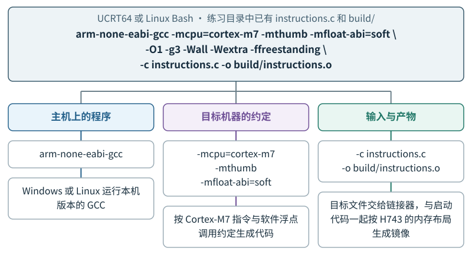
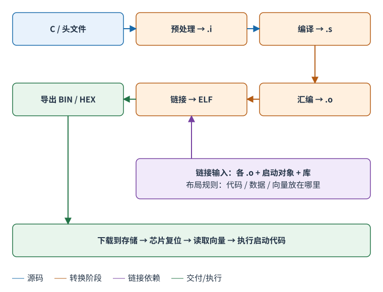
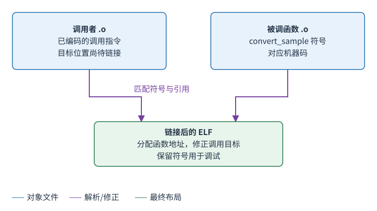

<!-- SPDX-License-Identifier: Apache-2.0 -->

# 第2章\_从C源码到芯片镜像

前面已经会读几条 Arm 指令，知道向量表保存入口地址，也知道程序段要被安排到实际存储器。现在把这些对象连起来：一份 C 文件是怎样变成 Flash 里的字节？为什么电脑上编译成功的可执行文件，不能直接复制给 H743 运行？

本章先阅读过程和已有产物，不要求提前安装软件。第12专题准备工具后，会用本章同一份访问宽度示例生成每个阶段的文件。这样读者先知道正在准备什么，再执行命令。

<a id="8.1_编译器在哪里运行与生成什么代码是两个问题"></a>

## 2.1\_编译器在哪里运行与生成什么代码是两个问题

先看图中的主机与目标两端：电脑运行构建工具，H743 执行生成的固件，两者需要分别匹配。



图例：**蓝色是运行工具的主机，橙色是构建输入与目标选项，绿色是生成物及其运行目标，紫线是交付方向。**

名称注释：`Host（主机）：运行编译工具的环境。` `Target（目标）：最终执行生成代码的环境。` `ABI（Application Binary Interface－应用二进制接口）：规定参数、返回值和对象之间怎样以二进制协作。`

**主机（Host）** 是运行编译工具的电脑环境，**目标（Target）** 是生成代码以后要运行的处理器及软件环境。Windows x64 上运行的编译器，既可以生成 Windows x64 程序，也可以作为交叉编译器生成 Arm Cortex-M 固件；选择由工具和参数决定。

对 H743，本例需要能生成 Cortex-M7 所支持 Thumb 指令的工具，遵守所选 Arm 调用约定，并配套嵌入式启动和链接环境。一个能编译 C 语法的桌面 x86 编译器，并不因此知道 H743 的 GPIO 地址、复位向量或 Flash 布局。

| 需要匹配的条件 | 不匹配会怎样 |
| --- | --- |
| 主机格式与依赖 | 工具程序在电脑上不能启动 |
| 目标指令集与 CPU 特性 | 固件包含芯片不能解释的机器指令 |
| 调用约定与浮点 ABI | 调用者、被调函数或库对参数位置的理解不同 |
| 链接区域与芯片地址 | 函数、数据或向量落到错误地址或越界 |
| 启动代码与运行库 | 初值、栈、库状态或应用入口未正确建立 |
| 板级条件与外设配置 | 镜像能生成，但电源、时钟或引脚并不满足运行要求 |

**ABI（Application Binary Interface－应用二进制接口）** 是二进制协作约定。比如硬件浮点参数约定和普通整数寄存器传参约定不能任意混接；也不能把不同工具库文件都当作“都是 Arm，所以一定兼容”。具体兼容性要看版本、对象格式、ABI 与库说明，而非仅看后缀。

<a id="8.2_五个构建阶段各自改变什么"></a>

## 2.2\_五个构建阶段各自改变什么



图例：**蓝色是人编写的输入，橙色是转换阶段，绿色是生成物，紫色是链接时必须补齐的启动、布局与库输入**。箭头表示构建期间的依赖，CPU 此时尚未在目标芯片执行固件。

名称注释：`Preprocessor（预处理器）：处理头文件包含、宏与条件编译。` `Compiler（编译器）：按语言语义和目标规则生成指令表示。` `Assembler（汇编器）：把指令与指示语句变成目标文件。` `Linker（链接器）：合并输入并确定符号与最终布局。`

先看同一源文件经过前三步：预处理将 `#include`、宏和条件分支整理成当前编译单元的输入，常见观察文件为 `.i`；编译阶段分析类型、运算和优化，生成目标汇编，常见文本为 `.s`；汇编阶段将其编码为机器码，形成 `.o` 目标文件。工具驱动可能把几步串成一次操作，不一定把所有中间文本保存在磁盘上，但职责仍然存在。

**目标文件（Object File）** 已有机器码，却可能保留未确定的外部地址。例如 `main.o` 调用了另一个文件中的函数，汇编器无法仅凭本文件决定它最终放在 Flash 的哪里，需要记录符号和重定位信息。

链接器接收这些 `.o`、启动目标文件、按需使用的库以及布局规则，检查符号能否解决，再分配代码/数据地址并修正引用。得到的 **ELF（Executable and Linkable Format－可执行与可链接格式）** 可以保存代码、数据、地址、符号和调试信息。不能把尚未链接的 `.o` 误叫作完整可启动固件。

最后可以从 ELF 导出原始 BIN 或带地址记录的 HEX。**BIN 主要保存字节，不自带同样的地址与符号信息；HEX 是带地址和校验记录的文本表示**。改扩展名不会完成格式转换。烧录工具将镜像写到目标存储，芯片复位后按前面讲过的启动规则读取入口，才开始实际执行。

<a id="8.3_一个外部函数怎样从名字变成调用目标"></a>

## 2.3\_一个外部函数怎样从名字变成调用目标

假设显示处理调用 `convert_sample()`。调用文件声明其接口，另一个 C 文件提供函数实现。各自编译时，调用者的 `.o` 中可以出现一条分支指令和一条“这里需要连接到 convert_sample”的重定位记录。



图例：**蓝色是调用方和被调方输入，紫色是链接时解析的符号关系，绿色是最终机器调用目标，灰色为尚待确定的地址**。函数名属于工具的符号信息，目标 CPU 不会运行时扫描 C 名称来找函数。

名称注释：`Symbol（符号）：工具用于标识函数、变量或位置的名称。` `Relocation（重定位）：在最终位置确定后修正相关引用的记录与处理。` `Map file（链接布局报告）：列出区域、段、符号等地址与大小，便于核查。`

若忘记提供实现，编译调用文件仍可能成功，链接时却报告未定义引用；若两个文件都提供同名强定义，可能报告重复定义；若类型声明与真正定义不一致，某些错误也可能漏过普通链接检查而在运行时出问题。**编译通过、链接通过、正确运行分别证明不同的事情。**

向量表也是同样的联系：源码中写 `Reset_Handler`，最终表里必须出现该函数入口的数值；链接器把向量段放到正确区域，硬件才能按预期读到它。CPU 既不认识 `.c` 文件，也不认识开发工具左侧的工程分组。

<a id="8.4_跟着一个字节访问看三种表示"></a>

## 2.4\_跟着一个字节访问看三种表示

第4专题的 `read_byte()` 返回 `bytes[1]`。在本机核验的对象文件中，反汇编显示：

```text
00000000 <read_byte>:
   0: 7840    ldrb r0, [r0, #1]
   2: 4770    bx   lr
```

最左列 0、2 是目标文件代码段内的偏移；`7840`、`4770` 是工具按指令半字显示的编码；后面是助记符和操作数。这里两条指令各占两字节，**并不意味着它们访问两字节的数据**：LDRB 的数据访问仍是一个字节。按小端检查对象中的代码字节，第一条是 `40 78`，后面是 `70 47`。

源代码层表达“第二个字节”，汇编层表达“以 r0 为基址偏移 1 进行字节加载”，机器码层编码寄存器、偏移和操作。链接后该函数可能位于 `0x0800xxxx`，但相同数据依赖继续成立；不能把对象文件偏移 0 当成需要烧录到 Flash 地址 0。

练习：若把 `uint8_t` 数组改成 `uint32_t` 数组，仍返回 `[1]`，预测哪两件事会变？答案是元素偏移变为 4，加载宽度变为字，因此本机对应输出是 `LDR r0,[r0,#4]`。函数名是否仍叫 read_byte 不会替编译器改变类型规则。

<a id="8.5_看汇编函数与查手册时先分清文字身份"></a>

## 2.5\_看汇编函数与查手册时先分清文字身份

反汇编通常在函数开头用 `<函数名>:` 标出符号，再列指令。汇编源文件还会出现 `.global`、`.section`、`.thumb_func` 或另一工具语法中的 `AREA`、`EXPORT`、`DCD`。这些是对汇编器的组织要求，不是处理器一条条执行的计算动作。标签也只是标记位置，不会独占一个指令周期。

读一个简单函数，先找参数和返回值的位置，再追踪实际读写，最后找返回或分支。`BX LR` 是常见返回形式，但函数也可能通过恢复 PC 返回，或优化成跳到另一函数，不能把“没有 BX LR”直接认定为缺少返回。

查 **LDRB** 时，在 [PM0253 的 3.4.2 LDR and STR, immediate offset](https://www.st.com/resource/en/programming_manual/DM00237416.pdf) 找加载/存储家族，再依次查看：

| 手册中的对象 | 阅读问题 | 套到本例 |
| --- | --- | --- |
| Syntax 与操作数 | 目标、基址、偏移各写在哪里 | 目标 r0、基址也是 r0、偏移 1 |
| Operation | 取几个字节、怎样扩展 | 取一个无符号字节，高位补零 |
| Restrictions | 寄存器、偏移、存储类型有什么限制 | 不把任意表达式或任意 MMIO 都当作可用 |
| Condition flags | 是否修改条件标志 | 本次 LDRB 不承担比较或置零标志职责 |
| Instruction encoding/width | 哪种编码能表达当前参数 | 本机这一条为 16 位编码，不推广到全部 LDR 形式 |

还要区分 CPU 指令手册和汇编器语法手册。前者规定指令做什么，后者规定 `.section` 或 `AREA` 怎样写。看到了名字相近的指示语句，不表示两个汇编器能直接互相编译同一份启动源文件。

<a id="8.6_从已有-h743-工程核对真实工具与入口"></a>

## 2.6\_从已有 H743 工程核对真实工具与入口

所核对的工程配置 `.uvprojx` 选择 **STM32H743VITx**，记录的编译器为 **Arm Compiler 5.06 update 7，build 960**，`uAC6=0`。这是工程文件声明的工具身份；配套的旧 `.map` 和生成的 `.sct` 是历史构建产物，尚未在本次重新构建，不能拿它们冒充当前源代码已经再次编译成功。

生成的 scatter 布局文件把装载区设在 `0x08000000`、容量 2 MiB，并为 `0x20000000` 的 128 KiB RAM 和 `0x24000000` 的 512 KiB RAM 定义运行区域。`*.o (RESET,+First)` 将匹配的向量区域放在指定执行区开头。**配置了两个 RAM 区域，不表示数据一定平均分配到两边**；真正落点要看 map，历史产物还可能已经过时。

同一工程的复位代码依次调用 `ExitRun0Mode()`、`SystemInit()`，随后转入 Arm 运行库入口 `__main`，运行库再进入应用的 `main()`。这里下划线开头的 **`__main` 是工具运行库入口，和应用 `main` 是不同符号**。编译选项、启动文件和库正是在这一处接到一起。

本专题自己编译的最小实验使用 GNU Arm 工具、GNU 启动语法和链接脚本，目的是让初始化与布局可直接观察。它没有重现用户工程的全部供电、库和板级配置，不能把“最小实验 ELF 结构正确”写成“已替代原工程并完成实板启动”。第15专题会把真实启动链与手写最小链分开对照。

练习：只有 `main.c`，选中 Cortex-M7 编译器并执行生成 `.o` 的动作，为什么还不能烧录启动？解答：还缺最终链接布局、合法向量与启动入口、必要符号和库的解决，以及实际镜像下载与板级条件。CPU 类型正确只是其中一项。

阅读导航：[前一专题](../P007_vector_table/P002_原理与实现.md) · [专题大纲](../大纲.md) · [后一专题：GPIO 与轮询](../P009_gpio_polling/P002_原理与实现.md)


专题内阅读：[关系与模型](P001_关系与模型.md) → 本篇原理与实现 → [案例与推演](P003_案例与推演.md)。返回：[本专题大纲](大纲.md)。
