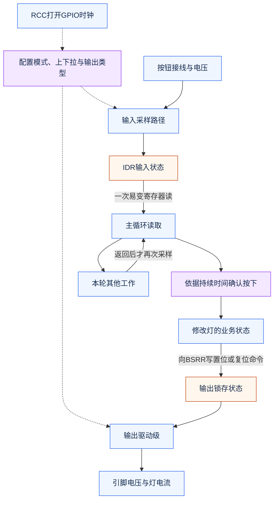

<!-- SPDX-License-Identifier: Apache-2.0 -->

# 第1章\_轮询程序怎样读到电平并控制输出

本专题要求能读简单 C 循环，并知道寄存器可以映射到地址空间。GPIO 的输入状态、输出锁存、复用选择和引脚电气模式是不同控制点；“写了一个位”只有经过正确路径才能变成可见电压。

图例：**蓝色节点表示一般参与者，紫色突出处理或决策，橙色表示保存的数据或状态。** 实线是输入、操作与循环顺序，虚线表示使路径具备工作条件。`IDR(Input Data Register-输入数据寄存器)：观察输入状态。` `BSRR(Bit Set/Reset Register-位设置与复位寄存器)：以写命令更新输出位。` RCC 的含义是 Reset and Clock Control，即复位与时钟控制。

初始化先保证模块可访问，再设置所需模式。对输出，通常需要考虑先预置安全输出值再使能驱动，避免模式切换瞬间出现不希望的脉冲；具体顺序依据器件与负载。教学 LED 可以允许短暂变化，功率开关则不能据此照搬。

轮询读取的是每次访问时的状态，不保存两次访问之间所有变化。假设读输入后执行 3 ms 显示计算和 2 ms 通信等待，下次读取至少要等这五毫秒过去。持续一毫秒的脉冲可能完全落在间隙里；单纯给变量加 volatile 不会增加采样次数。volatile 约束编译器对这些访问的处理，不负责事件排队与调度。

输出的读改写也有状态交接问题。先读 ODR、修改一个位、再写回期间，如果中断改了另一位，旧快照可能覆盖新结果。BSRR 用写命令表达“只置位或复位某位”，避免为这类操作回写整份旧快照；它不意味着所有 GPIO 配置操作都自动原子化。

继续：[原理与实现](P002_原理与实现.md)。返回：[专题大纲](大纲.md)。
