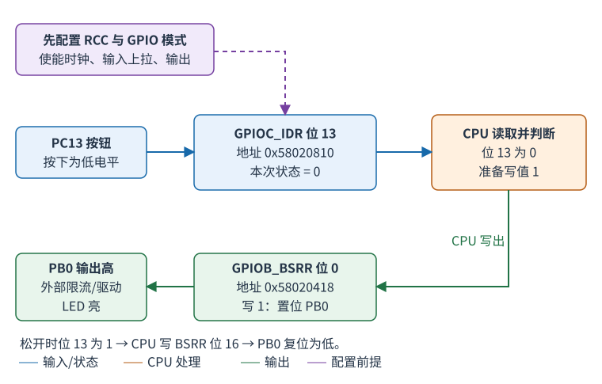

<!-- SPDX-License-Identifier: Apache-2.0 -->

# 第2章\_GPIO配置位操作与轮询延迟

> [P01 总目录](../大纲.md) / [P009 GPIO时钟与轮询程序](大纲.md) / 第 2 篇（共 3 篇）

本篇路线：

- [2.1_先让输入与输出具有确定的电气含义](#section-1)
- [2.2_从基址与偏移算出真正的访问位置](#section-2)
- [2.3_按硬件生效顺序组织初始化](#section-3)
- [2.4_BSRR 为什么比输出寄存器读改写更适合这里](#section-4)
- [2.5_轮询的响应延迟怎样计算](#section-5)


现在已经知道，H743 的 GPIO 有确定地址，也要通过相应总线和时钟工作。本章把第一章的 `read_button()` 与 `write_led()` 拆开，看到一个普通 C 访问如何落到外设寄存器。

为了使位号和地址能够具体计算，本章选 **PC13 作为低电平有效按钮输入、PB0 作为高电平有效输出**。这是教学接线约定，不代表读者手中任何 H743 板的实际连接。没有板子仍可以完整推演；真正接线前应查封装引脚和板原理图，确认没有其他电路驱动这些信号。LED 的电流限制或外部驱动必须独立满足电气要求。

<a id="9.1_先让输入与输出具有确定的电气含义"></a>

<a id="section-1"></a>

## 2.1\_先让输入与输出具有确定的电气含义

低电平有效按钮可以理解为：松开时输入由上拉保持高电平，按下时按钮把输入连接到地。程序因此把“读到 0”解释为按下。PB0 高电平有效则表示输出为高时，相应外部驱动使 LED 点亮。输入极性与输出极性是两个独立选择。

GPIO 引脚还要选择工作模式。输入模式让程序读取引脚状态；输出模式让输出电路驱动引脚；复用功能模式把引脚交给串行通信等外设；模拟模式用于相应模拟功能。**引脚编号不会自动决定功能**，模式和复用配置负责建立内部模块与引脚之间的关系。

GPIO 复位配置未必是“所有引脚默认输入”，有些调试相关引脚也有特殊初值。初始化时应按手册明确设置本例需要的位，不把猜测的复位状态当作前提。

<a id="9.2_从基址与偏移算出真正的访问位置"></a>

<a id="section-2"></a>

## 2.2\_从基址与偏移算出真正的访问位置

先看按钮按下的一次完整路径。图把电气输入、寄存器里的位、CPU 判断和输出控制分开，地址是找到各接口的依据。



图例：**蓝色是输入与状态，橙色是 CPU 计算，绿色是写出与输出效果，紫色虚线是初始化前提**。图中只有 CPU 执行判断；GPIO 硬件按配置提供状态与驱动输出。

名称注释：`RCC（Reset and Clock Control－复位与时钟控制）：提供外设时钟使能。` `IDR（Input Data Register－输入数据寄存器）：读取引脚状态。` `BSRR（Bit Set/Reset Register－位置位/复位寄存器）：写入位操作控制输出。` `LED（Light-Emitting Diode－发光二极管）：需要满足限流和驱动条件的指示器件。`

沿蓝线读 GPIOC 的位 13；位值为 0 时，沿绿线向 GPIOB 的 BSRR 写数值 1，使 PB0 置高。松开后位 13 变成 1，CPU 下次轮询写 `1u << 16`，让 PB0 复位为低。这两次写入都到同一个 BSRR 地址，**写入数值中的位决定置位还是复位，不能把位号当成另一个寄存器地址。**

GPIOB 基址是 `0x58020400`，GPIOC 基址是 `0x58020800`。一个端口内部不同寄存器通过偏移区分；例如 GPIOC 输入数据寄存器偏移 `0x10`，所以地址是 `0x58020810`。

下表只展开本例使用的字段。寄存器均用 32 位访问，未列出的位不能随意修改。名称中的 `GPIOx` 表示待替换的端口，如 GPIOB；后缀说明寄存器职责：MODER（Mode Register，模式寄存器）、OTYPER（Output Type Register，输出类型寄存器）、OSPEEDR（Output Speed Register，输出速度寄存器）、PUPDR（Pull-Up/Pull-Down Register，上下拉寄存器）、IDR（Input Data Register，输入数据寄存器）、BSRR（Bit Set/Reset Register，位置位/复位寄存器）。GPIOBEN、GPIOCEN 则是 RCC 寄存器中分别允许 B、C 端口时钟的字段名称。

| 寄存器 | 基址与偏移 | 属性与本例字段 | 操作效果 |
| --- | --- | --- | --- |
| `RCC_AHB4ENR` | RCC `0x58024400` + `0xE0` | 读写；GPIOBEN 位 1，GPIOCEN 位 2 | 写 1 使能对应 GPIO 时钟 |
| `GPIOx_MODER` | GPIOx + `0x00` | 读写；每脚两位，脚 n 对应 `[2n+1:2n]` | 00 输入，01 输出，10 复用，11 模拟 |
| `GPIOx_OTYPER` | GPIOx + `0x04` | 读写；脚 n 对应位 n | 0 推挽输出，1 开漏输出 |
| `GPIOx_OSPEEDR` | GPIOx + `0x08` | 读写；每脚两位 | 控制输出速度等级，本例使用 00 |
| `GPIOx_PUPDR` | GPIOx + `0x0C` | 读写；每脚两位 | 00 无上下拉，01 上拉，10 下拉，11 保留 |
| `GPIOx_IDR` | GPIOx + `0x10` | 只读；脚 n 对应位 n | 读取数字输入状态 |
| `GPIOx_BSRR` | GPIOx + `0x18` | 写操作；低 16 位置位，高 16 位复位 | 写位 n 为 1 置输出；写位 n+16 为 1 清输出 |

**官方对照：** [RM0433 Rev 7](https://www.st.com/resource/en/reference_manual/dm00314099.pdf)，**7.6 RCC registers** 中的 **RCC AHB4 Clock Register**，以及 **11.4 GPIO registers** 中上述同名条目。GPIOC 第 13 脚模式域的位置可以自己计算：`2×13=26`，所以要修改第 27、26 位；这个计算比直接背掩码更容易迁移。

<a id="9.3_按硬件生效顺序组织初始化"></a>

<a id="section-3"></a>

## 2.3\_按硬件生效顺序组织初始化

以下代码是自有教学实现中的 GPIO 部分。它展示完整初始化和一次输入输出循环；本章先阅读，第12专题准备工具，第15专题再把它与启动文件和链接脚本组合成完整固件。`mmio_read()`、`mmio_write()` 的完整定义在代码开头，没有隐藏库依赖。

```c
#include <stdint.h>

static uint32_t mmio_read(uintptr_t address)
{
    return *(volatile uint32_t *)address;
}

static void mmio_write(uintptr_t address, uint32_t value)
{
    *(volatile uint32_t *)address = value;
}

static void gpio_init(void)
{
    const uintptr_t rcc_enable = 0x580244E0u;
    const uintptr_t gpio_b = 0x58020400u;
    const uintptr_t gpio_c = 0x58020800u;

    mmio_write(rcc_enable, mmio_read(rcc_enable) | (1u << 1) | (1u << 2));
    (void)mmio_read(rcc_enable); /* 回读，给时钟使能传播留出访问间隔。 */

    mmio_write(gpio_b + 0x18u, 1u << 16); /* 先预置 PB0 输出为低。 */
    mmio_write(gpio_b + 0x04u, mmio_read(gpio_b + 0x04u) & ~1u);
    mmio_write(gpio_b + 0x08u, mmio_read(gpio_b + 0x08u) & ~3u);
    mmio_write(gpio_b + 0x0Cu, mmio_read(gpio_b + 0x0Cu) & ~3u);
    mmio_write(gpio_b, (mmio_read(gpio_b) & ~3u) | 1u);

    mmio_write(gpio_c, mmio_read(gpio_c) & ~(3u << 26));
    mmio_write(gpio_c + 0x0Cu,
               (mmio_read(gpio_c + 0x0Cu) & ~(3u << 26)) | (1u << 26));
}

int main(void)
{
    gpio_init();
    for (;;) {
        uint32_t input = mmio_read(0x58020810u);
        uint32_t output = (input & (1u << 13)) ? (1u << 16) : 1u;
        mmio_write(0x58020418u, output);
    }
}
```

先看 **`rcc_enable` 的置位与回读**：初始化必须先让 GPIO 接口得到时钟，再访问它的配置。回读是针对这里的时钟使能顺序，不是说对所有外设随意读一个寄存器都能完成同步。

再看 **先写 BSRR、后改 MODER**：输出使能之前先准备好低电平，可以减少切换成输出时出现非预期电平的机会。随后设置推挽、速度和上下拉，再把 PB0 模式改成输出。GPIOC 则选择输入并上拉，建立按钮松开时的默认电平。

最后看 **`output` 的三目表达式**：PC13 为 1 表示松开，写 BSRR 的第 16 位清 PB0；PC13 为 0 表示按下，写第 0 位置 PB0。本例采用“按住就亮”，没有加入消抖，也没有把未解释的计时算法藏入初始化。

`volatile` 告诉编译器这些访问具有必须保留的可观察意义，不能像普通局部变量一样随意消除或缓存到寄存器中。**它不提供线程互斥，不修复 DMA 缓存一致性，也不把一串读改写变成原子操作。** 正确访问还依赖地址、宽度、存储属性和外设规则。

<a id="9.4_bsrr-为什么比输出寄存器读改写更适合这里"></a>

<a id="section-4"></a>

## 2.4\_BSRR 为什么比输出寄存器读改写更适合这里

假设主循环修改 PB0，中断同时修改 PB1。主循环先读出输出值，中断置 PB1，主循环再把自己算出的旧值写回，就可能覆盖中断刚设置的 PB1。问题来自“读”和“写”之间允许插入另一位使用者。

BSRR 把某些位的置位或复位命令交给硬件，一次写入只作用于写 1 所指明的位，不需要先读取整个输出值。因此，分别控制不同输出位时可以避免这一种丢更新窗口。它并不替软件决定同一引脚两个相反请求的业务先后，也不是任意多条操作的锁。

这也是 MMIO 与普通内存的又一个区别：写进去的 `1u << 16` 并不要求 GPIO 把一个 32 位变量保存成这个值，而是要求 PB0 对应的输出状态变成 0。

<a id="9.5_轮询的响应延迟怎样计算"></a>

<a id="section-5"></a>

## 2.5\_轮询的响应延迟怎样计算

假设一次循环要读取按钮、更新灯，再处理显示任务。显示处理占 4 ms，其余操作合计 0.1 ms，那么两次按钮读取间隔大约 4.1 ms。按钮变化若均匀发生在间隔内，等待下一次采样的平均时间约 2.05 ms，最坏接近 4.1 ms，另外还要加采样后的判断与输出时间。

这些是**教学假设**，不是 H743 性能测量。结论依赖“每轮处理时长固定、事件到达相位均匀”；若显示处理时间有波动，应使用实际最长间隔评估最坏响应。没有实测时，不把平均数当成响应保证。

轮询也有价值：流程简单、状态集中、容易观察，负载小时可能非常合适。若程序能每 10 μs 可靠检查一次，而事件持续很长，就不必为了“架构高级”强行加入复杂并发。需要改进的条件是具体的采样间隔、事件保持时间和 CPU 工作量。

练习：只把 CPU 频率提高，能否保证 1 ms 短脉冲永远不会漏？解答：不能直接保证。要核对最坏两次采样间隔，检查循环中是否等待外设、关中断或执行可变工作；必要时由硬件锁存、捕获或缓冲事件。后一专题先观察这些能够独立推进的外设状态。

---

[← 采样消抖与输出控制路径](P001_采样消抖与输出控制路径.md) · [本专题目录](大纲.md) · [漏检和读改写冲突推演 →](P003_漏检和读改写冲突推演.md)
