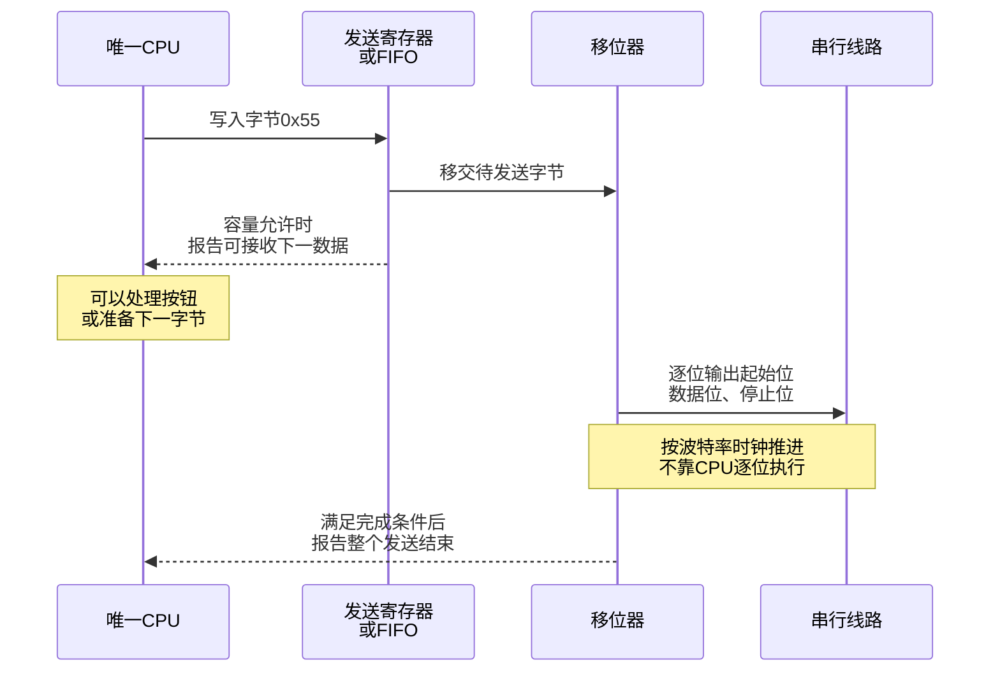

<!-- SPDX-License-Identifier: Apache-2.0 -->

# 第1章\_CPU提交与外设独立运行

> [P01 总目录](../大纲.md) / [P010 定时器与串行外设](大纲.md) / 第 1 篇（共 3 篇）

定时器和串行控制器都包含能随自己的时钟推进的硬件状态。CPU 负责配置和提交，并不需要为每一个串行位执行一次软件写操作。本专题先区分“提交可以返回”与“线路已经完成”，再讨论怎样利用这段时间。

图例：实线箭头表示提交或线路输出，虚线箭头表示状态通知；灰色生命线只表示对象存在，不表示持续占用 CPU。`FIFO(First In First Out-先进先出队列)：在硬件允许的深度内缓冲数据。` 图是功能时序，不按比例；具体空标志、阈值与完成条件以外设配置为准。

UART 使用 8 数据位、无校验、1 停止位时，每帧还包括 1 起始位，共 10 位。在 115200 bit/s 下，一帧约为 `10/115200=86.8 μs`。CPU 写完数据可能很快返回，但线路仍需花这些时间。若软件要求切换半双工收发方向，必须等待真正的发送完成，不能只看缓冲区可写。

定时器同样把重复动作交给硬件：预分频器降低计数输入频率，计数器推进到自动重装边界产生更新；比较单元把计数与阈值比较形成输出时刻。输入捕获则反过来，在边沿到达时保存当时的计数值。它们共享“计数”基础，却分别回答何时动作和何时发生，不是同一个功能的不同名字。

外设自主工作创造了 CPU 可做其他事的窗口。若程序写完字节后就在循环中不断等完成，这个窗口仍被忙等耗掉；改成状态机、中断通知或 DMA 后，才能把窗口用于实际工作。并不需要先安装 RTOS 才能获得这种收益。

## 1.1\_缓冲可写与线路空闲为什么不能共用一个完成标志

把发送链想成“待发送缓冲 → 移位器 → 引脚”。当移位器取走一个字节，缓冲可能已经可以接收下一个字节，但移位器还在逐位发送前一个字节。此时容量条件成立，整条线路完成条件不成立。

连续发送多个字节时，软件应在有容量时及时填充，以减少帧间空隙；结束一笔半双工事务时，则要按外设定义等待最后一帧真正发送完成，才能关闭发送驱动或切换方向。若把可写标志误作完成标志，可能截断最后一帧；若每写一个字节都等待整帧结束，又可能浪费硬件缓冲能力。

这也解释了驱动为何可能提供两种回调或状态：一个说明数据缓冲可以重用，另一个说明外设事务结束。DMA 读完源内存后，该内存是否可重用，需要按控制器和驱动保证判断；线路上的最后几位却仍可能尚未结束。必须按调用方真正需要的完成条件等待，不能只挑名字里带 done 的事件。

---

[← 漏检和读改写冲突推演](../P009_gpio_polling/P003_漏检和读改写冲突推演.md) · [本专题目录](大纲.md) · [定时器捕获PWM与串行通信 →](P002_定时器捕获PWM与串行通信.md)
