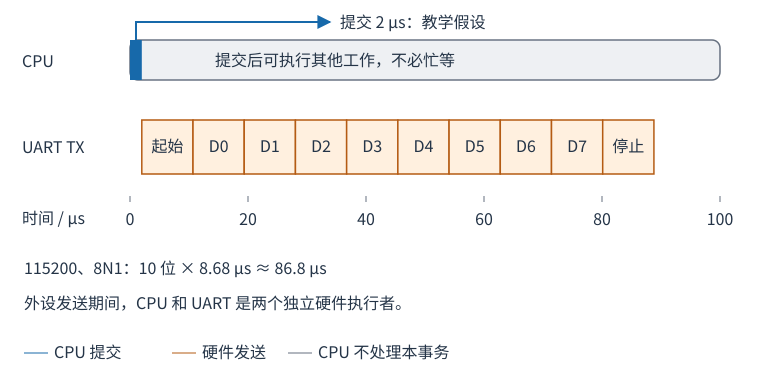

<!-- SPDX-License-Identifier: Apache-2.0 -->

# 第2章\_定时器与串行外设

前一专题 CPU 每轮读取按钮并写 GPIO。现在控制面板还要每隔一段时间采样温度，并把数值送到显示器。如果 CPU 用指令逐个等待时间、逐位改变通信引脚，它会把大量执行机会花在重复时序上。专门外设能接管其中规则明确的工作。

先区分两件事：CPU 配置外设，属于 CPU 执行的程序；外设按配置计数、移位或采样，属于独立硬件状态机的工作。外设完成后，CPU 何时来取结果是另一个问题，后一专题才引入中断。

<a id="10.1_定时器怎样在-cpu-不执行加法时计数"></a>

## 2.1\_定时器怎样在 CPU 不执行加法时计数

**定时器（Timer）** 内部有计数寄存器和更新规则。输入时钟经过分频，每个有效计数时刻让计数值增加；到设定终点时产生更新事件，并按模式重新开始。CPU 只需事先配置并启动，计数器就可在 CPU 计算其他事情时继续工作。

常见的向上计数模式中，**预分频器（Prescaler，PSC）** 用 `PSC+1` 分频，**自动重装寄存器（Auto-Reload Register，ARR）** 决定从 0 计到哪个值。只讨论边沿对齐向上计数、未使用重复计数器等额外机制时：

```text
计数频率 = 定时器输入时钟 / (PSC + 1)
更新频率 = 计数频率 / (ARR + 1)
```

若定时器输入时钟已经确认是 100 MHz，设 PSC=99，得到 1 MHz 计数频率；设 ARR=999，则每计 1000 次更新一次，频率 1 kHz、周期 1 ms。两个“加 1”来自包含零的计数长度，不能随意删去。

**这个 100 MHz 是给定的定时器输入时钟，不是从 CPU 频率猜来的。** H743 的定时器时钟还受 APB 分频及相关时钟配置影响。先沿 RCC 时钟树确认实际输入，再计算 PSC 和 ARR，才是正确顺序。

官方对照：[RM0433 Rev 7](https://www.st.com/resource/en/reference_manual/dm00314099.pdf)，**Reset and clock control (RCC)** 中定时器时钟路径，以及 **General-purpose timers (TIM2/TIM3/TIM4/TIM5)** 中 **Time-base unit、Counter modes**。本节解释公式所需字段，没有给出可直接执行的定时器初始化代码。

<a id="10.2_比较、捕获和-pwm-解决不同方向的问题"></a>

## 2.2\_比较、捕获和 PWM 解决不同方向的问题

计数值不断变化，可以与一个比较值对照。计到特定位置时改变输出，就能得到周期波形。**脉冲宽度调制（Pulse-Width Modulation，PWM）** 用高低电平持续时间比例表达控制量，例如调节 LED 平均亮度。CPU 不必每个周期亲自拉高、拉低引脚。

若 ARR=999，周期包含 1000 个计数时刻；在某种已选定的 PWM 模式下，输出于 `CNT<CCR` 时有效，CCR=250 则对应 25% 有效时间。实际高低极性、PWM 模式、输出使能和引脚复用都需要明确，不能只写“CCR=250 就一定高 25%”。

反过来，外部边沿到来时把当前计数值锁存到捕获寄存器，称为**输入捕获（Input Capture）**。如果两次边沿捕获值分别为 100 与 350，计数周期为 1 μs，在没有回绕且捕获正确的条件下，两次边沿相隔 250 μs。这里记录时间的是硬件，CPU 晚些读取结果也不会把边沿时刻变成读取时刻。

硬件保存能力仍有限。如果新捕获覆盖旧值，或多个事件只设置同一个状态位，软件可能丢失信息。准确计时、保存所有事件、通知 CPU，是三个需要分别检查的能力。

<a id="10.3_串口为什么可以边发送边让-cpu-工作"></a>

## 2.3\_串口为什么可以边发送边让 CPU 工作

**通用异步收发器（Universal Asynchronous Receiver/Transmitter，UART）** 用约定的帧格式和速率在引脚上传送位序列。异步通信双方没有为每一位共用一根时钟线，接收方依据起始位和本地时钟确定采样时机。

以 115200 波特、8 个数据位、无奇偶校验、1 个停止位为例，通常简称 8N1。一帧还包含 1 个起始位，共 10 位。每位约 `1/115200=8.68 μs`，一字节帧约 86.8 μs。CPU 把数据交给发送接口后，移位电路按时序把各位送出，不需要 CPU 每隔 8.68 μs 执行一次 GPIO 写入。



图例：**蓝色区段是 CPU 提交数据，橙色区段是 UART 硬件发送，灰色是 CPU 未执行本次发送处理的时间**。CPU 行与 UART 行是不同硬件执行者；两行重叠不表示存在第二颗 CPU。位时间按 115200、8N1 计算，CPU 提交开销为示意，未测量。

名称注释：`UART（Universal Asynchronous Receiver/Transmitter－通用异步收发器）：按约定帧格式独立完成串行发送与接收。` `TX（Transmit－发送）：数据从当前接口送出。` `RX（Receive－接收）：数据进入当前接口。`

CPU 交出数据后可以做显示内容计算，也可以忙等发送状态。硬件发送过程相同，CPU 的时间使用方式却不同。**忙等不会让一帧的物理位时间自动缩短**，它只是让 CPU 在完成前反复观察状态。

还要区分“发送数据入口可继续接收”和“最后一个停止位已经从引脚发出”。前者允许提交下一个数据，后者才适合某些关闭接口或切换收发方向的动作。把这两种完成条件混为一谈，会导致最后一字节尚未发完就关掉输出。

<a id="10.4_spi-和-i²c-怎样改变通信方式"></a>

## 2.4\_SPI 和 I²C 怎样改变通信方式

**串行外设接口（Serial Peripheral Interface，SPI）** 通常由控制方提供时钟，并用片选确定当前目标。温度传感器收到命令后，可以在后续时钟中返回数据。每个时钟边沿的采样关系由模式决定，发送一个字节常会同时收进一个字节，读操作也可能需要发送用于产生时钟的数据。

**集成电路间总线（Inter-Integrated Circuit，I²C）** 通常使用数据线 SDA 与时钟线 SCL，在共享连线上通过地址选择目标，并规定起始、应答、停止等阶段。其开漏连接与上拉、电容和速率共同影响信号时序，不能把它当作普通推挽 GPIO 的随意翻转。

当屏幕使用 SPI 时，一次屏幕更新可能包含发送命令、选择区域和发送像素。UART 更适合本例中简单的串行数据通道；I²C 常用于连接多个低速控制或测量器件。具体设备支持哪种接口，要以器件资料为准，不能仅按“显示器”“传感器”的名称推断协议。

| 比较维度 | UART | SPI | I²C |
| --- | --- | --- | --- |
| 每位时序怎样对齐 | 起始位与双方约定速率 | 通常由控制方提供时钟 | SCL 与协议规则 |
| 怎样区分目标 | 通常由物理连接或上层协议决定 | 常用片选 | 总线地址 |
| 完成一项事务要观察什么 | 帧、接收状态与错误 | 片选、时钟、收发状态 | 地址应答、数据应答、停止与错误 |

<a id="10.5_外设自动工作以后，cpu-仍缺什么"></a>

## 2.5\_外设自动工作以后，CPU 仍缺什么

现在我们可以让定时器计时、串口发送，但 CPU 仍需知道何时读取新数据、何时补充发送内容。轮询可以检查这些状态，不过多个外设交织时，观察间隔可能变长。

对面板的三个任务作区分：按钮只在状态变化时需要更新逻辑；温度传感器只在数据完成时需要解释读数；显示器只在内容变化或刷新完成时需要下一步处理。要求它们持续占用 CPU 才“保持运行”，显然浪费了外设独立工作的能力。后一专题让硬件在需要时提出请求。

练习：显示器以固定 SPI 速率发送 1024 字节，把忙等改成中断后，线上数据一定发送得更快吗？解答：位速率和帧间协议条件不变时，纯传输时间未必变化。主要收益是 CPU 可以在传输期间做其他事；若原程序存在供数间隙，中断或 DMA 的组织也可能减少间隙，但必须依据实际时序判断，不能把两种收益混成一句“中断更快”。

阅读导航：[前一专题](../P009_gpio_polling/P002_原理与实现.md) · [专题大纲](../大纲.md) · [后一专题：中断与 NVIC](../P011_interrupt_controller/P002_原理与实现.md)


专题内阅读：[关系与模型](P001_关系与模型.md) → 本篇原理与实现 → [案例与推演](P003_案例与推演.md)。返回：[本专题大纲](大纲.md)。
