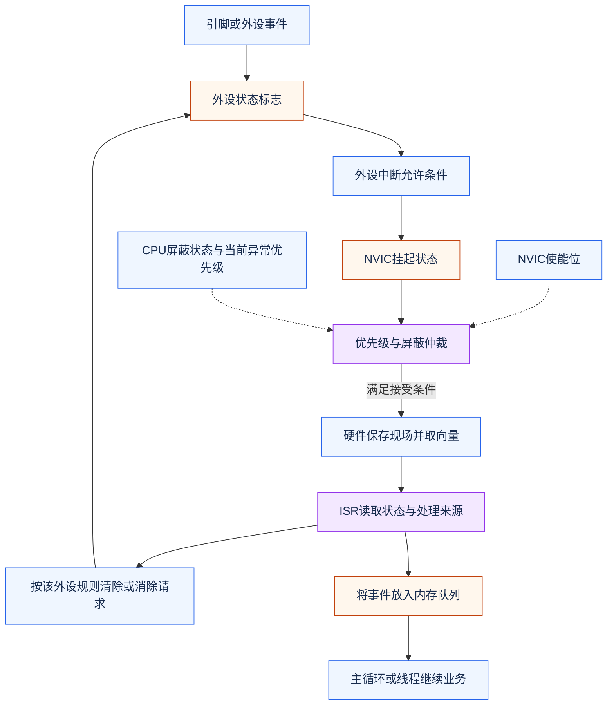

<!-- SPDX-License-Identifier: Apache-2.0 -->

# 第1章\_事件、挂起、优先级与处理函数如何接上

本专题只要求知道 CPU 一次执行一条当前控制流。中断让硬件事件参与决定这条控制流接下来在哪里执行；它并没有为每个外设增加一颗 CPU。先把外设状态与 NVIC 的管理状态分开，才能解释“标志已经置位，却没有进入处理函数”。

图例：**蓝色节点表示一般参与者，紫色突出处理或决策，橙色表示保存的数据或状态。** 实线是请求、处理或数据流，虚线是允许条件；回到状态标志的箭头表示处理来源，不表示所有标志都采用同一种写清方式。`ISR(Interrupt Service Routine-中断服务程序)：在异常上下文处理事件。` NVIC 是 Nested Vectored Interrupt Controller，管理嵌套向量中断。

外设标志回答“硬件发生了什么”；NVIC 挂起回答“有异常请求待考虑”；活动状态回答“异常已经进入处理”。三个问题不能用一个 ready 变量代替。即使清掉 NVIC 挂起，如果外设仍持续提出请求，也可能重新挂起；盲目反复清 NVIC 并不能修复来源未处理的问题。

优先级首先决定哪些异常有资格抢占。对于 Cortex-M，较小的优先级数值通常表示较高紧迫程度，但实现位数和分组影响实际比较。相同抢占级别不会因为副优先级更高就抢占当前处理函数；副优先级主要参与同时待服务时的选择。屏蔽还可能推迟接受，必须连同当前执行身份一起判断。

ISR 应尽快完成必要的读取与确认，再交出业务数据。单个布尔标志只能表示“至少发生过一次”，连续事件会合并；队列能保存多条报告，却必须定义容量耗尽时的行为。缩短 ISR 的意义不只是代码更短，还在于降低其他工作的最长等待。

继续：[原理与实现](P002_原理与实现.md)。返回：[专题大纲](大纲.md)。
