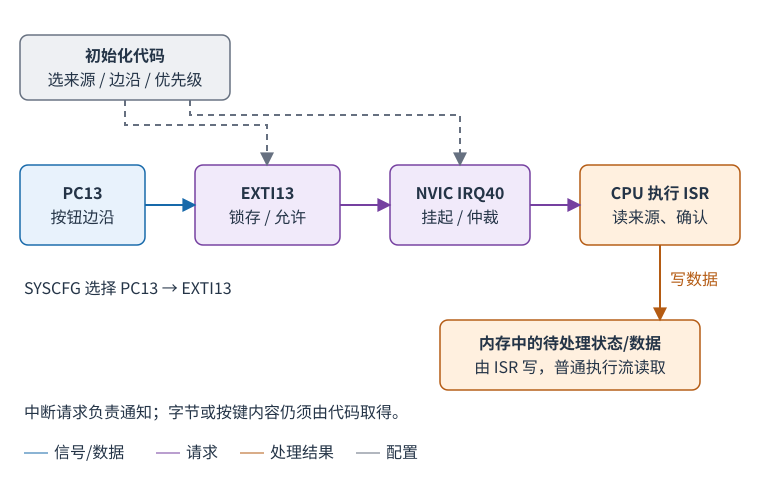
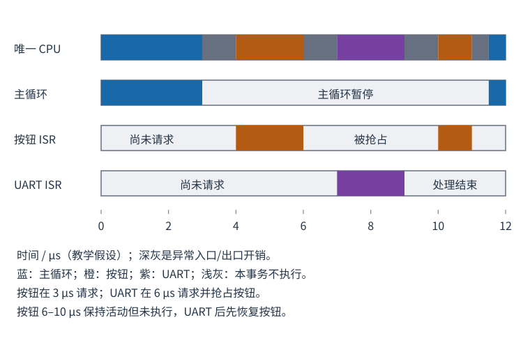

<!-- SPDX-License-Identifier: Apache-2.0 -->

# 第11章\_从轮询到中断与NVIC

定时器和串行外设可以独立工作了，但轮询程序仍要主动回来查看状态。若 CPU 正在计算显示内容，按钮恰好按下，系统需要一种不必等到主循环轮到按钮检查的机制。

**中断请求（Interrupt Request，IRQ）** 是外设等来源向处理器系统提出的处理请求。CPU 在满足允许条件的时机暂停当前执行流，进入对应处理程序，处理后再返回。请求只是提出“有事需要处理”，真正的数据仍要从状态寄存器或缓冲区读取。中断不会自动替应用计算温度或绘制画面。

## 11.1\_把事件产生、仲裁和处理分给不同部件

H743 的按钮连接 PC13 时，边沿先经过输入与路由电路。**外部中断/事件控制器（External Interrupt/Event Controller，EXTI）** 负责按配置识别触发条件、记录相应挂起状态并提出中断或事件。多个 GPIO 端口的同号引脚需要选择来源，系统配置控制器 SYSCFG 提供相应选择。

请求随后到达处理器侧的**嵌套向量中断控制器（Nested Vectored Interrupt Controller，NVIC）**。它管理允许、挂起、活动和优先级等状态，与处理器异常机制协作，决定哪些请求可以得到响应。处理程序入口通过向量表关联，后面的启动与异常章节会把入口地址和现场保存展开。

图例：**蓝色线是电平或数据读取，紫色线是中断请求与仲裁，橙色线是 CPU 执行处理后写入的软件状态，灰色虚线是初始化配置关系**。静态配置不会在每次按键时重新执行。

名称注释：`EXTI（External Interrupt/Event Controller－外部中断/事件控制器）：识别并记录已配置的触发。` `NVIC（Nested Vectored Interrupt Controller－嵌套向量中断控制器）：管理请求状态和优先级，参与异常响应。` `SYSCFG（System Configuration Controller－系统配置控制器）：配置 GPIO 等来源的系统级连接。` `ISR（Interrupt Service Routine－中断服务程序）：CPU 进入中断上下文后执行的代码。`

先沿灰色配置线检查“选了谁”：GPIO 模式、PC13 到 EXTI13 的来源选择、触发边沿、请求允许、IRQ 优先级与处理入口必须相互对应。再沿紫线跟踪一次事件：低电平有效按钮按下产生下降沿，EXTI 记录请求，NVIC 判断是否可响应，CPU 才进入 ISR。

**沿橙色线发生的是 CPU 执行软件，不是 NVIC 把按键数据自动塞进变量。** ISR 检查来源、确认或清除对应硬件状态，并把应用真正需要的信息交给后续处理。对于 UART 接收，中断说明存在接收工作，字节内容要通过接收数据接口取得；若使用 DMA，则数据可由 DMA 事先搬到内存。

将灰色配置线落实到 H743，PC13 的关键字段如下。表中寄存器按 32 位访问；执行配置前，要先完成第 9 章的 GPIO 输入配置，并使能 SYSCFG 的接口时钟。

| 配置位置 | 地址与本次字段 | 建立什么关系 |
| --- | --- | --- |
| `RCC_APB4ENR` | `0x580244F4`，SYSCFGEN 位 1，读写 | 允许 SYSCFG 寄存器接口时钟 |
| `SYSCFG_EXTICR4` | `0x58000414`，EXTI13 域为位 `[7:4]`，读写 | 该域写编码 2，选择 C 端口第 13 脚；其他域保留 |
| `EXTI_RTSR1` / `EXTI_FTSR1` | `0x58000000` / `0x58000004`，位 13，读写 | 本例关闭上升沿触发、打开下降沿触发 |
| `EXTI_CPUIMR1` | `0x58000080`，位 13，读写 | 允许 EXTI13 向 CPU 提出中断请求 |
| `EXTI_CPUPR1` | `0x58000088`，位 13，读取状态、写 1 清除 | 识别并确认 EXTI13 挂起；不能用读改写顺便清掉其他来源 |

例如选择 PC13，修改的是 EXTICR4 的四位域：保留其他位，清掉 `0xF0`，再加入 `2u<<4`，即 `0x20`。随后设置边沿、按初始化策略清除旧挂起，最后允许请求。NVIC 的 IRQ40 使能、优先级和向量表入口仍需继续配置，不能做完这张表就宣称完整中断程序已经运行。

这些地址按 RM0433 Rev 7 的 **SYSCFG external interrupt configuration register 4** 与 **20.6 EXTI registers** 核对。ST 器件头文件中同一 EXTI CPU 接口成员可写成 `EXTI->IMR1`、`EXTI->PR1`；手册中的 CPU 前缀说明接口归属，不能仅凭名字差异再发明一套地址。

## 11.2\_“已经发生”“正在等待”和“正在处理”不是同一个状态

一个外设有自己的状态，NVIC 又有请求状态。二者不能统称为“中断标志”。例如按钮下降沿已被 EXTI 锁存，但 NVIC 的该 IRQ 尚未使能，CPU 就可能暂时不进入处理程序。

| NVIC 状态 | 含义 | CPU 此刻是否必然在执行此 ISR |
| --- | --- | --- |
| Inactive | 既未挂起也未活动 | 否 |
| Pending | 请求等待响应 | 否，可能被屏蔽或优先级不够 |
| Active | 该异常已经被接受，尚未完成返回 | 不一定，可能被更高优先级异常抢占 |
| Active and pending | 当前处理尚未结束，又有一次待处理请求 | 当前上下文仍可能被抢占 |

**活动状态说明这一轮处理还没完成，不等于每一瞬间 CPU 都在跑它。** 这一区分可以解释中断嵌套：低优先级处理程序暂停在中间，它仍然活动，但 CPU 当前执行的是另一个更高优先级处理程序。

挂起位通常不是事件计数器。若同一来源在挂起状态下又发生多次事件，单个位无法保存“发生了三次”。需要每次都保留的数据应依靠外设 **FIFO（First In, First Out－先进先出缓冲）**、硬件计数/捕获、DMA 缓冲或经过容量设计的软件队列，不能把 NVIC 当成无限事件队列。FIFO 按进入顺序保存多个数据项，但同样有容量上限。

官方对照：[PM0253 Rev 6，2.4 Exception model](https://www.st.com/resource/en/programming_manual/DM00237416.pdf)，阅读 **2.4.1 Exception states、2.4.7 Exception entry and return**；H743 的来源路由见 [RM0433 Rev 7，External interrupt/event controller (EXTI)、System configuration controller (SYSCFG)](https://www.st.com/resource/en/reference_manual/dm00314099.pdf)。核心规则与芯片来源路由分别取证。

## 11.3\_为什么设置了一个使能位还可能不响应

一次请求需要经过若干允许条件。事件源要配置正确，外设内部的请求出口要打开，NVIC 对应 IRQ 要允许，处理器的屏蔽和当前执行优先级还要允许接纳。任何一层不满足，都会出现“外设看起来发生了事件，CPU 却没进 ISR”。

核心屏蔽寄存器包括 **PRIMASK（Priority Mask－优先级屏蔽寄存器）** 和 **BASEPRI（Base Priority－基准优先级屏蔽寄存器）**，它们是架构规定的寄存器名称，并非普通外设地址。PRIMASK 可以屏蔽可配置优先级异常的响应，但不是关闭 **NMI（Non-Maskable Interrupt－不可屏蔽中断）** 和 **HardFault（硬故障异常）** 的万能开关；BASEPRI 则按优先级阈值进行屏蔽，常用于保留更紧急的响应。修改它们需要合适的执行权限与配对恢复逻辑。

关闭响应也不一定删除已经记录的事件。重新允许后，旧请求可能立即被处理。另一方面，某些外设的 mask 条件会影响它向 NVIC 提交请求的方式，不能把“先关再开”当成统一的事件丢弃方法。需要丢弃旧事件时，应明确清除哪一层状态以及是否允许丢数据。

下面用外部 IRQ 号 40 演算核心索引。H743 器件头文件中的枚举常量 `EXTI15_10_IRQn` 值为 40，多个 EXTI 线共享这个入口，ISR 还需识别具体来源。下表中的 ISER/ICER 是中断置位使能/清除使能寄存器，ISPR/ICPR 是挂起置位/清除寄存器，IABR 是活动位寄存器，IPR 是优先级寄存器；名字不同，是因为它们改变或观察的状态不同。

| 核心寄存器组 | 地址/索引 | 当前用途与属性 |
| --- | --- | --- |
| NVIC ISER | `0xE000E100 + 4×(IRQ/32)` | 32 位，写 1 允许对应 IRQ，写 0 不改变 |
| NVIC ICER | `0xE000E180 + 4×(IRQ/32)` | 32 位，写 1 禁止对应 IRQ |
| NVIC ISPR / ICPR | `0xE000E200` / `0xE000E280` 加相同步长 | 32 位，写 1 设置/清除核心挂起状态 |
| NVIC IABR | `0xE000E300 + 4×(IRQ/32)` | 32 位，只读对应活动状态 |
| NVIC IPR | `0xE000E400 + IRQ` | 每个外部 IRQ 对应一个优先级字节，按已实现位解释 |

`40/32=1`、`40%32=8`，所以 ISER 的第二个 32 位字地址为 `0xE000E104`，位 8 对应 IRQ40。该 IRQ 在向量表中的异常编号是 `16+40=56`，32 位表项偏移为 `56×4=0xE0`。**IRQ 号、异常编号和表内字节偏移是三种不同量。** 表中的寄存器组仅对芯片实际实现的 IRQ 有效，不能因地址公式成立就使用任意编号。

优先级字节中，H743 实现高 4 位。使用 CMSIS 的 `NVIC_SetPriority()` 时传入的是未移位的逻辑优先级；直接写硬件字节时才按实现位位置编码。把已经左移的 `0x50` 再交给期望逻辑值 5 的接口，会产生错误配置。

官方对照：PM0253 的 **Nested vectored interrupt controller (NVIC)** 寄存器条目；IRQ40 与 4 位实现依据 ST [cmsis-device-h7 v1.10.6 的 stm32h743xx.h](https://github.com/STMicroelectronics/cmsis-device-h7/blob/v1.10.6/Include/stm32h743xx.h) 中 `IRQn_Type` 与 `__NVIC_PRIO_BITS`。本表用于解释机制，完整项目优先使用对应厂商/CMSIS 定义，避免手写地址分散维护。

## 11.4\_优先级怎样改变唯一 CPU 的执行顺序

数字越小，表示越高的可配置中断紧急程度。优先级分组还可把实现的优先级位分成抢占优先级和子优先级：前者决定能否打断当前处理，后者主要用于同抢占级候选的排序。相同抢占优先级的异常不能仅凭子优先级更小就抢占彼此。

假设全部 4 个有效位用于抢占优先级，按钮 IRQ 优先级为 6，UART 接收 IRQ 为 2。按钮 ISR 处理中 UART 到来，UART 可以抢占按钮；UART 结束后先继续未完成的按钮 ISR，再返回被按钮打断的主循环。

图例：**蓝色是主循环执行，橙色是按钮 ISR 执行，紫色是 UART ISR 执行；各事务中的浅灰色区间统一表示没有占用 CPU，CPU 总览中的深灰色是异常入口/出口开销**。浅灰区内标出较长区间的状态；按钮在 3 μs 请求，3–4 μs 正在异常进入，尚未执行按钮 ISR；UART 在 6–7 μs 同理。最上方只有一条 CPU 总览；下面泳道是同一执行的归属拆分，不是额外 CPU。本图采用假设时刻，不能据图报告 H743 实测延迟。

名称注释：`ISR（Interrupt Service Routine－中断服务程序）：占用同一 CPU 执行相应处理。` `UART（Universal Asynchronous Receiver/Transmitter－通用异步收发器）：本例提出接收处理请求的串行外设。` `CPU（Central Processing Unit－中央处理器）：图中唯一执行指令的处理器。`

观察 UART 开始时的橙色中断点：按钮没有重新从头开始，它保留暂停位置。再观察 UART 结束处：CPU 先回来完成按钮的剩余工作。只有所有活动异常按规则完成，CPU 才回到主循环。这正是“嵌套”要表达的栈式关系。

较高优先级也不是无条件立即响应。屏蔽、当前异常、访存与入口保存等因素会影响延迟。应把响应时间拆成“请求产生与传播、等待允许、异常进入、ISR 到关键动作”几段，再找具体瓶颈。

## 11.5\_处理函数怎样把工作交给主循环

按钮中断可以只记录“需要检查按钮”，把消抖与业务逻辑留给普通执行流。这样 ISR 比较短，其他工作被推迟的时间也较少。但共享状态必须有完整交接规则。

例如一个简单标志被主循环读到后，尚未清零时又被 ISR 置位，随后主循环清零，就会吞掉新通知。一个更稳妥的单核做法是，在极短且明确的保护区内完成“取出并清零”，恢复先前屏蔽状态后再做耗时处理；如果每次事件都重要，则应改用有容量与溢出处理的计数或队列。**`volatile` 不能修复这段读清窗口。**

按钮的机械抖动也不会因启用中断自动消失。可以先记录边沿，再由定时采样确认一段时间内电平稳定；不要在 ISR 中阻塞等待几十毫秒，导致所有同级或低优先级处理一起等待。

练习：把 UART 优先级改成 6、按钮也为 6，UART 在按钮 ISR 中到来会怎样？解答：它通常保持挂起，等待当前按钮处理完成再参与仲裁，而不是在两个 ISR 之间随意轮流执行。若改变分组，还必须先重新解释逻辑优先级中的抢占位与子优先级位。

现在我们能够画出中断控制流程，但还没看见 CPU 怎样保存暂停位置、怎样找到处理入口。后面先建立汇编观察工具，再用寄存器、栈和启动镜像把这一缺口补上。

阅读导航：[上一章](P010_定时器与串行外设.md) · [专题大纲](大纲.md) · [下一章：建立汇编观察环境](P012_建立汇编观察环境.md)
