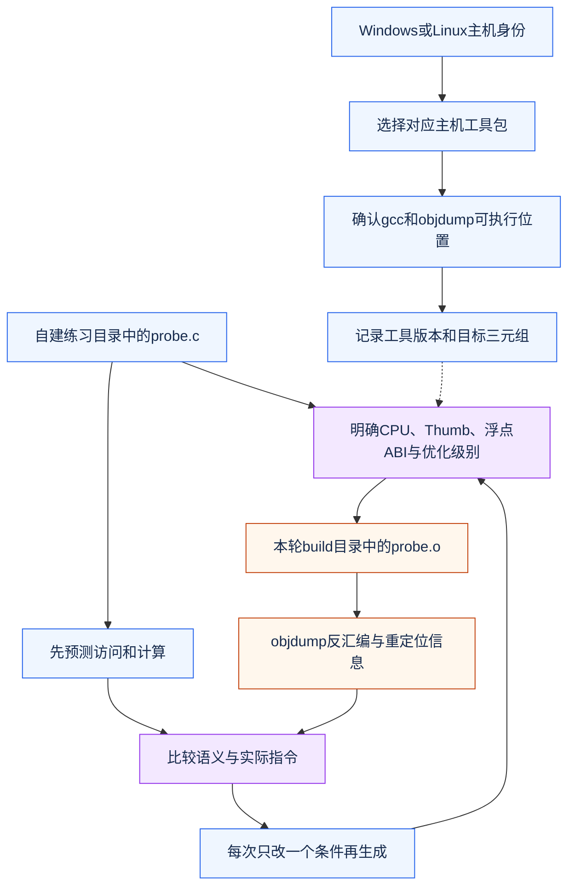

<!-- SPDX-License-Identifier: Apache-2.0 -->

# 第1章\_怎样建立可复核的汇编观察实验

本专题的目标是生成并解释自己的机器指令，先不连接开发板。主机工具是电脑上运行的程序，目标配置决定它输出哪一种指令；把两者分开，才不会下载了 Linux 主机包却期待在 Windows 直接运行。

图例：**蓝色节点表示一般参与者，紫色突出处理或决策，橙色表示保存的数据或状态。** 实线表示实验产物和观察顺序，虚线表示工具身份约束。`ABI(Application Binary Interface-应用二进制接口)：约束对象之间的调用与数据兼容方式。` objdump 是查看对象文件内容的工具名，不是芯片上的程序。

一份可复核观察至少要保存源文件、完整命令、工具版本和本轮输出。不同优化级别、目标 CPU 或 ABI 可能给出不同指令，若只留下截图，其他读者无法判断差异来自哪里。反汇编地址在对象文件中可能只是段内偏移，未链接的调用也可能带重定位，不能直接当作 Flash 运行地址。

先构造只有一次加载和加法的探针函数，容易识别编译器改变了什么。不要一开始把全部板级初始化拉入工程；那会把“工具能否生成目标指令”与“链接布局和板级配置是否正确”混在一起。进入完整启动实验时，再补链接脚本与复位入口。

Windows UCRT64 中，终端路径与传给 Windows 可执行文件的路径可能需要转换。优先使用练习目录内的相对文件名；选择工具目录时按核心篇给出的 `cygpath` 方法处理。不要为了让一个命令成功，永久改写整台电脑的 PATH 或删除其他工具版本。

继续：[原理与实现](P002_原理与实现.md)。返回：[专题大纲](大纲.md)。
