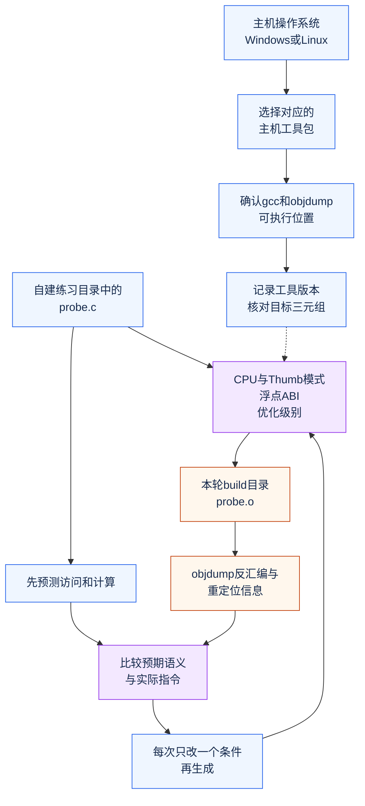

<!-- SPDX-License-Identifier: Apache-2.0 -->

# 第1章\_建立可复核的汇编观察流程

> [P01 总目录](../大纲.md) / [P012 建立汇编观察环境](大纲.md) / 第 1 篇（共 3 篇）

本专题的目标是生成并解释自己的机器指令，先不连接开发板。主机工具是电脑上运行的程序，目标配置决定它输出哪一种指令；把两者分开，才不会下载了 Linux 主机包却期待在 Windows 直接运行。

图例：**蓝色节点表示一般参与者，紫色突出处理或决策，橙色表示保存的数据或状态。** 实线表示实验产物和观察顺序，虚线表示工具身份约束。`ABI(Application Binary Interface-应用二进制接口)：约束对象之间的调用与数据兼容方式。` objdump 是查看对象文件内容的工具名，不是芯片上的程序。

一份可复核观察至少要保存源文件、完整命令、工具版本和本轮输出。不同优化级别、目标 CPU 或 ABI 可能给出不同指令，若只留下截图，其他读者无法判断差异来自哪里。反汇编地址在对象文件中可能只是段内偏移，未链接的调用也可能带重定位，不能直接当作 Flash 运行地址。

先构造只有一次加载和加法的探针函数，容易识别编译器改变了什么。不要一开始把全部板级初始化拉入工程；那会把“工具能否生成目标指令”与“链接布局和板级配置是否正确”混在一起。进入完整启动实验时，再补链接脚本与复位入口。

在 Windows UCRT64 中进入练习目录后，用相对文件名把同一个 `.o` 交给反汇编程序。用 `command -v arm-none-eabi-gcc` 和 `command -v arm-none-eabi-objdump` 核对两者来自预期工具目录；若查不到，再按[工具安装与当前终端设置](P002_安装工具并保留各阶段产物.md#section-2)准备。

## 1.1\_先验证工具身份，再比较指令差异

打开终端后，先用 `arm-none-eabi-gcc --version` 查看实际执行的版本，再用 `arm-none-eabi-gcc -dumpmachine` 核对目标身份。命令可执行不等于 PATH 指向刚安装的那份工具；电脑上有多套工具链时，这种混用尤其常见。

随后把同一条完整编译命令与结果放在同一个练习记录中。目标 CPU 影响可用指令，Thumb 选项影响编码体系，浮点 ABI 影响对象间的调用兼容性，优化级别影响寄存器分配与控制流。比较两份结果前先对齐这几个条件，否则很难判断究竟是代码变了还是实验条件变了。

对象文件只能证明编译器已经生成一部分目标代码。它没有完整向量表和布局，不能直接双击运行，也不能把整个文件按字节原样烧进 Flash。先用 objdump 读它的段、符号与重定位，等后续引入启动与链接脚本后，再讨论完整镜像的入口与下载。

---

[← 抢占时序与事件队列容量](../P011_interrupt_controller/P003_抢占时序与事件队列容量.md) · [本专题目录](大纲.md) · [安装工具并保留各阶段产物 →](P002_安装工具并保留各阶段产物.md)
