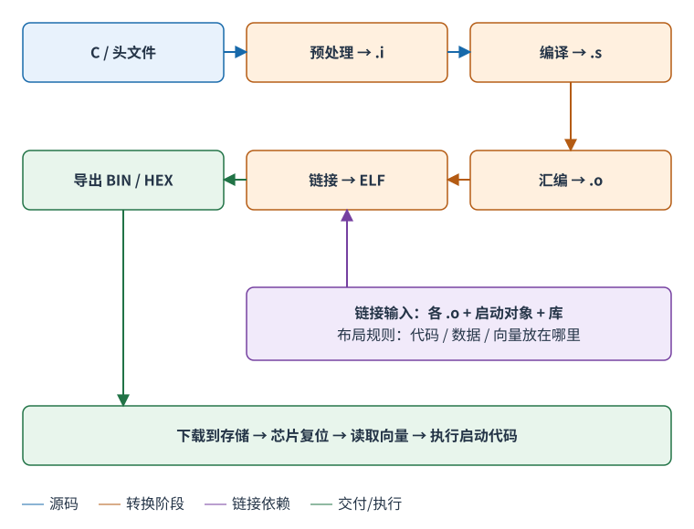

<!-- SPDX-License-Identifier: Apache-2.0 -->

# 第12章\_建立汇编观察环境

前面知道 CPU 执行的是指令，也知道中断会暂时改变执行流。要进一步理解寄存器与栈，最直接的办法是让工具把一段 C 代码翻译出来，再查看真正生成的指令。

本章只在电脑上编译和观察文件，不需要开发板、烧录器、Zephyr、Python 虚拟环境或完整芯片 SDK。**交叉编译器（Cross Compiler）** 运行在当前电脑上，却生成供另一类处理器执行的代码；这正是这里需要的工具。

## 12.1\_选择运行在电脑上、生成 Cortex-M 代码的工具

我们使用 GNU 系列的 Arm 嵌入式工具，其中 **GCC（GNU Compiler Collection－GNU 编译器集合）** 提供编译功能。命令前缀 **`arm-none-eabi`** 是目标配置标识：目标为 Arm，采用嵌入式应用二进制接口，不以 Linux 用户态运行环境为前提。`gcc` 编译 C，`objdump` 查看目标文件和反汇编，`readelf` 查看文件结构，`nm` 查看符号。

从 [Arm 官方 GNU 工具入口](https://developer.arm.com/downloads/-/arm-gnu-toolchain-downloads) 进入当前发行与下载位置。官网可能跳转到 Arm 的新下载站，仍需核对发行者和这两个选择维度：

| 选择维度 | Windows x64 电脑 | Linux x86_64 电脑 |
| --- | --- | --- |
| 主机平台：工具在哪里运行 | Windows，对应 Windows 归档或安装包 | Linux x86_64 归档 |
| 目标平台：生成什么程序 | `arm-none-eabi` | `arm-none-eabi` |

不要选择 `aarch64-none-linux-gnu` 来编译本例，也不要因为使用 UCRT64 终端就选 Linux 工具包。终端是操作入口，Windows 可执行文件仍然是 Windows 程序。

本教程的编译观察已使用 **GNU Arm Embedded Toolchain 10.3-2021.10，GCC 10.3.1** 核验。这是实际验证版本，不是“当前最新版”的声明。使用另一版本时，函数的具体寄存器分配和指令排列可能变化；我们会检查运算关系和文件结构，而不要求输出逐字符相同。

Windows 下载完成后，用资源管理器解压归档，或按安装包选择目录。打开安装结果，确认其中存在 `bin`，并能找到 `arm-none-eabi-gcc.exe`、`arm-none-eabi-objdump.exe`。这是确定工具根目录的依据，不能把下载目录或外层同名解压目录当作根目录。Linux 归档同样解压后检查 `bin/arm-none-eabi-gcc`。

## 12.2\_准备终端并找到刚解压的工具

Windows 主线使用 MSYS2 UCRT64 的 Bash。尚未安装 MSYS2 时，先打开 [MSYS2 官方安装页](https://www.msys2.org/)，下载安装器，按向导完成安装，再从开始菜单打开 **MSYS2 UCRT64**。**Bash** 是解释命令的 shell；UCRT64 是 MSYS2 提供的一种 Windows 工具环境，不是 Linux 虚拟机。

首次使用先更新软件包。以下命令在 UCRT64 中执行，当前位置不限：

```bash
# Windows / MSYS2 UCRT64；任意工作目录。
pacman -Syu
```

`pacman` 是 MSYS2 的软件包管理器。如果更新提示必须关闭终端，按提示结束，重新打开 UCRT64，再执行同一命令直到更新完成。这里的更新不会安装 Arm 编译器；Arm 工具仍使用上一节单独取得的发行包。

在资源管理器复制 Arm 工具根目录的地址，再由下面命令读取和转换。不要把示例说明文字当作实际路径输入：

```bash
# Windows / MSYS2 UCRT64；任意工作目录；工具已解压。
read -r -p '粘贴包含 bin 的 Arm 工具根目录：' arm_tool_root
arm_tool_root=$(cygpath -u "$arm_tool_root")
test -f "$arm_tool_root/bin/arm-none-eabi-gcc.exe" || exit 1
export PATH="$arm_tool_root/bin:$PATH"
command -v arm-none-eabi-gcc
arm-none-eabi-gcc --version
```

**`read -r`** 接收 Windows 路径而不把反斜杠当转义，**`cygpath -u`** 把它转换为 MSYS2 路径，**`PATH`** 使当前终端能找到 `bin` 中的工具。这个设置只影响当前终端及其子进程，重开终端需要重新设置。`command -v` 应指向刚选择的安装目录；如果不是，先修复路径，不能带着不明确的工具版本继续。

Linux 读者无需安装 MSYS2，也不要执行 `cygpath`。解压 Linux 主机包后，在本机 Bash 运行：

```bash
# Linux Bash；任意工作目录；Linux 主机工具包已解压。
read -r -p '输入包含 bin 的 Arm 工具根目录：' arm_tool_root
test -x "$arm_tool_root/bin/arm-none-eabi-gcc" || exit 1
export PATH="$arm_tool_root/bin:$PATH"
command -v arm-none-eabi-gcc
arm-none-eabi-gcc --version
```

若提示文件不存在，检查是否选择了外层解压目录；若 Windows 提示不能执行 ELF 文件，通常是下载了 Linux 主机包；若缺少 DLL 或加载失败，先按该工具发行说明核对主机要求。本章后续核心编译命令两类 Bash 共用，Windows 实测范围与 Linux 使用说明应分别理解。

## 12.3\_先创建源码，再要求工具生成结果

用资源管理器或文件管理器创建一个自己的练习目录，例如 `mcu_arch_lab`。把本专题 [labs 中的 instructions.c](labs/instructions.c) 复制进去，原件留作对照。也可以用编辑器新建同名文件，保存下面完整代码；确认文件后缀是 `.c`，没有额外的 `.txt`。

```c
#include <stdint.h>

uint32_t cap_count(uint32_t count, uint32_t limit)
{
    uint32_t next = count + 1u;
    return next > limit ? limit : next;
}

void increment_word(volatile uint32_t *count)
{
    *count = *count + 1u;
}
```

`uint32_t` 是头文件 `<stdint.h>` 提供的 32 位无符号整数类型；`cap_count()` 先增加，再在增加后的值超过 `limit` 时取上限。这里无符号加法本身按 32 位回绕，因此输入接近最大值时也要按这个规则分析，不能把函数名称当成“绝不会回绕”的保证。

`increment_word()` 的参数是一个地址，通过它读取并写回一个 32 位位置。`volatile` 保留实际访问，便于下一章观察加载和存储；本函数没有提供并发保护。

在 Windows 的 UCRT64 中进入刚创建的练习目录：

```bash
# Windows / MSYS2 UCRT64；沿用本终端的 Arm 工具 PATH。
read -r -p '粘贴 mcu_arch_lab 的资源管理器路径：' lab_dir
cd "$(cygpath -u "$lab_dir")" || exit 1
pwd
ls instructions.c
```

Linux 则使用本地路径执行 `cd /实际路径/mcu_arch_lab`，再执行 `pwd` 和 `ls instructions.c`。**先确认文件存在，下面的编译命令才有输入。** 后续章节均以这个练习目录作为工作目录，不在工具安装目录里创建源码。

## 12.4\_编译、反汇编和汇编文本各是什么

保持在练习目录，运行：

```bash
# UCRT64 或 Linux Bash；工作目录 mcu_arch_lab；Arm 工具已可用。
mkdir -p build
arm-none-eabi-gcc -mcpu=cortex-m7 -mthumb -mfloat-abi=soft \
  -O1 -g3 -Wall -Wextra -ffreestanding \
  -c instructions.c -o build/instructions.o
arm-none-eabi-objdump -dr build/instructions.o
```

**`-mcpu=cortex-m7 -mthumb`** 选择目标处理器与指令状态；**`-mfloat-abi=soft`** 让本系列整数实验采用不使用硬件浮点参数约定的构建路径，先避免把浮点调用和扩展异常帧混入主线。它不表示芯片没有浮点单元。

**`-O1`** 选择一级优化，**`-g3`** 保留调试信息，**`-Wall -Wextra`** 打开常用警告，**`-ffreestanding`** 告诉编译器当前程序不依赖完整的宿主运行环境。**`-c`** 只生成目标文件 `.o`，尚未生成可启动固件；没有 `main()` 也可以完成这一步。

**`objdump -d`** 将机器码解释成指令文本，附加的 **`-r`** 显示尚待链接解决的重定位。输出应出现 `cap_count`、`increment_word` 两个函数。本例已经编译成功；这只证明工具生成了 Arm 目标代码，不证明开发板运行或时序达标。

若希望直接查看编译器输出的汇编文本，可以再运行：

```bash
# 同一 Bash、同一练习目录。
arm-none-eabi-gcc -mcpu=cortex-m7 -mthumb -mfloat-abi=soft \
  -O1 -S instructions.c -o build/instructions.s
```

`.s` 是汇编文本，`.o` 保存机器码、符号和重定位等信息；把 `.s` 改名为 `.bin` 不会变成机器代码。下一章先读 `.o` 的反汇编，再在启动章节学习链接如何确定最终地址。

## 12.5\_亲手留下预处理、编译和汇编的产物

下面复用第 8 章的构建图，按前三个转换箭头逐步生成文件。



图例：**蓝色是源码，橙色是转换阶段，紫色是链接所需的额外输入，绿色是交付与执行阶段**。本节做到汇编后的 `.o`；完整链接和启动在第 15 章执行。

名称注释：`Preprocessor（预处理器）：展开头文件与宏。` `Assembler（汇编器）：生成目标机器编码。` `Linker（链接器）：确定符号和布局。` ELF 是可执行与可链接文件格式；`.o` 和链接后的文件可以同属 ELF，但所处构建阶段不同。

先回看第 8 章的构建流程图。本节亲手走完其中前三个箭头，链接与复位入口留到第 15 章组合。用文件管理器把 [access_width.c](labs/access_width.c) 和 [layout_checks.c](labs/layout_checks.c) 复制到同一个 `mcu_arch_lab` 目录，再执行下面命令。前者就是第 4 章的字节与字访问例子，后者把结构体布局预期写成编译期断言。

```bash
# UCRT64 或 Linux Bash；mcu_arch_lab；沿用本章工具 PATH。
ls access_width.c layout_checks.c
mkdir -p build
arm-none-eabi-gcc -mcpu=cortex-m7 -mthumb -mfloat-abi=soft \
  -E access_width.c -o build/access_width.i
arm-none-eabi-gcc -mcpu=cortex-m7 -mthumb -mfloat-abi=soft \
  -O1 -Wall -Wextra -ffreestanding -S build/access_width.i \
  -o build/access_width.s
arm-none-eabi-gcc -mcpu=cortex-m7 -mthumb -mfloat-abi=soft \
  -c build/access_width.s -o build/access_width.o
arm-none-eabi-objdump -dr build/access_width.o
arm-none-eabi-readelf -h build/access_width.o
arm-none-eabi-gcc -mcpu=cortex-m7 -mthumb -mfloat-abi=soft \
  -std=c11 -Wall -Wextra -Werror -c layout_checks.c \
  -o build/layout_checks.o
arm-none-eabi-nm -S build/layout_checks.o
```

先用编辑器打开 `.i`：头文件已展开，能找到整数类型定义和三个函数；再打开 `.s`：类型和数组访问已经变成指令与汇编器指示语句；最后看 `.o` 的反汇编。**三个文件是同一个例子逐步转换后的表示，不是三个分别运行的程序。**

| 检查点 | 本教程 GCC 10.3.1 的观察 | 它说明什么 |
| --- | --- | --- |
| `read_byte` | `ldrb r0, [r0, #1]` | 指针加 1 字节，读一个字节并零扩展 |
| `read_word` | `ldr r0, [r0, #4]` | 第二个 `uint32_t` 元素偏移 4 字节 |
| `write_byte` | `strb r1, [r0, #1]` | 只写第二个字节 |
| ELF 文件头 | `REL`、`ARM` | 可重定位的 Arm 目标文件，尚未形成最终固件 |
| `panel_record_example` 的大小 | 十六进制 `00000008` | 普通布局的一个结构体占 8 字节 |

布局源文件中的 `_Static_assert` 是 C11 编译期检查：本例要求 `state` 偏移为 0、`count` 偏移为 4、整体大小为 8。成功生成 `.o` 才说明这些检查在当前目标配置下成立。将练习副本中“整体大小等于 8”的断言改成“等于 5”再编译，应在该断言处报错；恢复为 8 后应通过。这让第 4 章图中的三个填充字节变成可检查的结果。

再做一次访问预测：将 `read_byte()` 中的 `bytes[1]` 改为 `bytes[2]`，重新执行整条流水线，预期仍是字节加载，而偏移从 1 变为 2；把它恢复。**元素位置改变不等于访问宽度改变。** 如果 `.o` 没变，先确认是否重新生成了 `.i` 和 `.s`，不要只汇编旧的 `.s`。

## 12.6\_一次有依据的对照实验

把编译命令中的 `-O1` 改成 `-O0`，输出到 `build/instructions_O0.o`，其余参数不动，再反汇编它。先预测：为了便于调试，未优化代码可能包含更多栈访问；优化代码则可能只在寄存器间完成计算。输出不一样，未必意味着其中一份算错。

如果只想恢复初始状态，用原件覆盖练习副本并重新生成 `build` 中对应产物即可，不必删除工具安装目录。保留两种优化结果用于下一章比较。

官方工具对照：[GNU objdump 文档](https://sourceware.org/binutils/docs/binutils/objdump.html) 的 **-d、-r** 选项说明分别回答“机器码怎样显示”和“哪些地址尚未由链接器确定”。本章没有要求安装 IDE，后面使用调试器时再说明硬件连接和观察条件。

阅读导航：[上一章](P011_从轮询到中断与NVIC.md) · [专题大纲](大纲.md) · [下一章：Thumb 指令与 C](P013_Thumb指令与C语句.md)
