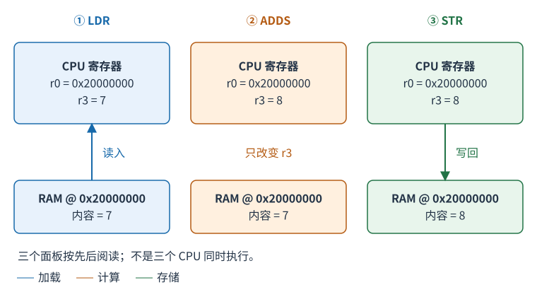
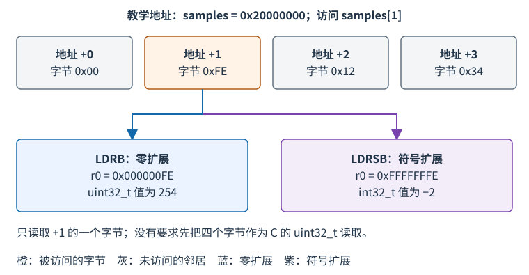
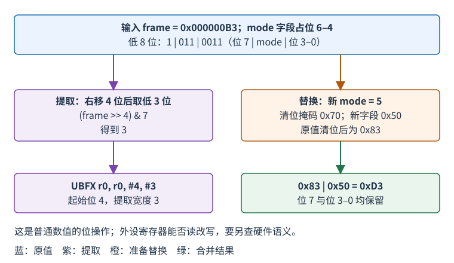
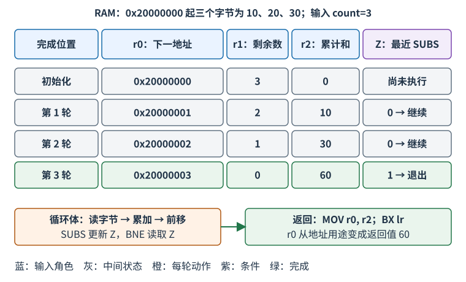

<!-- SPDX-License-Identifier: Apache-2.0 -->

# 第13章\_Thumb指令与C语句

上一章已经生成 `instructions.o`。现在要把反汇编输出里的地址、编码和寄存器变化对上 C 语义，弄清楚程序究竟做了哪些机器动作。

**汇编语言（Assembly Language）** 使用便于阅读的助记符表达机器指令，也包括指导汇编器组织代码的指示语句。**Thumb** 是 Arm 的指令编码体系名称，Cortex-M7 使用其支持的 16 位和 32 位指令编码。名称中的 Thumb 不是一个需要逐字展开的缩写；指令宽度也不等于处理器寄存器宽度。

## 13.1\_先认出指令操作的寄存器

M7 的核心通用寄存器为 32 位。r0–r12 可参与普通数据运算；r13 是栈指针 SP，r14 是链接寄存器 LR，r15 对应 PC。另有程序状态寄存器，提供条件标志、执行状态和当前异常信息。

**栈指针（Stack Pointer，SP）** 表示当前栈位置，下一章会实际计算它的变化。**链接寄存器（Link Register，LR）** 常用于保存函数返回信息；异常时它还可能保存特殊返回标记，不能永远解释成普通代码地址。

`MOV r1, r0` 表示把 r0 的值复制到 r1，不是把 r0 这块硬件移动过去。`LDR r1, [r0]` 则把 r0 当作地址，读取该地址的内容送入 r1。一个方括号，改变的是数据从哪里取得。

### 13.1.1\_先按动作认识常用指令

第 3 章已经建立寄存器全景。本章继续用同一个控制面板：读取采样字节、处理控制帧中的字段、累计一组样本。把这些工作拆开，才知道在指令手册里该找哪一类操作。

| 想做的事 | 常见写法 | 数据和状态如何变化 |
| --- | --- | --- |
| 复制值或放入小常数 | `mov r1,r0`；`movs r2,#0` | 前者复制位模式；后者置零并按该编码更新标志，不读 RAM |
| 加减 | `adds r2,r2,r3`；`subs r1,r1,#1` | 修改目标寄存器；这里带 S 的形式还更新 N、Z、C、V |
| 乘除 | `mul r0,r1,r2`；`udiv r0,r1,r2`；`sdiv r0,r1,r2` | 整数乘法；无符号/有符号除法。除零须按配置和业务处理，不能靠助记符保证合法输入 |
| 取位、置位、清位、翻转 | `and`、`orr`、`bic`、`eor` | 按位与、或、与取反、异或；BIC 常用于清除掩码覆盖的位 |
| 移位 | `lsl`、`lsr`、`asr` | 左移、逻辑右移补零、算术右移复制符号位；具体合法移位量由编码规定 |
| 按宽度加载/存储 | `ldrb/strb`、`ldrh/strh`、`ldr/str` | 本章分别访问 8、16、32 位；字节和半字加载零扩展到寄存器 |
| 读取带符号的窄数据 | `ldrsb`、`ldrsh` | 分别读取 8、16 位，再符号扩展到 32 位 |
| 检查值而不保存运算结果 | `cmp r0,r1`；`tst r0,#8` | CMP 更新减法相关标志；TST 按位与后更新相应标志，用 Z 判断掩码位是否全为零 |
| 跳转与循环 | `b label`、`beq label`、`bne label` | 无条件跳转、Z=1 跳转、Z=0 跳转；不会自动保存普通函数返回位置 |
| 函数调用/返回 | `bl function`；`bx lr` | BL 更新 LR 后进入目标；BX LR 使用返回信息，嵌套调用须保存旧 LR |
| 保存和恢复寄存器 | `push {r4,lr}`；`pop {r4,pc}` | 更新 SP 并访问栈内存；普通调用用法在第 14 章手算 |
| 提取连续位段 | `ubfx r0,r0,#4,#3` | 从位 4 起提取 3 位并零扩展；后面用实际 C 编译结果核对 |
| 读写控制状态 | `mrs r0,control`；`msr control,r0` | 访问第 3 章的特殊状态，写入受权限与字段规则约束，不是普通 RAM 存取 |

这里是一张**读码索引**，不是所有编码和标志规则的替代品。看到 `S` 通常需要检查是否更新条件标志，但不同指令更新的位并不相同：逻辑与不提供一套新的有符号减法结果，不能随意替代 CMP。`BIC` 是 Bit Clear（位清除），`TST` 是 Test（按位测试），`UBFX` 是 Unsigned Bit Field Extract（无符号位域提取）；助记符描述动作，不是 C 函数名。

再拆一条 `ldrb r3,[r0,#1]`：`r3` 是结果，`r0` 是地址基值，`#1` 是字节偏移，方括号要求读取地址处的内容，`B` 选择字节宽度。若工具显示 `.w`，它指宽指令编码，不表示本次一定读取 32 位数据；`ldrb.w` 仍只加载一个字节。`.n` 表示窄编码选择。立即数能否编码、寄存器是否允许参与，还要查该条指令的限制。

## 13.2\_从四条指令看懂一次变量增加

先把第 3 章的三个状态与这次亲手生成的反汇编对应起来。



图例：**蓝色是读入，橙色是计算，绿色是写回；三个面板属于同一 CPU 的先后状态**。地址始终留在 r0，r3 中的数据先变化，RAM 中的数据后变化。

名称注释：`LDR（Load Register－加载寄存器）：把内存内容读入寄存器。` `ADDS（更新条件标志的加法指令）：改变计算结果和相应标志。` `STR（Store Register－存储寄存器）：把结果写回内存。`

本机 GCC 10.3.1、`-O1` 的 `increment_word()` 反汇编如下，左列是目标文件中该代码段内的偏移，尚不是 Flash 最终位置：

```text
0000000a <increment_word>:
   a: 6803   ldr r3, [r0, #0]
   c: 3301   adds r3, #1
   e: 6003   str r3, [r0, #0]
  10: 4770   bx lr
```

`6803` 等是指令编码的显示，`ldr` 等是工具解释出的助记符。当前这些指令均为 16 位，所以地址每次增加 2；不能据此推断所有 Thumb 指令都长 2 字节。

设入口时 r0=`0x20000000`，该地址中保存 7。按顺序走一次：

| 完成指令 | r0 | r3 | 地址 `0x20000000` 中的值 |
| --- | --- | --- | --- |
| 入口 | `0x20000000` | 尚不依赖 | 7 |
| `ldr r3,[r0]` | 不变 | 7 | 7 |
| `adds r3,#1` | 不变 | 8 | 7 |
| `str r3,[r0]` | 不变 | 8 | 8 |
| `bx lr`（控制流返回调用者） | 不变 | 不要求保留 | 8 |

重点看中间一行：**加法结束后，存储器仍然是 7。** 只有存储指令才把结果写回。因此 `(*count)++` 不能被看成一个对所有观察者不可分割的动作。如果中断也修改同一位置，就要检查加载和存储之间的交错。

`LDRB/STRB` 访问字节，`LDRH/STRH` 访问半字，普通 `LDR/STR` 在这里访问 32 位字。访问外设时必须使用它允许的宽度，而不是因为只关心一个状态位就随便改用字节访问。

## 13.3\_比较如何产生条件

`cap_count()` 的相同版本输出是：

```text
00000000 <cap_count>:
   0: 3001   adds r0, #1
   2: 4288   cmp r0, r1
   4: bf28   it cs
   6: 4608   movcs r0, r1
   8: 4770   bx lr
```

先增加 r0，得到源码中的 `next`；然后 `CMP` 进行比较并更新条件标志，不把减法结果写到普通目标寄存器。这里按无符号数比较 r0 与 r1，`CS` 表示进位条件成立，对比较而言对应 r0 大于等于 r1。

源码条件是“大于”，编译器却使用“大于等于”，为什么结果仍然正确？当两者相等时，把 r1 复制到 r0 与保持 r0 不变完全相同。因此优化可以选择这个等价动作。**应该核对程序意义，不能只按条件单词逐个找源码对应。**

`IT` 是 Thumb 的条件执行控制指令；本例让后面一条 `MOVCS` 仅在相应条件成立时生效。另一版本编译器可能生成条件分支，例如跳过某条赋值，也能实现相同逻辑。`BX LR` 完成函数返回，参数和结果为什么使用 r0、r1，下一章会用调用约定解释。

| 标志 | 名称与当前含义 | 常见用途 |
| --- | --- | --- |
| N | Negative，结果符号相关标志 | 配合 V 判断有符号比较 |
| Z | Zero，结果为零 | 相等/不等判断 |
| C | Carry，进位或减法未借位相关标志 | 无符号比较与多字运算 |
| V | Overflow，有符号溢出 | 配合 N 判断有符号大小 |

无符号大于可看 C、Z 的组合，有符号大于则要看 N、V、Z。不能把 `BGT` 与 `BHI` 仅理解为两种随便选的“大于”。例如 `0xFFFFFFFF` 按无符号比较大于 1，按 32 位补码解释却为 −1，小于 1。

对应第 3 章的标志图，可以把比较后的常用条件精确到下表。条件用于 `CMP 左值,右值` 后的判断；中间不要插入会破坏所需标志的指令。

| 比较关系 | 无符号分支与条件 | 有符号分支与条件 |
| --- | --- | --- |
| 相等 / 不等 | BEQ：Z=1；BNE：Z=0 | 同左，与有无符号无关 |
| 大于 | BHI：C=1 且 Z=0 | BGT：Z=0 且 N=V |
| 大于等于 | BHS / BCS：C=1 | BGE：N=V |
| 小于 | BLO / BCC：C=0 | BLT：N≠V |
| 小于等于 | BLS：C=0 或 Z=1 | BLE：Z=1 或 N≠V |

例如 r0=`0xFFFFFFFF`、r1=1 时，CMP 后 C=1、Z=0、N=1、V=0。BHI 会跳转，BGT 不会；同一组寄存器和比较结果，通过不同条件表达两种解释。这也是阅读反汇编时必须回看 C 类型的原因。

## 13.4\_立即数、地址和伪指令如何区分

`#1` 是立即数，表示数值直接由指令表达。`[r0,#4]` 表示在 r0 地址上加四字节偏移后访问内容。`LDR r0, =symbol` 则是 GNU 汇编中常见的伪指令写法，要求汇编器把某个数值或符号地址装入 r0，最终可能展开成从常量池加载或其他合法编码。

**伪指令（Pseudo-instruction）** 是汇编器提供的表达便利，不保证与一条固定机器指令对应。源码写了 `=symbol`，不能因此认为 CPU 在运行时解析字符串 `symbol`；链接器会解决符号位置，机器码或常量区中保存的是相应编码和值。

`B label` 改变执行位置，通常不保存普通函数返回位置；`BL function` 在转移时更新 LR，以便函数返回。`BX` 根据寄存器值转移，并涉及指令状态规则。Cortex-M 只执行支持的 Thumb 状态，函数入口地址和向量项的最低位承担状态含义，不是普通指令字节真正存放在奇数地址。

## 13.5\_用优化差异加固阅读方法

对比上一章生成的 `-O0` 与 `-O1` 输出。未优化版本可能建立栈帧、把参数写到栈上再读回来；优化版本可能完全留在寄存器中。局部变量的源代码名字不保证对应固定 RAM 地址，调试器显示“变量被优化掉”也不表示程序没执行相关计算。

阅读时按三步检查：输入从哪里来，哪条指令改变了值，结果通过哪里交回。然后才看具体用了哪个寄存器、是否经过栈。这种方法可以适应编译器升级和优化变化。

练习：令 `cap_count(0xFFFFFFFFu, 100u)`，结果是否为 100？解答：`count+1u` 先按 32 位无符号规则回绕为 0，0 不超过 100，所以返回 0。如果业务要求真正饱和递增，应在增加前检查 `count>=limit` 等条件，并明确对所有输入的预期；不要用函数名替代码保证。

## 13.6\_同一个采样字节为什么会得到 254 或 −2

控制面板收到的字节可以表示原始计数，也可以表示带符号的修正量。先固定 RAM 中的比特，只改变读取类型，观察寄存器高位怎样形成。



图例：**橙色是实际读取的字节，灰色是未读取的邻居，蓝色是零扩展，紫色是符号扩展。** 两条支路是两次独立对照，不是一次加载得到两个结果。

名称注释：`LDRB（Load Register Byte－字节加载）：读取 8 位并零扩展。` `LDRSB（Load Register Signed Byte－有符号字节加载）：读取 8 位并符号扩展。` `Zero extension（零扩展）：在高位填零。` `Sign extension（符号扩展）：用原数最高位填充新增高位。`

用编辑器新建 `assembly_basics.c`，或把 [配套原件](labs/assembly_basics.c) 复制到第 12 章建立的 `mcu_arch_lab`。原件包含本节及后两节的五个函数；手工录入时，先保存下面代码，再按后两节继续添加函数。前提是工具 PATH 已按 [第 12 章](P012_建立汇编观察环境.md)设置。

```c
#include <stdint.h>

uint32_t sample_unsigned(const uint8_t *samples)
{
    return samples[1];
}

int32_t sample_signed(const int8_t *samples)
{
    return samples[1];
}
```

两者都要求输入指向至少两个有效元素；第二个元素分别按 `uint8_t` 或 `int8_t` 解释。调用示例可以使用 `uint8_t raw[2]={0,254};` 和 `int8_t correction[2]={0,-2};`，分别传给对应函数。这里的 254 和 −2 在目标的单字节补码表示中具有相同的 `0xFE` 位模式。

```bash
# UCRT64 或 Linux Bash；工作目录 mcu_arch_lab；Arm 工具 PATH 已设置。
ls assembly_basics.c
mkdir -p build
arm-none-eabi-gcc -mcpu=cortex-m7 -mthumb -mfloat-abi=soft \
  -O1 -g3 -Wall -Wextra -Werror -ffreestanding \
  -c assembly_basics.c -o build/assembly_basics.o
arm-none-eabi-objdump -dr build/assembly_basics.o
```

先确认编译无错误，再找两个函数。GNU Arm GCC 10.3.1 的实际输出去掉地址与编码列后为：

```asm
sample_unsigned:
    ldrb    r0, [r0, #1]
    bx      lr
sample_signed:
    ldrsb.w r0, [r0, #1]
    bx      lr
```

沿蓝线，`0xFE` 的上方补 24 个零，结果 `0x000000FE`，十进制 254。沿紫线，原位 7 为 1，上方补 24 个一，结果 `0xFFFFFFFE`，按 32 位有符号整数解释为 −2。r0 入口时是地址，加载完成后成为返回值；这不改变原 RAM 字节，也不需要保持 r0 的旧用途。

**地址加一不是非对齐的 32 位加载。** 这里访问宽度为一个字节，任意字节地址都满足其自然对齐；不能因为 CPU 寄存器是 32 位，就把图中四个字节解释成每次必读的一个 C 对象。总线或缓存内部可能搬更大的块，那是实现细节，不能代替这条指令对程序承诺的访问语义。

练习：把两个数组的第二个元素都改为 `0x7F`，预测两种结果。两者都得到 `0x0000007F`，即 127，因为原位 7 为零。若误把带负数的输入交给无符号读取路径，程序不会自动报错，而是得到错误业务含义的正数。

## 13.7\_把控制帧的三位字段拆开与装回

控制面板的一字节协议把位 6–4 分给工作模式，其他位另有用途。修改模式时要保留其他字段，不能直接把整个字节替换为模式编号。



图例：**蓝色是原值，紫色是提取路径，橙色是清位和新字段准备，绿色是合并结果。** 左右是两个不同函数的用途；读取模式不必先执行右边的替换。

名称注释：`Mask（位掩码）：用一组 1 指定参与操作的位。` `UBFX（Unsigned Bit Field Extract－无符号位域提取）：按起始位和宽度取出连续字段。` 本例 frame、mode 都是普通函数参数，不是外设寄存器名称。

继续在 `assembly_basics.c` 中加入：

```c
uint32_t extract_mode(uint32_t frame)
{
    return (frame >> 4) & 7u;
}

uint32_t update_mode(uint32_t frame, uint32_t mode)
{
    return (frame & ~(7u << 4)) | ((mode & 7u) << 4);
}
```

重新执行上一节同一组编译与反汇编命令。本机 `-O1` 生成：

```asm
extract_mode:
    ubfx  r0, r0, #4, #3
    bx    lr
update_mode:
    lsls  r1, r1, #4
    and.w r1, r1, #112
    bic.w r0, r0, #112
    orrs  r0, r1
    bx    lr
```

沿左边紫线，源码写了右移和按位与，编译器用一条 UBFX 实现相同语义；其中 `#3` 是提取宽度，不是最高位编号。沿右边橙线，`112=0x70` 是位 6–4 的掩码。LSLS 将模式移到目标位置，AND 只保留这三位，BIC 清掉原值中旧模式，ORRS 合并结果。两操作数的 `orrs r0,r1` 在这里表示 `r0=r0|r1`。

用图上的输入手算：`extract_mode(0xB3)` 得到 3；`update_mode(0xB3,5)` 先得到 `0x83` 和 `0x50`，合并为 `0xD3`。如果删除清位动作，只执行 `frame | (mode<<4)`，旧模式中残留的 1 会使结果变成 `0xF3`，模式错误地成为 7。

再传 `mode=13`：本函数按低三位截取，效果仍为 5；这不是输入合法性检查。若协议要求拒绝 8 以上的值，应在调用前判断并返回错误，不能把掩码当作业务校验。对于真实外设，还必须检查是否只写、读有副作用、写 1 清零或有专用置位/复位入口；本例的普通数值读改写不能直接套用到任意外设寄存器。

## 13.8\_让三次采样走完一次真正的汇编循环

最后把加载、加法、地址前移、比较和返回连起来。控制面板准备了三个采样字节 10、20、30，我们要计算它们的总和。先在图中追踪每轮结束时的寄存器，再读循环体。



图例：**蓝色是输入角色，灰色是中间状态，橙色是每轮动作，紫色是分支条件，绿色是完成状态。** 每行是同一组 CPU 寄存器在不同时刻的值；图中地址是教学假设，不是读者必须烧录的地址。

名称注释：`SUBS（Subtract and update flags－减法并更新标志）：本例减少剩余数量并产生 Z。` `BNE（Branch if Not Equal－不等时分支）：当 Z=0 时回到循环。` r0、r1、r2 的角色由本函数分配，不是硬件永久绑定的变量名称。

在同一个 C 文件加入完整的对照函数：

```c
uint32_t sum_samples(const uint8_t *samples, uint32_t count)
{
    uint32_t sum = 0;

    for (uint32_t index = 0; index < count; ++index) {
        sum += samples[index];
    }
    return sum;
}
```

输入必须包含至少 count 个有效字节；count=0 时不读取数据，结果为 0。总和按 `uint32_t` 规则回绕，函数不负责确认缓冲区长度或保证任意长度累加不溢出。现在新建 `sum_samples.S`，或复制 [配套原件](labs/sum_samples.S)。下面是**手写的等价教学实现**，不是声称 GCC 必须生成这些指令：

```asm
.syntax unified
.cpu cortex-m7
.thumb
.text

.global sum_samples_asm
.type sum_samples_asm, %function
.thumb_func
sum_samples_asm:
    movs r2, #0
    cmp r1, #0
    beq .Ldone
.Lloop:
    ldrb r3, [r0]
    adds r2, r2, r3
    adds r0, r0, #1
    subs r1, r1, #1
    bne .Lloop
.Ldone:
    mov r0, r2
    bx lr
.size sum_samples_asm, .-sum_samples_asm
```

点号开头的 `.syntax`、`.cpu` 等是汇编器指示语句；`.Lloop` 和 `.Ldone` 是本文件内部标签。`.global` 导出函数，`.type` 与 `.thumb_func` 标记函数身份，`.size` 记录长度；CPU 实际执行的是标签之间的机器指令，不执行这些文本声明。

入口 r0 是缓冲区地址，r1 是数量。MOVS 清零累计寄存器 r2，CMP/BEQ 先处理零长度，避免空输入也读取一次。每轮 LDRB 把一个字节送入 r3，ADDS 加到 r2，第二条 ADDS 把地址推进一字节，SUBS 减少剩余数。**BNE 紧跟 SUBS，读取的是剩余数是否为零的 Z，而不是更早加法的 Z。** 若把会修改 Z 的指令插到二者之间，就会改变循环判断。

沿图灰色行手推：第一轮地址前移、剩余 2、累计 10；第二轮累计 30；第三轮累计 60 且剩余 0，Z=1，不再跳转。退出时 MOV 把 r2 放到 r0 作为返回值，再 BX LR 返回。本函数只使用允许改写的 r0–r3，不调用其他函数，因此不需要为了形式而建立栈帧。

```bash
# UCRT64 或 Linux Bash；mcu_arch_lab；两个源文件都已保存。
mkdir -p build
arm-none-eabi-gcc -mcpu=cortex-m7 -mthumb -mfloat-abi=soft \
  -O1 -Wall -Wextra -Werror -ffreestanding \
  -c assembly_basics.c -o build/assembly_basics.o
arm-none-eabi-gcc -mcpu=cortex-m7 -mthumb -mfloat-abi=soft \
  -c sum_samples.S -o build/sum_samples.o
arm-none-eabi-objdump -dr build/assembly_basics.o
arm-none-eabi-objdump -dr build/sum_samples.o
```

手写函数的反汇编应保留零长度分支和循环尾的 SUBS/BNE。C 版本则可能使用结束地址比较；本机 GCC 10.3.1 实际生成 `ldrb.w r1,[r3,#1]!`，随后用 CMP 比较遍历地址和结束地址。这里 `!` 表示将有效地址写回基址寄存器；这与不带 `!` 的偏移访问不同。不能因为寄存器角色与图不同就判定编译器出错，应核对读了哪些字节、是否越界、最终返回值是否一致。

可在已准备好的目标调试环境中，用原型 `uint32_t sum_samples_asm(const uint8_t *, uint32_t);` 调用手写版本，并与 C 版本对照。没有开发板时，本章的编译和手推已能完成读码实验；`.o` 尚不是独立可运行固件。

| 输入与变更 | 预期结果 | 要定位的机制 |
| --- | --- | --- |
| `{10,20,30}`，count=3 | 60 | 三次字节读取，最后一轮 Z=1 |
| 同一数组，count=1 | 10 | 只读取首字节 |
| count=0 | 0，完全不读取缓冲区 | 入口 BEQ 直接到完成标签 |
| `{255,1}`，count=2 | 256 | 单字节加载不意味着累计和也只有 8 位 |
| 删除入口 CMP/BEQ，再传 count=0 | 逻辑错误，可能越界或故障 | 仍会先读一次，剩余数减为 `0xFFFFFFFF`，不能正常按零长度返回 |

本章新增 C 与手写汇编均已用上述工具编译和反汇编核对；普通算例可手工重建全部寄存器变化。这些结论不表示已在 H743 实板运行或测得指令耗时。

官方对照：[PM0253 Rev 6，§3 The Cortex-M7 instruction set](https://www.st.com/resource/en/programming_manual/DM00237416.pdf)，按 **LDR/LDRB/LDRSB、LSL、BIC、UBFX、CMP、B、MRS/MSR** 的独立条目查询操作数、条件标志和权限。先查“数据从哪里到哪里”，再查标志和限制；不要仅按指令名称猜副作用。本章保留整数主线，浮点与 DSP 指令不要求在此背全。

阅读导航：[上一章](P012_建立汇编观察环境.md) · [专题大纲](大纲.md) · [下一章：函数调用与栈](P014_函数调用与栈.md)
