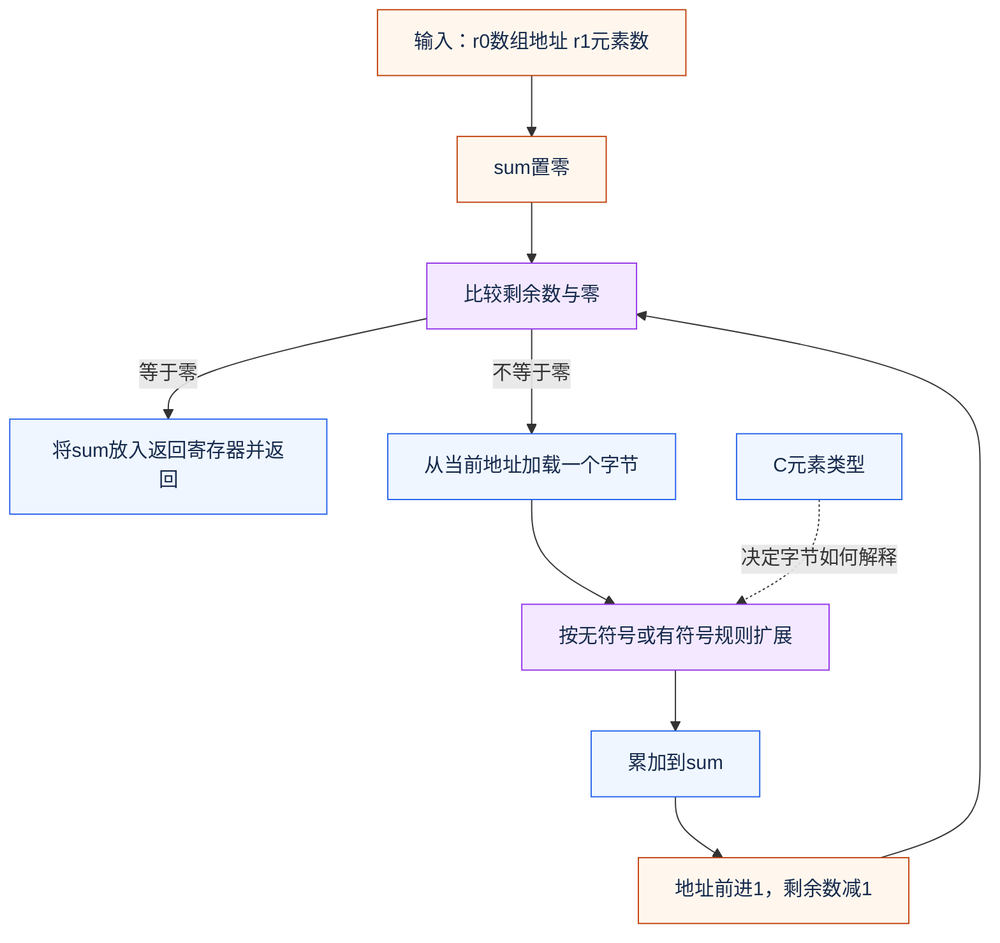

<!-- SPDX-License-Identifier: Apache-2.0 -->

# 第1章\_用寄存器状态读懂分支与循环

本专题把汇编当作状态变化的描述：指令读取什么、写入什么、下一步到哪里。先认识通用寄存器与地址，再看一个采样求和循环，比孤立背诵助记符更容易迁移到编译器生成的程序。

图例：**蓝色节点表示一般参与者，紫色突出处理或决策，橙色表示保存的数据或状态。** 实线是控制流，虚线连接语言类型与指令语义。`Thumb` 是 Arm 指令编码体系的名称；Cortex-M 使用 Thumb 指令，指令编码可以是16或32位，不能把 Thumb 理解为所有数据都只有16位。

循环至少维护三种独立状态：当前指针、剩余数量和累计结果。只看 ADD 会遗漏地址与退出条件，进而看不出越界或死循环。比较指令更新条件标志，随后的条件分支读取标志；如果中间插入会改标志的指令，分支依据可能已经改变。

字节 `0xFE` 经过零扩展得到254，经过符号扩展得到-2。两者读的是相同内存位串，差别在扩展规则。无符号大小比较与有符号大小比较也使用不同条件：C 与 Z 支持无符号关系，N 与 V 的组合用于有符号关系。不能把看到最高位为1直接等同于“所有比较里都更小”。

编译器可能把剩余数减一和比较合并，也可能展开循环；这些优化改变形式，却必须保持适用语言条件下的结果。阅读时先还原状态与终止条件，再给每条指令归属职责。

继续：[原理与实现](P002_原理与实现.md)。返回：[专题大纲](大纲.md)。
