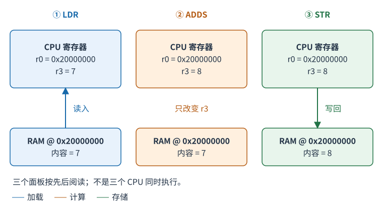

<!-- SPDX-License-Identifier: Apache-2.0 -->

# 第2章\_Thumb操作数条件与地址形成

> [P01 总目录](../大纲.md) / [P013 Thumb指令与C语句](大纲.md) / 第 2 篇（共 4 篇）

本篇细节：

- [2.1.1_先按动作认识常用指令](#subsection-2-1-1)

本篇路线：

- [2.1_先认出指令操作的寄存器](#section-1)
- [2.2_从四条指令看懂一次变量增加](#section-2)
- [2.3_比较如何产生条件](#section-3)
- [2.4_立即数、地址和伪指令如何区分](#section-4)
- [2.5_用优化差异加固阅读方法](#section-5)


前一专题已经生成 `instructions.o`。现在要把反汇编输出里的地址、编码和寄存器变化对上 C 语义，弄清楚程序究竟做了哪些机器动作。

**汇编语言（Assembly Language）** 使用便于阅读的助记符表达机器指令，也包括指导汇编器组织代码的指示语句。**Thumb** 是 Arm 的指令编码体系名称，Cortex-M7 使用其支持的 16 位和 32 位指令编码。名称中的 Thumb 不是一个需要逐字展开的缩写；指令宽度也不等于处理器寄存器宽度。

<a id="13.1_先认出指令操作的寄存器"></a>

<a id="section-1"></a>

## 2.1\_先认出指令操作的寄存器

M7 的核心通用寄存器为 32 位。r0–r12 可参与普通数据运算；r13 是栈指针 SP，r14 是链接寄存器 LR，r15 对应 PC。另有程序状态寄存器，提供条件标志、执行状态和当前异常信息。

**栈指针（Stack Pointer，SP）** 表示当前栈位置，后一专题会实际计算它的变化。**链接寄存器（Link Register，LR）** 常用于保存函数返回信息；异常时它还可能保存特殊返回标记，不能永远解释成普通代码地址。

`MOV r1, r0` 表示把 r0 的值复制到 r1，不是把 r0 这块硬件移动过去。`LDR r1, [r0]` 则把 r0 当作地址，读取该地址的内容送入 r1。一个方括号，改变的是数据从哪里取得。

<a id="13.1.1_先按动作认识常用指令"></a>

<a id="subsection-2-1-1"></a>

### 2.1.1\_先按动作认识常用指令

CPU 的通用寄存器保存当前运算的数或地址。下面读每条 Thumb 指令时，先找它取哪些寄存器的值，再找结果写回哪里。我们用同一块控制面板的三个任务练习：读取采样字节、处理控制帧中的字段、累计一组样本。

| 想做的事 | 常见写法 | 数据和状态如何变化 |
| --- | --- | --- |
| 复制值或放入小常数 | `mov r1,r0`；`movs r2,#0` | 前者复制位模式；后者置零并按该编码更新标志，不读 RAM |
| 加减 | `adds r2,r2,r3`；`subs r1,r1,#1` | 修改目标寄存器；这里带 S 的形式还更新 N、Z、C、V |
| 乘除 | `mul r0,r1,r2`；`udiv r0,r1,r2`；`sdiv r0,r1,r2` | 整数乘法；无符号/有符号除法。除零须按配置和业务处理，不能靠助记符保证合法输入 |
| 取位、置位、清位、翻转 | `and`、`orr`、`bic`、`eor` | 按位与、或、与取反、异或；BIC 常用于清除掩码覆盖的位 |
| 移位 | `lsl`、`lsr`、`asr` | 左移、逻辑右移补零、算术右移复制符号位；具体合法移位量由编码规定 |
| 按宽度加载/存储 | `ldrb/strb`、`ldrh/strh`、`ldr/str` | 本章分别访问 8、16、32 位；字节和半字加载零扩展到寄存器 |
| 读取带符号的窄数据 | `ldrsb`、`ldrsh` | 分别读取 8、16 位，再符号扩展到 32 位 |
| 检查值而不保存运算结果 | `cmp r0,r1`；`tst r0,#8` | CMP 更新减法相关标志；TST 按位与后更新相应标志，用 Z 判断掩码位是否全为零 |
| 跳转与循环 | `b label`、`beq label`、`bne label` | 无条件跳转、Z=1 跳转、Z=0 跳转；不会自动保存普通函数返回位置 |
| 函数调用/返回 | `bl function`；`bx lr` | BL 更新 LR 后进入目标；BX LR 使用返回信息，嵌套调用须保存旧 LR |
| 保存和恢复寄存器 | `push {r4,lr}`；`pop {r4,pc}` | 更新 SP 并访问栈内存；普通调用用法在第14专题手算 |
| 提取连续位段 | `ubfx r0,r0,#4,#3` | 从位 4 起提取 3 位并零扩展；后面用实际 C 编译结果核对 |
| 读写控制状态 | `mrs r0,control`；`msr control,r0` | 访问第3专题的特殊状态，写入受权限与字段规则约束，不是普通 RAM 存取 |

这里是一张**读码索引**，不是所有编码和标志规则的替代品。看到 `S` 通常需要检查是否更新条件标志，但不同指令更新的位并不相同：逻辑与不提供一套新的有符号减法结果，不能随意替代 CMP。`BIC` 是 Bit Clear（位清除），`TST` 是 Test（按位测试），`UBFX` 是 Unsigned Bit Field Extract（无符号位域提取）；助记符描述动作，不是 C 函数名。

再拆一条 `ldrb r3,[r0,#1]`：`r3` 是结果，`r0` 是地址基值，`#1` 是字节偏移，方括号要求读取地址处的内容，`B` 选择字节宽度。若工具显示 `.w`，它指宽指令编码，不表示本次一定读取 32 位数据；`ldrb.w` 仍只加载一个字节。`.n` 表示窄编码选择。立即数能否编码、寄存器是否允许参与，还要查该条指令的限制。

<a id="13.2_从四条指令看懂一次变量增加"></a>

<a id="section-2"></a>

## 2.2\_从四条指令看懂一次变量增加

先把第3专题的三个状态与这次亲手生成的反汇编对应起来。



图例：**蓝色是读入，橙色是计算，绿色是写回；三个面板属于同一 CPU 的先后状态**。地址始终留在 r0，r3 中的数据先变化，RAM 中的数据后变化。

名称注释：`LDR（Load Register－加载寄存器）：把内存内容读入寄存器。` `ADDS（更新条件标志的加法指令）：改变计算结果和相应标志。` `STR（Store Register－存储寄存器）：把结果写回内存。`

本机 GCC 10.3.1、`-O1` 的 `increment_word()` 反汇编如下，左列是目标文件中该代码段内的偏移，尚不是 Flash 最终位置：

```text
0000000a <increment_word>:
   a: 6803   ldr r3, [r0, #0]
   c: 3301   adds r3, #1
   e: 6003   str r3, [r0, #0]
  10: 4770   bx lr
```

`6803` 等是指令编码的显示，`ldr` 等是工具解释出的助记符。当前这些指令均为 16 位，所以地址每次增加 2；不能据此推断所有 Thumb 指令都长 2 字节。

设入口时 r0=`0x20000000`，该地址中保存 7。按顺序走一次：

| 完成指令 | r0 | r3 | 地址 `0x20000000` 中的值 |
| --- | --- | --- | --- |
| 入口 | `0x20000000` | 尚不依赖 | 7 |
| `ldr r3,[r0]` | 不变 | 7 | 7 |
| `adds r3,#1` | 不变 | 8 | 7 |
| `str r3,[r0]` | 不变 | 8 | 8 |
| `bx lr`（控制流返回调用者） | 不变 | 不要求保留 | 8 |

重点看中间一行：**加法结束后，存储器仍然是 7。** 只有存储指令才把结果写回。因此 `(*count)++` 不能被看成一个对所有观察者不可分割的动作。如果中断也修改同一位置，就要检查加载和存储之间的交错。

`LDRB/STRB` 访问字节，`LDRH/STRH` 访问半字，普通 `LDR/STR` 在这里访问 32 位字。访问外设时必须使用它允许的宽度，而不是因为只关心一个状态位就随便改用字节访问。

<a id="13.3_比较如何产生条件"></a>

<a id="section-3"></a>

## 2.3\_比较如何产生条件

`cap_count()` 的相同版本输出是：

```text
00000000 <cap_count>:
   0: 3001   adds r0, #1
   2: 4288   cmp r0, r1
   4: bf28   it cs
   6: 4608   movcs r0, r1
   8: 4770   bx lr
```

先增加 r0，得到源码中的 `next`；然后 `CMP` 进行比较并更新条件标志，不把减法结果写到普通目标寄存器。这里按无符号数比较 r0 与 r1，`CS` 表示进位条件成立，对比较而言对应 r0 大于等于 r1。

源码条件是“大于”，编译器却使用“大于等于”，为什么结果仍然正确？当两者相等时，把 r1 复制到 r0 与保持 r0 不变完全相同。因此优化可以选择这个等价动作。**应该核对程序意义，不能只按条件单词逐个找源码对应。**

`IT` 是 Thumb 的条件执行控制指令；本例让后面一条 `MOVCS` 仅在相应条件成立时生效。另一版本编译器可能生成条件分支，例如跳过某条赋值，也能实现相同逻辑。`BX LR` 完成函数返回，参数和结果为什么使用 r0、r1，后一专题会用调用约定解释。

| 标志 | 名称与当前含义 | 常见用途 |
| --- | --- | --- |
| N | Negative，结果符号相关标志 | 配合 V 判断有符号比较 |
| Z | Zero，结果为零 | 相等/不等判断 |
| C | Carry，进位或减法未借位相关标志 | 无符号比较与多字运算 |
| V | Overflow，有符号溢出 | 配合 N 判断有符号大小 |

无符号大于可看 C、Z 的组合，有符号大于则要看 N、V、Z。不能把 `BGT` 与 `BHI` 仅理解为两种随便选的“大于”。例如 `0xFFFFFFFF` 按无符号比较大于 1，按 32 位补码解释却为 −1，小于 1。

对应第3专题的标志图，可以把比较后的常用条件精确到下表。条件用于 `CMP 左值,右值` 后的判断；中间不要插入会破坏所需标志的指令。

| 比较关系 | 无符号分支与条件 | 有符号分支与条件 |
| --- | --- | --- |
| 相等 / 不等 | BEQ：Z=1；BNE：Z=0 | 同左，与有无符号无关 |
| 大于 | BHI：C=1 且 Z=0 | BGT：Z=0 且 N=V |
| 大于等于 | BHS / BCS：C=1 | BGE：N=V |
| 小于 | BLO / BCC：C=0 | BLT：N≠V |
| 小于等于 | BLS：C=0 或 Z=1 | BLE：Z=1 或 N≠V |

例如 r0=`0xFFFFFFFF`、r1=1 时，CMP 后 C=1、Z=0、N=1、V=0。BHI 会跳转，BGT 不会；同一组寄存器和比较结果，通过不同条件表达两种解释。这也是阅读反汇编时必须回看 C 类型的原因。

<a id="13.4_立即数、地址和伪指令如何区分"></a>

<a id="section-4"></a>

## 2.4\_立即数、地址和伪指令如何区分

`#1` 是立即数，表示数值直接由指令表达。`[r0,#4]` 表示在 r0 地址上加四字节偏移后访问内容。`LDR r0, =symbol` 则是 GNU 汇编中常见的伪指令写法，要求汇编器把某个数值或符号地址装入 r0，最终可能展开成从常量池加载或其他合法编码。

**伪指令（Pseudo-instruction）** 是汇编器提供的表达便利，不保证与一条固定机器指令对应。源码写了 `=symbol`，不能因此认为 CPU 在运行时解析字符串 `symbol`；链接器会解决符号位置，机器码或常量区中保存的是相应编码和值。

`B label` 改变执行位置，通常不保存普通函数返回位置；`BL function` 在转移时更新 LR，以便函数返回。`BX` 根据寄存器值转移，并涉及指令状态规则。Cortex-M 只执行支持的 Thumb 状态，函数入口地址和向量项的最低位承担状态含义，不是普通指令字节真正存放在奇数地址。

<a id="13.5_用优化差异加固阅读方法"></a>

<a id="section-5"></a>

## 2.5\_用优化差异加固阅读方法

对比前一专题生成的 `-O0` 与 `-O1` 输出。未优化版本可能建立栈帧、把参数写到栈上再读回来；优化版本可能完全留在寄存器中。局部变量的源代码名字不保证对应固定 RAM 地址，调试器显示“变量被优化掉”也不表示程序没执行相关计算。

阅读时按三步检查：输入从哪里来，哪条指令改变了值，结果通过哪里交回。然后才看具体用了哪个寄存器、是否经过栈。这种方法可以适应编译器升级和优化变化。

练习：令 `cap_count(0xFFFFFFFFu, 100u)`，结果是否为 100？解答：`count+1u` 先按 32 位无符号规则回绕为 0，0 不超过 100，所以返回 0。如果业务要求真正饱和递增，应在增加前检查 `count>=limit` 等条件，并明确对所有输入的预期；不要用函数名替代码保证。

---

[← 循环状态与条件标志的关系](P001_循环状态与条件标志的关系.md) · [本专题目录](大纲.md) · [字节扩展位字段与采样循环 →](P003_字节扩展位字段与采样循环.md)
