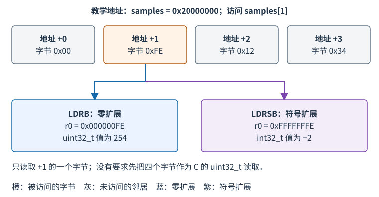
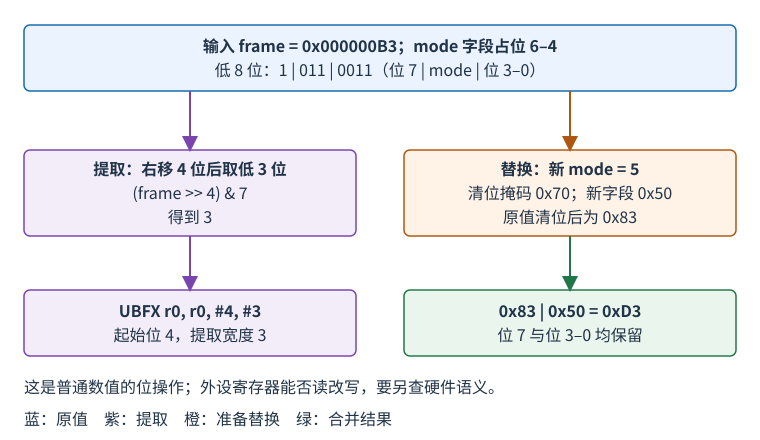
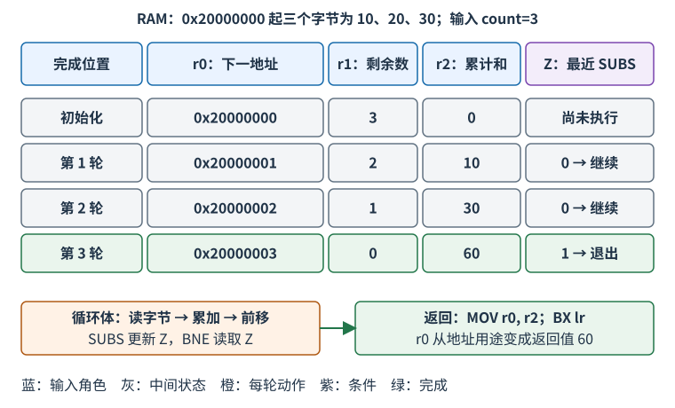

<!-- SPDX-License-Identifier: Apache-2.0 -->

# 第3章\_字节扩展位字段与采样循环

> [P01 总目录](../大纲.md) / [P013 Thumb指令与C语句](大纲.md) / 第 3 篇（共 4 篇）

本篇路线：

- [3.1_同一个采样字节为什么会得到 254 或 −2](#section-1)
- [3.2_把控制帧的三位字段拆开与装回](#section-2)
- [3.3_让三次采样走完一次真正的汇编循环](#section-3)


前篇已经建立操作数、条件标志和地址形成。本篇将这些规则用到真实字节和循环：先比较零扩展与符号扩展，再提取控制帧字段，最后跟踪三次采样的累加过程。

<a id="13.6_同一个采样字节为什么会得到-254-或-−2"></a>

<a id="section-1"></a>

## 3.1\_同一个采样字节为什么会得到 254 或 −2

控制面板收到的字节可以表示原始计数，也可以表示带符号的修正量。先固定 RAM 中的比特，只改变读取类型，观察寄存器高位怎样形成。



图例：**橙色是实际读取的字节，灰色是未读取的邻居，蓝色是零扩展，紫色是符号扩展。** 两条支路是两次独立对照，不是一次加载得到两个结果。

名称注释：`LDRB（Load Register Byte－字节加载）：读取 8 位并零扩展。` `LDRSB（Load Register Signed Byte－有符号字节加载）：读取 8 位并符号扩展。` `Zero extension（零扩展）：在高位填零。` `Sign extension（符号扩展）：用原数最高位填充新增高位。`

用编辑器新建 `assembly_basics.c`，或把 [配套原件](../labs/assembly_basics.c) 复制到第12专题建立的 `mcu_arch_lab`。原件包含本节及后两节的五个函数；手工录入时，先保存下面代码，再按后两节继续添加函数。前提是工具 PATH 已按 [第12专题](../P012_assembly_tools/P002_安装工具并保留各阶段产物.md)设置。

```c
#include <stdint.h>

uint32_t sample_unsigned(const uint8_t *samples)
{
    return samples[1];
}

int32_t sample_signed(const int8_t *samples)
{
    return samples[1];
}
```

两者都要求输入指向至少两个有效元素；第二个元素分别按 `uint8_t` 或 `int8_t` 解释。调用示例可以使用 `uint8_t raw[2]={0,254};` 和 `int8_t correction[2]={0,-2};`，分别传给对应函数。这里的 254 和 −2 在目标的单字节补码表示中具有相同的 `0xFE` 位模式。

```bash
# UCRT64 或 Linux Bash；工作目录 mcu_arch_lab；Arm 工具 PATH 已设置。
ls assembly_basics.c
mkdir -p build
arm-none-eabi-gcc -mcpu=cortex-m7 -mthumb -mfloat-abi=soft \
  -O1 -g3 -Wall -Wextra -Werror -ffreestanding \
  -c assembly_basics.c -o build/assembly_basics.o
arm-none-eabi-objdump -dr build/assembly_basics.o
```

先确认编译无错误，再找两个函数。GNU Arm GCC 10.3.1 的实际输出去掉地址与编码列后为：

```asm
sample_unsigned:
    ldrb    r0, [r0, #1]
    bx      lr
sample_signed:
    ldrsb.w r0, [r0, #1]
    bx      lr
```

沿蓝线，`0xFE` 的上方补 24 个零，结果 `0x000000FE`，十进制 254。沿紫线，原位 7 为 1，上方补 24 个一，结果 `0xFFFFFFFE`，按 32 位有符号整数解释为 −2。r0 入口时是地址，加载完成后成为返回值；这不改变原 RAM 字节，也不需要保持 r0 的旧用途。

**地址加一不是非对齐的 32 位加载。** 这里访问宽度为一个字节，任意字节地址都满足其自然对齐；不能因为 CPU 寄存器是 32 位，就把图中四个字节解释成每次必读的一个 C 对象。总线或缓存内部可能搬更大的块，那是实现细节，不能代替这条指令对程序承诺的访问语义。

练习：把两个数组的第二个元素都改为 `0x7F`，预测两种结果。两者都得到 `0x0000007F`，即 127，因为原位 7 为零。若误把带负数的输入交给无符号读取路径，程序不会自动报错，而是得到错误业务含义的正数。

<a id="13.7_把控制帧的三位字段拆开与装回"></a>

<a id="section-2"></a>

## 3.2\_把控制帧的三位字段拆开与装回

控制面板的一字节协议把位 6–4 分给工作模式，其他位另有用途。修改模式时要保留其他字段，不能直接把整个字节替换为模式编号。



图例：**蓝色是原值，紫色是提取路径，橙色是清位和新字段准备，绿色是合并结果。** 左右是两个不同函数的用途；读取模式不必先执行右边的替换。

名称注释：`Mask（位掩码）：用一组 1 指定参与操作的位。` `UBFX（Unsigned Bit Field Extract－无符号位域提取）：按起始位和宽度取出连续字段。` 本例 frame、mode 都是普通函数参数，不是外设寄存器名称。

继续在 `assembly_basics.c` 中加入：

```c
uint32_t extract_mode(uint32_t frame)
{
    return (frame >> 4) & 7u;
}

uint32_t update_mode(uint32_t frame, uint32_t mode)
{
    return (frame & ~(7u << 4)) | ((mode & 7u) << 4);
}
```

重新执行上一节同一组编译与反汇编命令。本机 `-O1` 生成：

```asm
extract_mode:
    ubfx  r0, r0, #4, #3
    bx    lr
update_mode:
    lsls  r1, r1, #4
    and.w r1, r1, #112
    bic.w r0, r0, #112
    orrs  r0, r1
    bx    lr
```

沿左边紫线，源码写了右移和按位与，编译器用一条 UBFX 实现相同语义；其中 `#3` 是提取宽度，不是最高位编号。沿右边橙线，`112=0x70` 是位 6–4 的掩码。LSLS 将模式移到目标位置，AND 只保留这三位，BIC 清掉原值中旧模式，ORRS 合并结果。两操作数的 `orrs r0,r1` 在这里表示 `r0=r0|r1`。

用图上的输入手算：`extract_mode(0xB3)` 得到 3；`update_mode(0xB3,5)` 先得到 `0x83` 和 `0x50`，合并为 `0xD3`。如果删除清位动作，只执行 `frame | (mode<<4)`，旧模式中残留的 1 会使结果变成 `0xF3`，模式错误地成为 7。

再传 `mode=13`：本函数按低三位截取，效果仍为 5；这不是输入合法性检查。若协议要求拒绝 8 以上的值，应在调用前判断并返回错误，不能把掩码当作业务校验。对于真实外设，还必须检查是否只写、读有副作用、写 1 清零或有专用置位/复位入口；本例的普通数值读改写不能直接套用到任意外设寄存器。

<a id="13.8_让三次采样走完一次真正的汇编循环"></a>

<a id="section-3"></a>

## 3.3\_让三次采样走完一次真正的汇编循环

最后把加载、加法、地址前移、比较和返回连起来。控制面板准备了三个采样字节 10、20、30，我们要计算它们的总和。先在图中追踪每轮结束时的寄存器，再读循环体。



图例：**蓝色是输入角色，灰色是中间状态，橙色是每轮动作，紫色是分支条件，绿色是完成状态。** 每行是同一组 CPU 寄存器在不同时刻的值；图中地址是教学假设，不是读者必须烧录的地址。

名称注释：`SUBS（Subtract and update flags－减法并更新标志）：本例减少剩余数量并产生 Z。` `BNE（Branch if Not Equal－不等时分支）：当 Z=0 时回到循环。` r0、r1、r2 的角色由本函数分配，不是硬件永久绑定的变量名称。

在同一个 C 文件加入完整的对照函数：

```c
uint32_t sum_samples(const uint8_t *samples, uint32_t count)
{
    uint32_t sum = 0;

    for (uint32_t index = 0; index < count; ++index) {
        sum += samples[index];
    }
    return sum;
}
```

输入必须包含至少 count 个有效字节；count=0 时不读取数据，结果为 0。总和按 `uint32_t` 规则回绕，函数不负责确认缓冲区长度或保证任意长度累加不溢出。现在新建 `sum_samples.S`，或复制 [配套原件](../labs/sum_samples.S)。下面是**手写的等价教学实现**，不是声称 GCC 必须生成这些指令：

```asm
.syntax unified
.cpu cortex-m7
.thumb
.text

.global sum_samples_asm
.type sum_samples_asm, %function
.thumb_func
sum_samples_asm:
    movs r2, #0
    cmp r1, #0
    beq .Ldone
.Lloop:
    ldrb r3, [r0]
    adds r2, r2, r3
    adds r0, r0, #1
    subs r1, r1, #1
    bne .Lloop
.Ldone:
    mov r0, r2
    bx lr
.size sum_samples_asm, .-sum_samples_asm
```

点号开头的 `.syntax`、`.cpu` 等是汇编器指示语句；`.Lloop` 和 `.Ldone` 是本文件内部标签。`.global` 导出函数，`.type` 与 `.thumb_func` 标记函数身份，`.size` 记录长度；CPU 实际执行的是标签之间的机器指令，不执行这些文本声明。

入口 r0 是缓冲区地址，r1 是数量。MOVS 清零累计寄存器 r2，CMP/BEQ 先处理零长度，避免空输入也读取一次。每轮 LDRB 把一个字节送入 r3，ADDS 加到 r2，第二条 ADDS 把地址推进一字节，SUBS 减少剩余数。**BNE 紧跟 SUBS，读取的是剩余数是否为零的 Z，而不是更早加法的 Z。** 若把会修改 Z 的指令插到二者之间，就会改变循环判断。

沿图灰色行手推：第一轮地址前移、剩余 2、累计 10；第二轮累计 30；第三轮累计 60 且剩余 0，Z=1，不再跳转。退出时 MOV 把 r2 放到 r0 作为返回值，再 BX LR 返回。本函数只使用允许改写的 r0–r3，不调用其他函数，因此不需要为了形式而建立栈帧。

```bash
# UCRT64 或 Linux Bash；mcu_arch_lab；两个源文件都已保存。
mkdir -p build
arm-none-eabi-gcc -mcpu=cortex-m7 -mthumb -mfloat-abi=soft \
  -O1 -Wall -Wextra -Werror -ffreestanding \
  -c assembly_basics.c -o build/assembly_basics.o
arm-none-eabi-gcc -mcpu=cortex-m7 -mthumb -mfloat-abi=soft \
  -c sum_samples.S -o build/sum_samples.o
arm-none-eabi-objdump -dr build/assembly_basics.o
arm-none-eabi-objdump -dr build/sum_samples.o
```

手写函数的反汇编应保留零长度分支和循环尾的 SUBS/BNE。C 版本则可能使用结束地址比较；本机 GCC 10.3.1 实际生成 `ldrb.w r1,[r3,#1]!`，随后用 CMP 比较遍历地址和结束地址。这里 `!` 表示将有效地址写回基址寄存器；这与不带 `!` 的偏移访问不同。不能因为寄存器角色与图不同就判定编译器出错，应核对读了哪些字节、是否越界、最终返回值是否一致。

可在已准备好的目标调试环境中，用原型 `uint32_t sum_samples_asm(const uint8_t *, uint32_t);` 调用手写版本，并与 C 版本对照。没有开发板时，本章的编译和手推已能完成读码实验；`.o` 尚不是独立可运行固件。

| 输入与变更 | 预期结果 | 要定位的机制 |
| --- | --- | --- |
| `{10,20,30}`，count=3 | 60 | 三次字节读取，最后一轮 Z=1 |
| 同一数组，count=1 | 10 | 只读取首字节 |
| count=0 | 0，完全不读取缓冲区 | 入口 BEQ 直接到完成标签 |
| `{255,1}`，count=2 | 256 | 单字节加载不意味着累计和也只有 8 位 |
| 删除入口 CMP/BEQ，再传 count=0 | 逻辑错误，可能越界或故障 | 仍会先读一次，剩余数减为 `0xFFFFFFFF`，不能正常按零长度返回 |

本章新增 C 与手写汇编均已用上述工具编译和反汇编核对；普通算例可手工重建全部寄存器变化。这些结论不表示已在 H743 实板运行或测得指令耗时。

官方对照：[PM0253 Rev 6，§3 The Cortex-M7 instruction set](https://www.st.com/resource/en/programming_manual/DM00237416.pdf)，按 **LDR/LDRB/LDRSB、LSL、BIC、UBFX、CMP、B、MRS/MSR** 的独立条目查询操作数、条件标志和权限。先查“数据从哪里到哪里”，再查标志和限制；不要仅按指令名称猜副作用。本章保留整数主线，浮点与 DSP 指令不要求在此背全。

---

[← Thumb操作数条件与地址形成](P002_Thumb操作数条件与地址形成.md) · [本专题目录](大纲.md) · [类型解释与空输入边界推演 →](P004_类型解释与空输入边界推演.md)
