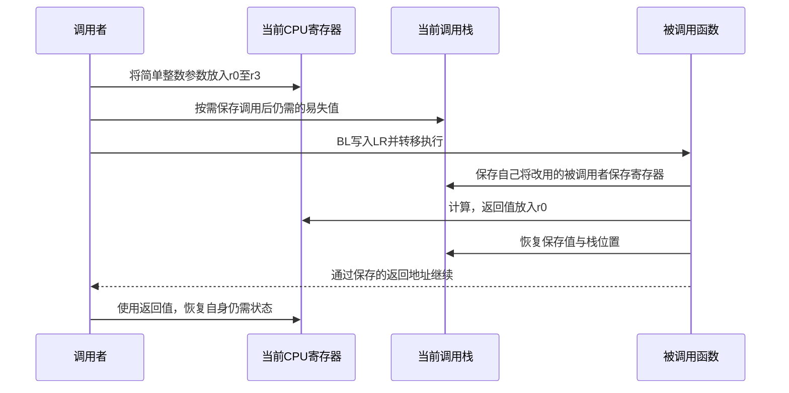

<!-- SPDX-License-Identifier: Apache-2.0 -->

# 第1章\_函数之间怎样交接寄存器与栈

分别编译的两个函数并不知道对方的源码，却必须约定参数、返回值与哪些寄存器可以被改写。这个约定由 ABI 的过程调用规则提供。本专题使用 AAPCS32 的普通整数调用，浮点参数变体和复杂类型另核对相应规则。

图例：实线为操作或控制转移，虚线为返回；灰色生命线不是并行执行的 CPU。`LR(Link Register-链接寄存器)：保存调用返回信息。` `AAPCS(Procedure Call Standard for the Arm Architecture-Arm架构过程调用标准)：规定函数二进制接口。`

普通简单整数参数从 r0–r3 开始，更多参数和特殊类型按规则使用栈或其他安排。r0 也常承载简单整数返回值。调用者不能假定 r0–r3、r12 与标志在调用后仍保持原值；被调用者改用要求保留的寄存器时，则要负责恢复。r9 的用途受平台约定影响，不能脱离具体 ABI 固定解释。

一个函数如果还要调用下一级，新的 BL 会覆盖 LR。因此“只把 LR 放在寄存器里”不够保持多层返回路径，需要先保存原返回信息。保存可用栈实现，但每次出入栈必须平衡，公共调用边界还须满足8字节栈对齐。

栈记录的是尚未完成的调用，不是所有函数都固定分配一样大的栈帧。叶函数可能不需要压栈；优化后某些局部值只在寄存器里。观察反汇编时应逐条计算 SP 的变化，不要仅靠函数序言长得像某模板来判断正确性。

继续：[原理与实现](P002_原理与实现.md)。返回：[专题大纲](大纲.md)。
