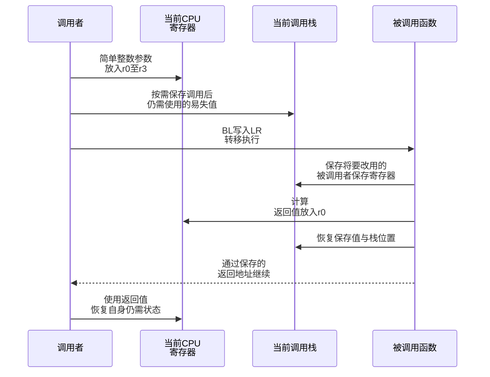

<!-- SPDX-License-Identifier: Apache-2.0 -->

# 第1章\_调用者与被调用者怎样交接状态

> [P01 总目录](../大纲.md) / [P014 函数调用与栈](大纲.md) / 第 1 篇（共 3 篇）

分别编译的两个函数并不知道对方的源码，却必须约定参数、返回值与哪些寄存器可以被改写。这个约定由 ABI 的过程调用规则提供。本专题使用 AAPCS32 的普通整数调用，浮点参数变体和复杂类型另核对相应规则。

图例：实线为操作或控制转移，虚线为返回；灰色生命线不是并行执行的 CPU。`LR(Link Register-链接寄存器)：保存调用返回信息。` `AAPCS(Procedure Call Standard for the Arm Architecture-Arm架构过程调用标准)：规定函数二进制接口。`

普通简单整数参数从 r0–r3 开始，更多参数和特殊类型按规则使用栈或其他安排。r0 也常承载简单整数返回值。调用者不能假定 r0–r3、r12 与标志在调用后仍保持原值；被调用者改用要求保留的寄存器时，则要负责恢复。r9 的用途受平台约定影响，不能脱离具体 ABI 固定解释。

一个函数如果还要调用下一级，新的 BL 会覆盖 LR。因此“只把 LR 放在寄存器里”不够保持多层返回路径，需要先保存原返回信息。保存可用栈实现，但每次出入栈必须平衡，公共调用边界还须满足8字节栈对齐。

栈记录的是尚未完成的调用，不是所有函数都固定分配一样大的栈帧。叶函数可能不需要压栈；优化后某些局部值只在寄存器里。观察反汇编时应逐条计算 SP 的变化，不要仅靠函数序言长得像某模板来判断正确性。

## 1.1\_调用者保存与被调用者保存是两份责任

假设函数 screen_update 在 r1 中保留了当前行号，又调用 calc_color。若 calc_color 合法地把 r1 当临时寄存器，返回后 screen_update 就不能继续把 r1 当作原行号。调用者必须提前保存之后还要用的易失状态。

另一种情况是 calc_color 需要使用 r4。按所用普通调用约定，若 r4 属于要求保留的状态，calc_color 应在入口保存它，在所有返回路径恢复它。调用者无需知道 calc_color 内部究竟做了多少次计算，只依赖接口约定保持成立。

“保存责任”是软件之间的契约，不是给寄存器分配不同速度或硬件权限。r4 并不因为需要恢复就比 r1 更慢；代价来自本次实际保存与恢复的指令。优化器可以根据调用关系减少开销，但跨独立编译边界仍要满足双方约定，否则一个看似正确的函数就可能破坏另一个函数的局部状态。

---

[← 类型解释与空输入边界推演](../P013_thumb_semantics/P004_类型解释与空输入边界推演.md) · [本专题目录](大纲.md) · [AAPCS传参嵌套调用与栈对齐 →](P002_AAPCS传参嵌套调用与栈对齐.md)
