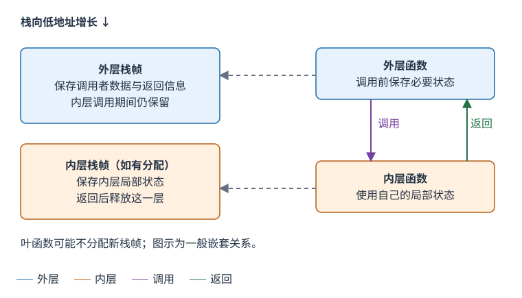

<!-- SPDX-License-Identifier: Apache-2.0 -->

# 第2章\_AAPCS传参嵌套调用与栈对齐

> [P01 总目录](../大纲.md) / [P014 函数调用与栈](大纲.md) / 第 2 篇（共 3 篇）

本篇路线：

- [2.1_调用约定让分别编译的函数能够合作](#section-1)
- [2.2_栈只是有组织地使用一段 RAM](#section-2)
- [2.3_亲手写一个会嵌套调用的汇编函数](#section-3)
- [2.4_把栈指针的每一步算出来](#section-4)
- [2.5_编译与观察尚未链接的调用](#section-5)


前一专题看到参数从 r0、r1 进入，结果从 r0 返回，最后用 `BX LR` 回到调用者。现在让函数再调用另一个函数：新的 `BL` 会更新 LR，原来那个返回位置保存到哪里？如果两个函数都使用 r4，又由谁保证原值不丢？

这些问题需要软件约定与存储空间共同解决。CPU 提供加载、存储、分支和栈相关指令，编译器与汇编程序按共同规则组织它们。

<a id="14.1_调用约定让分别编译的函数能够合作"></a>

<a id="section-1"></a>

## 2.1\_调用约定让分别编译的函数能够合作

**应用二进制接口（Application Binary Interface，ABI）** 规定二进制层面如何协作，包括参数、结果、寄存器使用和对象布局等。这里使用其中的 **Arm 过程调用标准（Procedure Call Standard for the Arm Architecture，AAPCS32）** 来解释基本整数调用。

对于本例两个 32 位整数参数，前四个参数寄存器 r0–r3 足以容纳；一个 32 位结果使用 r0。更复杂的类型、对齐、浮点 ABI 和可变参数另有规则，不能把“前四个参数寄存器”当作所有 C 类型逐个机械塞入的通用算法。

| 角色 | 基本整数调用中的责任 |
| --- | --- |
| r0–r3、r12 | 调用后可被被调函数改写；调用者若仍需旧值，要提前保存 |
| r4–r8、r10、r11 | 被调函数若使用并修改，需要恢复调用者看到的原值 |
| r9 | 与平台采用的调用标准变体有关，不能脱离约定擅自占用 |
| SP | 管理合法栈范围；公共调用边界维持所需对齐 |
| LR | 普通调用时保存返回信息；嵌套调用前可能需要另存 |

这些是协作规则，不是寄存器硬件访问权限。CPU 并不会阻止错误汇编覆盖 r4；结果是调用者的假设被破坏，错误可能在返回后很久才出现。

官方对照：[AAPCS32，2025Q1，6.1.1 Core registers、6.2.1 The Stack](https://github.com/ARM-software/abi-aa/blob/2025Q1/aapcs32/aapcs32.rst)。尤其注意 r9 的平台角色，以及普通栈约束与公共接口八字节对齐要求的区别。

<a id="14.2_栈只是有组织地使用一段-ram"></a>

<a id="section-2"></a>

## 2.2\_栈只是有组织地使用一段 RAM

**栈（Stack）** 是按后进先出规则管理的存储区域。Cortex-M 的常见栈向低地址增长：保存内容时减小 SP，取回时增大 SP。栈内保存的可以是返回地址、被保存寄存器、局部变量或额外参数；其布局由当前代码和 ABI 决定。

一个函数为自己保留的这一段空间称为**栈帧（Stack Frame）**。两个嵌套函数需要分别理解各自的帧，不能画成一个“函数现场”盒子后让读者自行猜归属。



图例：**蓝色表示外层函数保留的数据，橙色表示内层活动帧，紫色箭头是调用，绿色箭头是返回；灰色虚线连接函数与它使用的栈帧**。这是教学布局，具体编译器生成的栈帧可能不同。

名称注释：`SP（Stack Pointer－栈指针）：标识当前栈位置。` `LR（Link Register－链接寄存器）：普通调用中保存返回信息。` `ABI（Application Binary Interface－应用二进制接口）：约定函数之间的二进制协作规则。`

先看蓝色帧：它保存外层尚未用完的信息。内层使用橙色帧时不会覆盖蓝色帧，只要 SP 移动和访问范围正确。内层返回后释放橙色帧，外层仍能取回自己的数据。**空间被释放意味着可被后续调用重新使用，不代表 RAM 自动清零。** 因此返回局部栈对象的地址会留下指向失效生命周期的指针。

<a id="14.3_亲手写一个会嵌套调用的汇编函数"></a>

<a id="section-3"></a>

## 2.3\_亲手写一个会嵌套调用的汇编函数

在[已配置 Arm 工具的练习目录](../P012_assembly_tools/P002_安装工具并保留各阶段产物.md#section-2)创建 `calls.S`，或复制 [配套原件](../labs/calls.S)。以下是完整的两个函数与必要指示语句：

```asm
.syntax unified
.cpu cortex-m7
.thumb
.text

.global add_one
.type add_one, %function
.thumb_func
add_one:
    adds r0, r0, #1
    bx lr
.size add_one, .-add_one

.global add_then_accumulate
.type add_then_accumulate, %function
.thumb_func
add_then_accumulate:
    push {r4, lr}
    mov r4, r0
    bl add_one
    add r0, r0, r4
    pop {r4, pc}
.size add_then_accumulate, .-add_then_accumulate
```

`.syntax`、`.cpu`、`.thumb` 选择汇编语法和目标；`.global` 让链接时可以从其他文件引用符号；`.type`、`.thumb_func` 标记函数身份与指令状态；`.size` 描述函数长度。这些是汇编器指示语句，不是 CPU 运行时执行的指令。

`add_one()` 不再调用其他函数，所以直接返回即可。`add_then_accumulate()` 先用 **`PUSH {r4,lr}`** 保存自己调用者的 r4 与返回位置，共 8 字节，再借 r4 保存原参数。`BL add_one` 改写 LR 并进入内层；内层将 x+1 放在 r0 返回，外层再加上 r4 中的 x，最终得到 `2x+1` 的 32 位回绕结果。

最后的 **`POP {r4,pc}`** 把旧 r4 恢复，同时将先前保存的外层返回信息装入 PC，回到最初调用者。它没有把内层 `BL` 留下的 LR 当成最终返回位置，因此不会困在内层返回后的代码附近。

<a id="14.4_把栈指针的每一步算出来"></a>

<a id="section-4"></a>

## 2.4\_把栈指针的每一步算出来

假设进入外层函数时 SP=`0x20001000`，且已经满足八字节对齐。执行 `PUSH {r4,lr}` 后，SP 变为 `0x20000FF8`。较低编号寄存器 r4 保存到较低地址 `0x20000FF8`，旧 LR 保存到 `0x20000FFC`。

| 时刻 | SP | 仍需保留的信息 |
| --- | --- | --- |
| 外层入口 | `0x20001000` | 调用者寄存器与返回关系仍在 CPU 中 |
| 外层 PUSH 后 | `0x20000FF8` | RAM 保存旧 r4、旧 LR |
| 内层执行中 | `0x20000FF8` | 本例内层没有新增栈帧；LR 指向外层 BL 后 |
| 内层返回后 | `0x20000FF8` | 外层仍可从 r4 取原参数 |
| 外层 POP 后 | `0x20001000` | 栈空间归还，旧 r4 恢复，返回调用者 |

图中的两帧用于解释一般嵌套关系；这个最小内层是叶函数，没有分配新帧，表中明确体现这一差别。**函数调用不必每次都压栈**，需要保存什么取决于调用约定与实际使用。

若只 `PUSH {lr}` 就调用符合 AAPCS 的函数，SP 可能从八字节对齐变为只四字节对齐，违背公共调用边界的要求。保存两个寄存器在本例同时满足保存需要和八字节对齐，但不能把“随便多压一个寄存器”当作所有栈布局的设计方法。

<a id="14.5_编译与观察尚未链接的调用"></a>

<a id="section-5"></a>

## 2.5\_编译与观察尚未链接的调用

在工具路径已设置的同一 Bash、练习目录中运行：

```bash
# UCRT64 或 Linux Bash；在保存本节源文件的练习目录执行。
(
set -e
cd "${MCU_ARCH_LAB:-$HOME/mcu_arch_lab}"
mkdir -p build
arm-none-eabi-gcc -mcpu=cortex-m7 -mthumb -mfloat-abi=soft \
  -c calls.S -o build/calls.o
arm-none-eabi-objdump -dr build/calls.o
)
```

输出应出现 `push`、`bl` 和 `pop`。本机结果中 `BL` 使用 32 位编码，在 `-r` 输出里还能看到与 `add_one` 对应的调用重定位。目标文件里的临时分支编码不是最终固件地址，链接器会根据最终布局完成相关修正。

练习：去掉外层的 PUSH/POP，保留 `BL add_one`，最后改成 `BX LR`，为什么不能正常回到最初调用者？解答：`BL` 已把 LR 换成外层函数内部的返回点。内层返回后，LR 不自动恢复成更早的值，再 `BX LR` 就会回到这个内部位置。修复必须保存并恢复原返回信息，不能靠函数名或缩进让硬件记住调用层次。

现在函数返回有了保存位置，但上电后尚未有人调用第一个函数。后一专题从硬件复位开始，解释初始 SP、第一条指令和 C 运行环境由谁建立。

---

[← 调用者与被调用者怎样交接状态](P001_调用者与被调用者怎样交接状态.md) · [本专题目录](大纲.md) · [返回路径与寄存器保存推演 →](P003_返回路径与寄存器保存推演.md)
