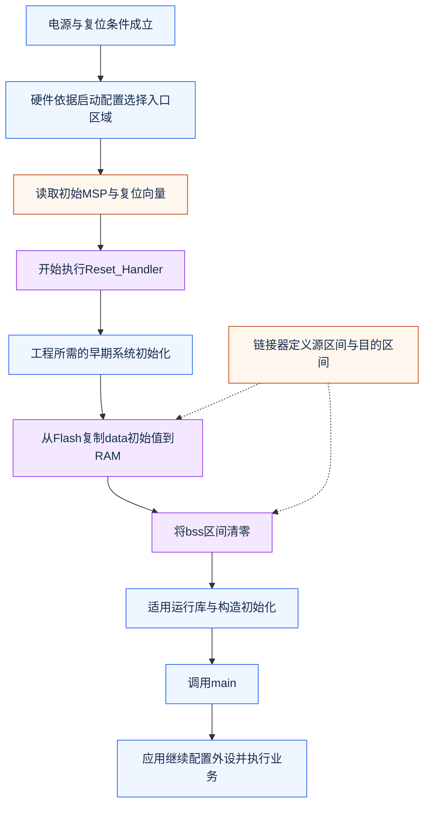

<!-- SPDX-License-Identifier: Apache-2.0 -->

# 第1章\_复位如何建立C程序所需的运行状态

main 不是芯片知道的特殊硬件地址。芯片先根据启动配置找到入口，复位代码再建立 C 程序所需要的环境。本专题先区分硬件启动选择、向量数据、启动汇编和运行库初始化，避免把这些职责全部塞进一个“启动文件”方框。

图例：**蓝色节点表示一般参与者，紫色突出处理或决策，橙色表示保存的数据或状态。** 实线是职责顺序，虚线是地址布局依赖。`MSP(Main Stack Pointer-主栈指针)：复位入口建立的栈指针。` Reset_Handler 是惯用的复位处理符号名。图表示教学职责链；具体工程可能由运行库完成复制、清零与构造调用，早期初始化顺序也应按真实启动代码核对。

设 `unsigned threshold=25;`，它运行时要能被修改，所以最终对象通常在 RAM。掉电后 RAM 不保留25，下载镜像必须在 Flash 带一份初始值，再由启动过程复制到运行地址。ELF 中的加载位置和运行位置因此可能不同。仅把变量链接进 RAM，却不安排初始化，无法兑现 C 语言的初始值约定。

未显式初始化的静态对象需要零初始化，常由 bss 清零实现。bss 的大小会占用 RAM，却不需要在原始镜像中存入同样大小的零字节。栈顶则通常取预留区间的高端边界；它不是链接器自动保证永远不会溢出的魔法地址。

调试器可能替程序写内存、设置 PC 或初始化时钟，掩盖独立上电缺陷。验证启动时应分别记录“加载后运行”“复位后运行”“断电后启动”。其中一种成功，不能冒充其余两种也已验证。

继续：[原理与实现](P002_原理与实现.md)。返回：[专题大纲](大纲.md)。
