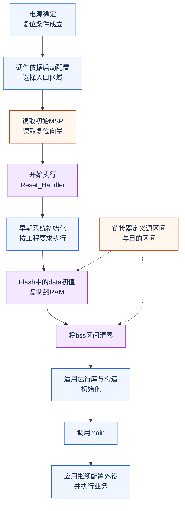

<!-- SPDX-License-Identifier: Apache-2.0 -->

# 第1章\_复位怎样建立C运行环境

> [P01 总目录](../大纲.md) / [P015 从上电复位到main](大纲.md) / 第 1 篇（共 4 篇）

main 不是芯片知道的特殊硬件地址。芯片先根据启动配置找到入口，复位代码再建立 C 程序所需要的环境。本专题先区分硬件启动选择、向量数据、启动汇编和运行库初始化，避免把这些职责全部塞进一个“启动文件”方框。

图例：**蓝色节点表示一般参与者，紫色突出处理或决策，橙色表示保存的数据或状态。** 实线是职责顺序，虚线是地址布局依赖。`MSP(Main Stack Pointer-主栈指针)：复位入口建立的栈指针。` Reset_Handler 是惯用的复位处理符号名。图表示教学职责链；具体工程可能由运行库完成复制、清零与构造调用，早期初始化顺序也应按真实启动代码核对。

设 `unsigned threshold=25;`，它运行时要能被修改，所以最终对象通常在 RAM。掉电后 RAM 不保留25，下载镜像必须在 Flash 带一份初始值，再由启动过程复制到运行地址。ELF 中的加载位置和运行位置因此可能不同。仅把变量链接进 RAM，却不安排初始化，无法兑现 C 语言的初始值约定。

未显式初始化的静态对象需要零初始化，常由 bss 清零实现。bss 的大小会占用 RAM，却不需要在原始镜像中存入同样大小的零字节。栈顶则通常取预留区间的高端边界；它不是链接器自动保证永远不会溢出的魔法地址。

调试器可能替程序写内存、设置 PC 或初始化时钟，掩盖独立上电缺陷。验证启动时应分别记录“加载后运行”“复位后运行”“断电后启动”。其中一种成功，不能冒充其余两种也已验证。

## 1.1\_启动阶段为什么不能随意调用平常的C函数

刚进入 Reset_Handler 时，C 运行环境尚未完整建立。一个看似简单的函数若读取已初始化全局变量，可能依赖尚未复制的 data；若读取本应为零的静态对象，可能依赖尚未清零的 bss。函数是用 C 写的，并不自动使这些条件提前成立。

因此早期初始化代码必须知道自己已经拥有什么：栈是否有效、所用 RAM 是否可访问、全局数据是否已建立、浮点单元是否允许使用、外部存储是否就绪。工具链生成的运行库入口可能负责其中一部分，厂商启动代码负责另一部分。读启动链时应逐个标记职责，不能根据函数名 SystemInit 就假定它已经做完全部工作。

设阈值变量在 Flash 的初值副本为25，RAM 运行位置断电后内容未知。若早期函数在复制前用阈值决定时钟配置，会把未建立的数据当成配置依据；调试器预先加载 RAM 时它可能暂时正常，独立上电时却失败。这是启动问题常被调试器掩盖的一条具体因果链。

将断点依次放在复位入口、复制清零之后和 main 入口，观察同一地址的变化，比只在 main 断点等待更有解释力。实验需要使用自己的已知好板卡与配置，并区分调试器下载后的复位与真正断电启动；本教材的链接实验本身不能替代这一步硬件验证。

---

[← 返回路径与寄存器保存推演](../P014_calling_convention/P003_返回路径与寄存器保存推演.md) · [本专题目录](大纲.md) · [硬件启动选择与data和bss初始化 →](P002_硬件启动选择与data和bss初始化.md)
