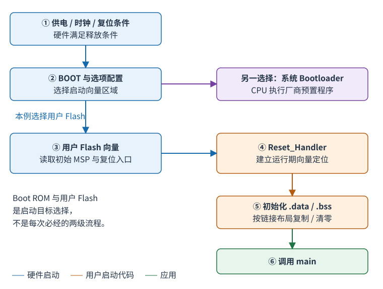
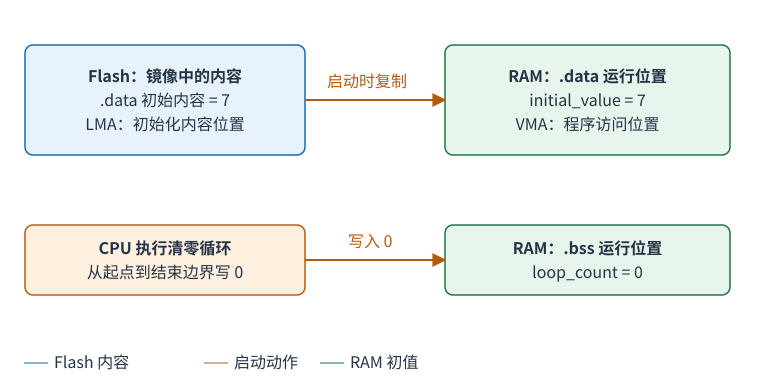

<!-- SPDX-License-Identifier: Apache-2.0 -->

# 第2章\_硬件启动选择与data和bss初始化

> [P01 总目录](../大纲.md) / [P015 从上电复位到main](大纲.md) / 第 2 篇（共 4 篇）

本篇路线：

- [2.1_供电、复位与第一条指令之间还有硬件工作](#section-1)
- [2.2_H743 怎样选择用户 Flash 或系统启动程序](#section-2)
- [2.3_初始栈和复位入口怎样从数据变成执行状态](#section-3)
- [2.4_为什么 `.data` 要复制，`.bss` 要清零](#section-4)


前面解释函数调用时，已经有一个正在运行的调用者、合法的栈和可用的数据。刚上电时这些条件尚未由应用建立。CPU 不会因为 Flash 中某个符号叫 `main`，就自动找到它并替 C 语言准备好变量。

本章从电源和复位开始，沿 H743 的启动选择、向量读取、启动代码、C 数据初始化走到 `main`，再用前一专题已经准备好的工具生成一份能够检查其结构的固件。实际烧录与运行依赖具体板卡，本章的已执行验证是编译、链接和镜像检查。

<a id="15.1_供电、复位与第一条指令之间还有硬件工作"></a>

<a id="section-1"></a>

## 2.1\_供电、复位与第一条指令之间还有硬件工作

电源上升时，芯片内部各部分并非同时到达可靠工作状态。**上电复位（Power-On Reset，POR）** 等电路在规定条件满足前保持相关逻辑处于复位状态。外部 NRST 引脚、看门狗、软件复位等也可能引发复位，但不同复位源对各区域的影响范围并不完全相同。

CPU 解除复位需要可用的时钟和符合条件的芯片状态。应用后来配置的 PLL 高速时钟并不是此时唯一可能的起点；H743 有复位时可使用的内部时钟路径。板上的电源、去耦、复位连接和启动信号必须先符合芯片要求，程序才有机会执行。



图例：**蓝色是硬件完成的启动选择与向量读取，橙色是 CPU 执行的用户启动代码，绿色是建立 C 环境后执行的应用**；紫色分支表示另一种启动目标。两个启动目标是互斥选择，不能按图理解为每次先执行 Boot ROM 再执行用户 Flash。

名称注释：`POR（Power-On Reset－上电复位）：在电源启动条件下管理复位。` `MSP（Main Stack Pointer－主栈指针）：复位后使用的栈指针。` `Boot ROM（Boot Read-Only Memory－启动只读存储区域，常用称呼）：保存厂商预置启动程序的系统存储区域。` `Flash（Flash Memory－闪存）：保存用户固件。`

沿蓝色主线先找到“选择启动区域”：硬件必须决定到哪里读取启动所需的信息。只有选到了用户固件所在区域，橙色的用户 `Reset_Handler` 才有机会被执行。若选择厂商系统启动程序，CPU 执行的是另一份程序；不是同一份 `main` 换了一个入口名称。

<a id="15.2_h743-怎样选择用户-flash-或系统启动程序"></a>

<a id="section-2"></a>

## 2.2\_H743 怎样选择用户 Flash 或系统启动程序

H743 的启动选择涉及 BOOT 引脚以及 **BOOT_ADD0、BOOT_ADD1** 选项字节。**选项字节（Option Bytes）** 是芯片用于保存启动、保护等配置的非易失设置，不是应用 RAM 中的普通变量。

按 RM0433 Rev 7 的出厂配置，BOOT 为 0 时所选启动地址对应用户 Flash `0x08000000`，BOOT 为 1 时对应系统启动程序 `0x1FF00000`。这两个地址可以受选项配置改变，所以不能把“拉低某脚一定从同一地址启动”当成不需要核对选项字节的绝对规则。

系统存储器中的启动程序由 ST 预置，常用于通过支持的通信接口下载固件。它就是通常说的厂商 Bootloader。用户也可以在自己的 Flash 中编写一个 Bootloader，由它选择并跳转到应用，但那是又增加了一层软件，不应与厂商系统启动程序混为同一个东西。

| 对象 | 谁提供 | 存放位置与作用 |
| --- | --- | --- |
| 硬件启动选择 | 芯片设计与选项配置 | 决定复位后从哪个区域取得启动信息 |
| 厂商系统 Bootloader | ST | 系统存储器，提供相应下载等功能 |
| 用户 Bootloader | 产品开发者，可选 | 用户 Flash，可能负责升级、镜像选择与跳转 |
| 用户启动代码 | 工具链模板或开发者 | 用户固件中，建立运行环境并调用应用 |
| `main()` | 应用开发者 | 在前置条件建立后执行应用逻辑 |

**官方对照：** [RM0433 Rev 7，2.6 Boot configuration、Table 9 Boot modes](https://www.st.com/resource/en/reference_manual/dm00314099.pdf)，可确认 BOOT 与两个启动地址配置的关系；具体系统 Bootloader 支持哪些接口、版本和引脚，应查 [AN2606](https://www.st.com/resource/en/application_note/an2606-stm32-microcontroller-system-memory-boot-mode-stmicroelectronics.pdf) 的对应 H743 分支。本章只观察启动配置，不要求读者修改选项字节或保护级别。

<a id="15.3_初始栈和复位入口怎样从数据变成执行状态"></a>

<a id="section-3"></a>

## 2.3\_初始栈和复位入口怎样从数据变成执行状态

选定启动向量区域后，处理器取得两个关键字：第一个提供初始 MSP，第二个提供复位处理入口。它们是存储器中的 32 位值，不是两条需要顺序执行的机器指令。

以本章用户 Flash 镜像为例：

| 镜像位置 | 保存内容 | 由谁使用 |
| --- | --- | --- |
| `0x08000000` | 初始栈顶，例如 `0x20020000` | 复位机制建立 MSP |
| `0x08000004` | `Reset_Handler` 的 Thumb 入口值 | 复位机制建立后续执行位置与状态 |
| 后续表项 | NMI、HardFault 等异常入口 | 相应异常发生时查用 |

本例 DTCM 占 `0x20000000` 到 `0x2001FFFF`，初始栈顶写成 `0x20020000` 并没有要求先访问这一个越过末端的字节。栈向低地址增长，第一次保存会先降低 SP，再写入有效 RAM。若把栈顶误填到不可写区域，启动程序一旦压栈或发生异常，就可能立即故障。

复位入口表项最低位应表示合法 Thumb 状态。比如表项为 `0x08000299`，实际指令位于对齐的 `0x08000298`。最低位在这里承担状态信息，不是让 CPU 从奇数地址按字节偏一位开始解释机器码。

**运行期向量表基址寄存器 VTOR（Vector Table Offset Register）** 位于 **SCB（System Control Block－系统控制块）** 内。它使后续异常知道去哪里取入口。本例在启动代码中明确把 VTOR 设置为用户表的地址，代码注释用 `SCB_VTOR` 表示这个寄存器。启动地址选择、镜像内向量表位置和 VTOR 配置必须协调，但它们不是同一个设置；把可执行文件头中的入口改成 `main`，不会替代芯片的硬件复位向量读取。

<a id="15.4_为什么-`.data`-要复制，`.bss`-要清零"></a>

<a id="section-4"></a>

## 2.4\_为什么 `.data` 要复制，`.bss` 要清零

考虑这两个文件作用域变量：

```c
volatile uint32_t initial_value = 7u;
volatile uint32_t loop_count;
```

`initial_value` 运行时需要可写，因此放在 RAM；断电后还要知道它的初始值 7，因此镜像在 Flash 中另外保存初始化内容。启动时把这份内容复制到 RAM，变量才从正确初值开始。这个区域通常叫 **`.data`**，是链接组织中的段名。

`loop_count` 没有显式初始化值，按 C 的静态存储期初始化规则应在程序开始时为零。镜像没有必要为每个这样的字节保存一个零，只需记录应清零的 RAM 范围，启动代码把它清零即可；这个区域通常叫 **`.bss`**。RAM 上电时碰巧读到零，不能替代这一初始化责任。



图例：**蓝色是 Flash 中随镜像保存的初始化内容，橙色框与箭头是启动代码执行的复制或清零，绿色是 RAM 中建立的初始状态**。这张图解释存储内容，不表示又有一颗执行复制的 CPU。

名称注释：`LMA（Load Memory Address－装载地址）：初始化内容在镜像中的位置。` `VMA（Virtual Memory Address－链接工具的运行地址术语）：对象运行时使用的位置；这里不意味着 H743 启用了虚拟地址转换。` `SRAM（Static Random-Access Memory－静态随机存取存储器）：保存运行期数据。`

本例不用 C++ 构造函数、标准库启动框架、动态内存或硬件浮点，也不切换到 PLL 高速时钟。因此可把最小顺序明确写成：设置运行期向量表 → 复制 `.data` → 清零 `.bss` → 调用 `main`。更完整的运行库可能还要调用构造函数、初始化库状态，厂商模板也可能在不同位置执行 `SystemInit()`；应检查实际启动文件，不能把本例顺序当成所有工程的统一实现。

---

[← 复位怎样建立C运行环境](P001_复位怎样建立C运行环境.md) · [本专题目录](大纲.md) · [链接脚本启动汇编与镜像验证 →](P003_链接脚本启动汇编与镜像验证.md)
