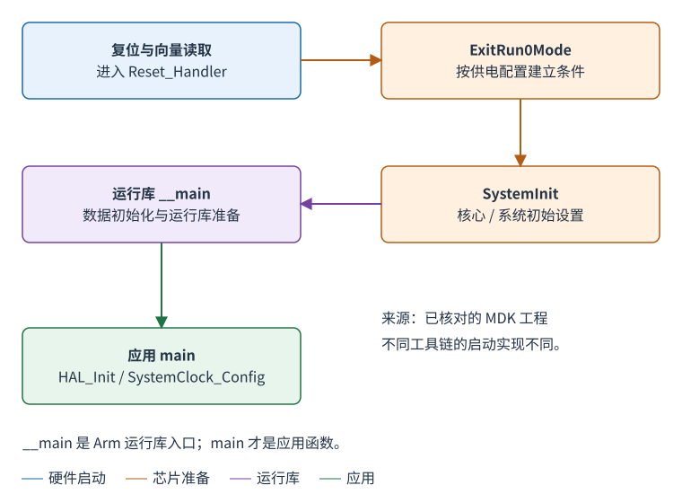

<!-- SPDX-License-Identifier: Apache-2.0 -->

# 第3章\_链接脚本启动汇编与镜像验证

> [P01 总目录](../大纲.md) / [P015 从上电复位到main](大纲.md) / 第 3 篇（共 4 篇）

本篇路线：

- [3.1_用链接脚本明确 Flash、RAM 与栈的边界](#section-1)
- [3.2_把启动汇编逐段读通](#section-2)
- [3.3_生成镜像，再验证前面每个判断](#section-3)
- [3.4_调试器为什么容易让启动问题暂时消失](#section-4)
- [3.5_对照实际 H743 工程中的启动链](#section-5)


硬件已经知道从哪里开始，data复制和bss清零也有了职责。本篇把这些要求变成链接脚本和启动汇编，生成可检查的ELF；随后对照实际H743工程，区分镜像检查与板上独立启动。

<a id="15.5_用链接脚本明确-flash、ram-与栈的边界"></a>

<a id="section-1"></a>

## 3.1\_用链接脚本明确 Flash、RAM 与栈的边界

**链接器（Linker）** 将目标文件合成最终映像，安排代码和数据的位置，并解决跨文件符号引用。链接脚本告诉它哪些地址区域存在、各段放在哪里。

在[准备好 Arm 工具的练习目录](../P012_assembly_tools/P002_安装工具并保留各阶段产物.md#section-2)中复制 [minimal.ld](../labs/minimal.ld)、[startup.S](../labs/startup.S) 和 [main.c](../labs/main.c)。其中 `main.c` 是第9专题已展开的 GPIO 例子，加上上节两个全局观察变量，并在循环末尾增加 `loop_count++`。配套源文件中的完整内容是实验原件，不依赖厂商头文件或隐藏初始化库。

先认识链接脚本的三个层次。`ENTRY` 指定输出文件的入口符号；`MEMORY` 声明有哪些存储区域，其中 `ORIGIN` 是起始地址、`LENGTH` 是容量，FLASH 和 RAM 是本脚本为区域取的名字；`SECTIONS` 再把目标文件的代码、数据等输入段安排到这些区域。它们都是链接脚本语法，不是 CPU 运行时执行的指令。

脚本还使用 `KEEP` 保留输入段、`ALIGN` 对齐地址、`AT` 指定装载位置、`LOADADDR` 查询段的装载地址、`NOLOAD` 标记无需镜像加载的段，以及 `ASSERT` 检查条件。`COMMON` 收集工具可能产生的公共未初始化符号；当前例子的普通 `.bss` 也有独立匹配规则。先看这些关键字怎样组成布局，再按代码后面的具体地址关系核对。

`minimal.ld` 的关键内容如下；与原件相比只省略许可证注释：

```ld
ENTRY(Reset_Handler)
MEMORY
{
    FLASH (rx)  : ORIGIN = 0x08000000, LENGTH = 2M
    RAM   (rwx) : ORIGIN = 0x20000000, LENGTH = 128K
}
__stack_top = ORIGIN(RAM) + LENGTH(RAM);
__stack_limit = __stack_top - 4K;
SECTIONS
{
    .isr_vector : { KEEP(*(.isr_vector)) } > FLASH
    .text : { *(.text*) *(.rodata*) . = ALIGN(4); } > FLASH
    .ARM.exidx : { *(.ARM.exidx*) } > FLASH
    .data :
    {
        . = ALIGN(4);
        __data_start = .;
        *(.data*)
        . = ALIGN(4);
        __data_end = .;
    } > RAM AT> FLASH
    __data_load = LOADADDR(.data);
    .bss (NOLOAD) :
    {
        . = ALIGN(4);
        __bss_start = .;
        *(.bss*) *(COMMON)
        . = ALIGN(4);
        __bss_end = .;
    } > RAM
    ASSERT(__bss_end <= __stack_limit, "RAM objects overlap reserved stack")
}
```

**`> RAM AT> FLASH`** 同时表达两个位置：变量运行于 RAM，初始化内容放在 Flash 镜像。`LOADADDR(.data)` 得到后者；启动代码将从这个符号指向的位置复制到 `__data_start`，直到 `__data_end`。

**`KEEP(*(.isr_vector))`** 保留向量表，不让开启无用段回收时误删它；**`NOLOAD`** 表明 `.bss` 不需要把逐字节零内容作为正常加载数据写入镜像。`ALIGN(4)` 使本例按字复制、清零的边界成立。

脚本从 RAM 顶部预留 4 KiB 给栈，并用 `ASSERT` 检查静态数据是否越过这个保留边界。这只能发现链接时的空间冲突，不能保证运行期深层调用或异常嵌套永远不超过 4 KiB；运行期栈用量要另行评估。`.ARM.exidx` 是工具可能生成的 Arm 异常展开索引段名，这里给它明确位置，本例并不启用 C++ 异常。

<a id="15.6_把启动汇编逐段读通"></a>

<a id="section-2"></a>

## 3.2\_把启动汇编逐段读通

下面是 `startup.S` 的完整功能内容。它没有调用外部初始化函数，因此读者可以从向量表一直追踪到 `main`：

```asm
.syntax unified
.cpu cortex-m7
.thumb

.section .isr_vector, "a", %progbits
.balign 1024
.global vector_table
vector_table:
    .word __stack_top
    .word Reset_Handler
    .word Default_Handler       /* NMI */
    .word Default_Handler       /* HardFault */
    .word Default_Handler       /* MemManage */
    .word Default_Handler       /* BusFault */
    .word Default_Handler       /* UsageFault */
    .word 0, 0, 0, 0            /* 保留项 */
    .word Default_Handler       /* SVCall */
    .word Default_Handler       /* DebugMonitor */
    .word 0
    .word Default_Handler       /* PendSV */
    .word Default_Handler       /* SysTick */
    .rept 150
    .word Default_Handler       /* 本例不使能外部 IRQ */
    .endr

.section .text.Reset_Handler, "ax", %progbits
.global Reset_Handler
.type Reset_Handler, %function
.thumb_func
Reset_Handler:
    ldr r0, =vector_table
    ldr r1, =0xE000ED08
    str r0, [r1]                /* 设置 SCB_VTOR */
    dsb
    isb
    ldr r0, =__data_load
    ldr r1, =__data_start
    ldr r2, =__data_end
1:
    cmp r1, r2
    bhs 2f
    ldr r3, [r0], #4
    str r3, [r1], #4
    b 1b
2:
    ldr r1, =__bss_start
    ldr r2, =__bss_end
    movs r3, #0
3:
    cmp r1, r2
    bhs 4f
    str r3, [r1], #4
    b 3b
4:
    bl main
    b Default_Handler
.size Reset_Handler, .-Reset_Handler

.section .text.Default_Handler, "ax", %progbits
.global Default_Handler
.type Default_Handler, %function
.thumb_func
Default_Handler:
    b .
.size Default_Handler, .-Default_Handler
```

**向量表部分**用 `.word` 生成 32 位内容。H743 的表覆盖核心表项和外部 IRQ 槽位，本例统一把未实现的处理入口指向 `Default_Handler`；保留的核心槽位填零。不能为了缩短表，删除中间空槽而让后续编号错位。`.balign 1024` 给这张表足够的对齐，表长度与实现的异常数量共同决定对齐要求。

**VTOR 写入部分**使用 `0xE000ED08`，这是 32 位可读写的核心向量表基址寄存器；基址必须满足实现与表大小的对齐约束。`DSB` 是 Data Synchronization Barrier，数据同步屏障，等待相关先前访问完成；`ISB` 是 Instruction Synchronization Barrier，指令同步屏障，使后续执行使用更新后的上下文。本例在更新向量定位后显式完成相应同步。

**标签 1 到 2** 对应 `.data` 复制：`r0` 指源，`r1` 指目标，`r2` 是目标结束边界。`[r0],#4` 表示访问后把指针增加 4；每轮搬一个 32 位字。先比较再访问，使空 `.data` 也能正确跳过。`1b` 表示向后寻找数字标签 1，`2f` 表示向前寻找标签 2，它们是汇编器的局部标签语法。

**标签 3 到 4** 对应 `.bss` 清零，源值改为 r3 中的零，目标范围由链接符号给出。随后 `BL main` 才进入 C 应用。若 `main` 返回，本例停在默认循环；嵌入式环境没有凭空存在的桌面操作系统来接收它的退出码。

<a id="15.7_生成镜像，再验证前面每个判断"></a>

<a id="section-3"></a>

## 3.3\_生成镜像，再验证前面每个判断

保持 Arm 工具在 PATH 中，在练习目录运行：

```bash
# UCRT64 或 Linux Bash；在保存本节源文件的练习目录执行。
(
set -e
cd "${MCU_ARCH_LAB:-$HOME/mcu_arch_lab}"
mkdir -p build
arm-none-eabi-gcc -mcpu=cortex-m7 -mthumb -mfloat-abi=soft \
  -O1 -g3 -Wall -Wextra -ffreestanding -fno-builtin -nostdlib \
  -T minimal.ld startup.S main.c \
  -Wl,-Map=build/minimal.map -o build/minimal.elf
arm-none-eabi-readelf -h build/minimal.elf
arm-none-eabi-objdump -h build/minimal.elf
arm-none-eabi-objdump -s -j .isr_vector build/minimal.elf
arm-none-eabi-nm -n build/minimal.elf
)
```

**`-nostdlib`** 不加入默认启动文件和标准库，本例自己承担入口与初始化；**`-T`** 指定刚创建的链接脚本；**`-Wl,-Map=...`** 把生成布局报告的选项传给链接器。`minimal.elf` 使用 **ELF（Executable and Linkable Format－可执行与可链接格式）** 保存代码、数据、地址、符号及调试信息。

本机验证中，`.isr_vector` 从 `0x08000000` 开始，`.data` 的 VMA 为 `0x20000000`、LMA 为 `0x0800038C`，`.bss` 从 `0x20000004` 开始。编译器版本或代码改变后，Flash 中具体偏移可能变化；应检查“Flash 保存初始化内容、RAM 保存运行对象”的关系。

本例向量前八字节显示为 `00 00 02 20 99 02 00 08`。按小端规则，前四字节是栈顶 `0x20020000`，后四字节是复位入口值 `0x08000299`。这把第4专题的字节序、第13专题的 Thumb 状态与本章的启动流程接到同一个实际产物上。

如果只需要原始镜像，可运行 `arm-none-eabi-objcopy -O binary build/minimal.elf build/minimal.bin`。BIN 文件不携带同样的符号和调试结构，烧录时还需明确装载地址；不能只凭它叫 `minimal.bin` 就让烧录工具猜起点。

<a id="15.8_调试器为什么容易让启动问题暂时消失"></a>

<a id="section-4"></a>

## 3.4\_调试器为什么容易让启动问题暂时消失

调试配置可能下载镜像、复位、设置断点、运行到 `main`，也可能采用不同的复位方式。读者只看到停在 `main`，不表示前面的初始化没有执行；反过来，调试器若直接设置 PC、SP 或初始化某些外设，也可能掩盖断电独立启动时缺失的步骤。

要观察启动，应使用适合板卡的复位后停机方式，把断点设在 `Reset_Handler` 的首条指令，查看初始 SP、向量内容与启动选择。随后单步到复制循环结束，确认 `initial_value=7`；到清零结束，确认 `loop_count=0`；最后进入 `main`。检查 GPIO 行为前，仍要核对 PC13/PB0 的真实板级连接。**这里给出观察方法，没有把未进行的 H743 实板调试写成验证结果。**

练习：把链接脚本中 `.data` 改到另一个 RAM 地址，却保留旧启动文件中硬编码的目标地址，会发生什么？解答：C 代码按新的运行地址访问变量，启动却把 7 复制到旧位置，两者脱节。本例使用链接符号正是为了让初始化范围随布局一起变化。

<a id="15.9_对照实际-h743-工程中的启动链"></a>

<a id="section-5"></a>

## 3.5\_对照实际 H743 工程中的启动链

前面的 GNU 最小例子用于编译、链接和初始化结构观察。实际板卡还需要满足电源、时钟及所用运行库的条件。看用户提供的 H743 工程，启动文件把这些责任交给了不同函数。



图例：**蓝色是硬件复位入口，橙色是芯片和供电准备，紫色是 C 运行库初始化，绿色是应用入口；箭头表示执行次序。** 这是所查工程的源码调用链，不是本次重新构建或实板测量结果。

名称注释：`MDK（Microcontroller Development Kit－微控制器开发工具套件）：该工程所用工具环境。` `LDO（Low-Dropout Regulator－低压差线性稳压器）：该工程配置涉及的供电方式。` `__main（Arm C 运行库入口）：建立运行环境后再调用用户 main，不是 main 的另一种拼写。`

先看图中的三次转移，对应启动文件 `startup_stm32h743xx.s` 中的这段真实指令：

```asm
    LDR R0, =ExitRun0Mode
    BLX R0
    LDR R0, =SystemInit
    BLX R0
    LDR R0, =__main
    BX  R0
```

`LDR R0, =符号` 是此处汇编器的装载地址伪指令写法；`BLX R0` 调用并保留返回位置，`BX R0` 转交执行。图中的 **ExitRun0Mode** 先按工程供电配置准备芯片：所查工程定义了 `USE_PWR_LDO_SUPPLY`，相应代码使能 LDO 并等待供电状态就绪。这一步不能用“反正之后会运行 main”跳过，也不能把其他板的供电分支照搬过来。

随后 **SystemInit** 承担所选系统初始化，具体条件由源码宏控制。例如所查文件中的 `USER_VECT_TAB_ADDRESS` 未启用，不能据此宣称它每次都会重设 VTOR。再往下的 **__main** 属于 Arm 运行库入口，负责按链接结果建立 C 运行环境；它与 GNU 示例中手写 `.data` 复制、`.bss` 清零承担相近的一部分责任，但不是可以任意替换的同名工具组件。

最后看绿色框：该工程的用户 `main()` 中先后调用 `HAL_Init()` 和 `SystemClock_Config()`，之后才继续应用初始化。**硬件复位已经开始执行、C 对象已经初始化、应用已经配置好时钟，是三个不同阶段。** 最小 GNU 例子没有复现这份板级供电和库启动流程，不能当作该产品工程的可直接替换固件。

练习：如果调试器直接把 PC 设置到 `main`，图中哪些责任可能被绕过？沿箭头回查：可能跳过供电准备、系统配置和运行库初始化。即使一次调试碰巧能继续，也不能推出断电启动正确。恢复正常复位路径，在每个阶段验证它负责建立的状态，才能定位问题。

到这里，启动责任已经分别落到硬件、芯片初始化、运行库和应用。后一专题回到运行中：中断打断 `main` 时，硬件怎样保存现场，返回时又怎样把 CPU 恢复到原来的位置。

---

[← 硬件启动选择与data和bss初始化](P002_硬件启动选择与data和bss初始化.md) · [本专题目录](大纲.md) · [初始化边界与独立上电排错 →](P004_初始化边界与独立上电排错.md)
