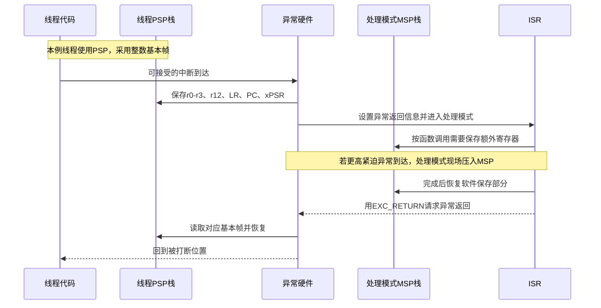

<!-- SPDX-License-Identifier: Apache-2.0 -->

# 第1章\_中断嵌套时每份现场究竟保存在哪里

理解异常现场需要知道寄存器只保存当前正在执行的状态。被打断程序稍后要继续，就必须把必要状态转存到内存。Cortex-M 的硬件异常帧与处理函数自行建立的调用帧共同完成这件事，但二者有不同的创建者。

图例：实线表示保存、读取或执行交接，虚线表示返回；生命线不是额外 CPU，时序不按周期比例。`PSP(Process Stack Pointer-进程栈指针)` 与 `MSP(Main Stack Pointer-主栈指针)` 是两套栈指针状态；名字不意味着硬件已经实现了操作系统进程。`EXC_RETURN(Exception Return-异常返回编码)：指示返回所需的模式、栈及帧类型等信息。`

基本整数帧有8个字，即32字节。进入时如需满足栈对齐，还可能留出填充位置，不能只减32就解释所有现场；启用浮点且需要保存相关状态时还可能涉及扩展帧与延迟保存。图明确选择基本帧，是为了先看清所有权，不把简化当作通用固定长度。

ISR 中的普通函数调用会另外保存其需要的寄存器。硬件基本帧不含所有 r4–r11，因此需要保存的值由软件按调用约定维护。将硬件帧看成“CPU全部寄存器的一次完整快照”，会漏掉软件帧，也会误算嵌套栈需求。

第二个中断打断处理模式时，必须保存的是第一个 ISR 的当前状态，而不是再复制原线程状态。于是线程 PSP 上保留第一份帧，MSP 上可能叠加 ISR 调用帧与嵌套异常帧；返回时逐层恢复，不能直接跳过仍在执行的下层处理程序。

继续：[原理与实现](P002_原理与实现.md)。返回：[专题大纲](大纲.md)。
