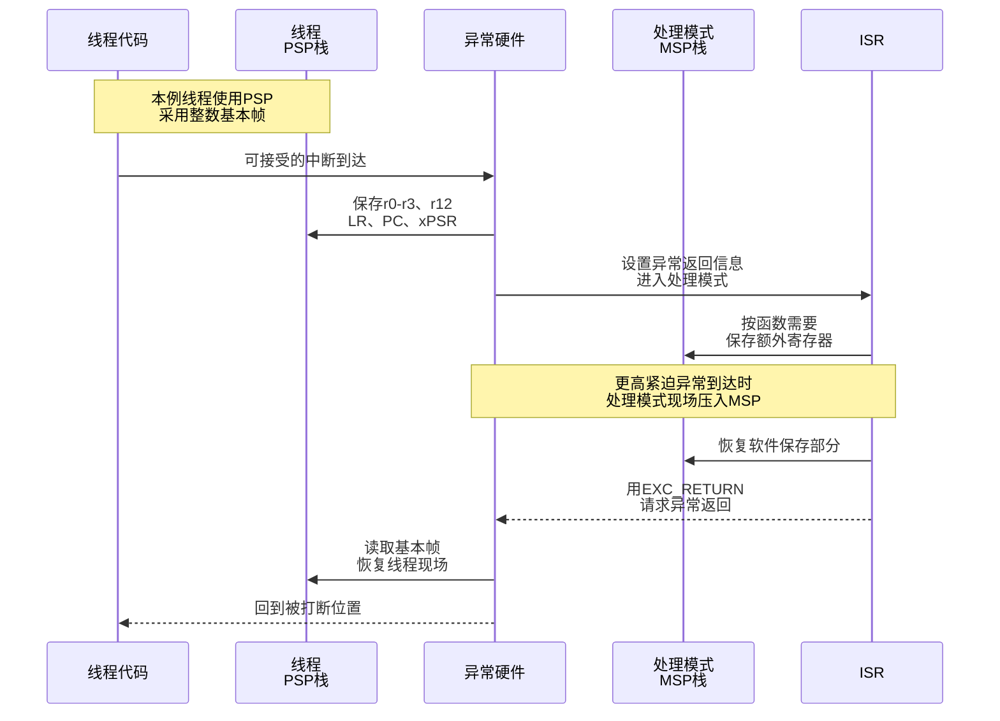

<!-- SPDX-License-Identifier: Apache-2.0 -->

# 第1章\_异常进入和返回的两套栈

> [P01 总目录](../大纲.md) / [P016 异常现场与中断返回](大纲.md) / 第 1 篇（共 3 篇）

理解异常现场需要知道寄存器只保存当前正在执行的状态。被打断程序稍后要继续，就必须把必要状态转存到内存。Cortex-M 的硬件异常帧与处理函数自行建立的调用帧共同完成这件事，但二者有不同的创建者。

图例：实线表示保存、读取或执行交接，虚线表示返回；生命线不是额外 CPU，时序不按周期比例。`PSP(Process Stack Pointer-进程栈指针)` 与 `MSP(Main Stack Pointer-主栈指针)` 是两套栈指针状态；名字不意味着硬件已经实现了操作系统进程。`EXC_RETURN(Exception Return-异常返回编码)：指示返回所需的模式、栈及帧类型等信息。`

基本整数帧有8个字，即32字节。进入时如需满足栈对齐，还可能留出填充位置，不能只减32就解释所有现场；启用浮点且需要保存相关状态时还可能涉及扩展帧与延迟保存。图明确选择基本帧，是为了先看清所有权，不把简化当作通用固定长度。

ISR 中的普通函数调用会另外保存其需要的寄存器。硬件基本帧不含所有 r4–r11，因此需要保存的值由软件按调用约定维护。将硬件帧看成“CPU全部寄存器的一次完整快照”，会漏掉软件帧，也会误算嵌套栈需求。

第二个中断打断处理模式时，必须保存的是第一个 ISR 的当前状态，而不是再复制原线程状态。于是线程 PSP 上保留第一份帧，MSP 上可能叠加 ISR 调用帧与嵌套异常帧；返回时逐层恢复，不能直接跳过仍在执行的下层处理程序。

## 1.1\_从被打断指令看硬件帧与软件帧的分工

被打断程序恢复时，至少要回到合适的指令位置，恢复必要通用寄存器与程序状态。Cortex-M 的基本异常帧把 r0–r3、r12、LR、PC 与 xPSR 保存到被打断上下文所使用的栈；处理函数随后按调用约定保存自己还会破坏的其他状态。

这里的两次保存有不同拥有者。硬件负责进入异常所需的固定基本结构；编译器生成的函数序言或手写汇编负责处理函数自身的保存责任。若手写处理程序直接改用 r4，却没有安排恢复，不能指望基本帧中存在 r4 的备份。

嵌套异常又增加一层：高紧迫异常打断的是低紧迫处理函数，故它保存低紧迫函数当前的寄存器，而非重新保存原线程最初状态。分析栈内存时必须先确认每一帧对应哪条执行流、由谁压入、何时恢复。浮点与对齐条件还会改变帧布局，只有确认这些条件后，才可以按偏移读取其中的 PC。

---

[← 初始化边界与独立上电排错](../P015_reset_startup/P004_初始化边界与独立上电排错.md) · [本专题目录](大纲.md) · [基本帧扩展条件与EXC_RETURN →](P002_基本帧扩展条件与EXC_RETURN.md)
