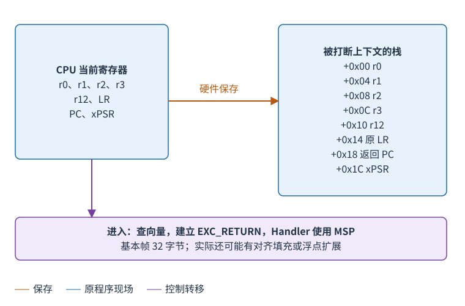
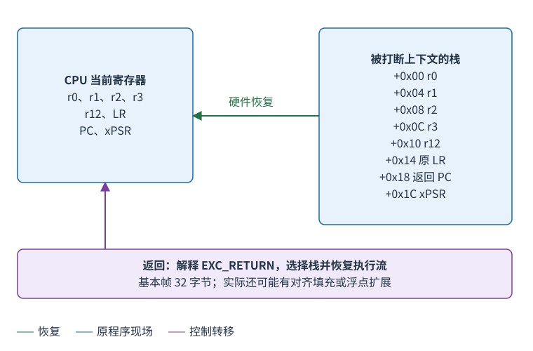

<!-- SPDX-License-Identifier: Apache-2.0 -->

# 第2章\_异常现场与中断返回

启动代码已经建立栈并调用 `main`。假设 CPU 正在计算显示内容，UART 收到字节并提出可响应的请求。NVIC 可以决定让 UART 先处理，但必须保证显示计算以后还能继续：刚算出的值、下一条指令的位置和条件标志都不能凭空丢掉。

处理器把中断、故障和部分系统服务统称为**异常（Exception）**。外部 IRQ 是异常来源的一类。本章聚焦 Cortex-M7 的异常进入与返回，先采用没有活动浮点上下文的基本帧，之后补充浮点与对齐边界。

## 2.1\_线程模式与处理模式先说明执行身份

Cortex-M 用 **Thread mode（线程模式）** 执行普通程序，用 **Handler mode（处理模式）** 执行异常处理。这里的 Thread 是架构中的模式名称，**裸机 `main` 也运行在线程模式，不需要先创建一个 RTOS（Real-Time Operating System－实时操作系统）线程**。操作系统线程是软件管理对象，后面才引入。

处理器提供 MSP 和 PSP 两个栈指针。**PSP（Process Stack Pointer－进程栈指针）** 是架构名称，也不意味着硬件已经创建了操作系统进程。普通线程模式可以按配置选用 MSP 或 PSP，处理模式使用 MSP。两个寄存器保存地址；它们不会自动分配 RAM，也不保证软件给它们设置了互不重叠的区域。

复位后先使用 MSP。第15专题的最小固件没有切换到 PSP，所以 `main` 与异常都会使用同一块 MSP 栈，通过向下增长保留不同层次的内容。RTOS 则常让每个线程使用自己的 PSP 栈，把 MSP 留给处理模式。

## 2.2\_异常进入时硬件实际保存哪些字

当一个允许响应的异常被接受，处理器自动保存基本现场：r0、r1、r2、r3、r12、原 LR、返回 PC 和 xPSR。**xPSR** 是处理器组合状态寄存器的名称，包含执行所需的状态与异常信息。保存位置是被打断上下文当时使用的栈；随后处理程序使用 MSP 执行。

图例：**橙色箭头表示硬件保存，蓝色表示被打断程序的寄存器/内存，紫色表示进入处理程序的控制转移**。这张图只画进入；返回单独画在下一节，避免一组双向箭头掩盖先后关系。

名称注释：`MSP（Main Stack Pointer－主栈指针）：处理模式使用的栈指针。` `PSP（Process Stack Pointer－进程栈指针）：线程模式可选的另一栈指针。` `xPSR（Program Status Register 组合名称－程序状态寄存器）：保存条件、执行状态和异常相关信息。`

若基本帧已正确形成且没有额外浮点部分，从保存后的帧基址开始是：

| 帧内偏移 | 保存内容 | 返回时的用途 |
| --- | --- | --- |
| `+0x00`、`+0x04`、`+0x08`、`+0x0C` | r0、r1、r2、r3 | 恢复被打断的临时值和参数 |
| `+0x10` | r12 | 恢复临时寄存器 |
| `+0x14` | 被打断时的 LR | 恢复原调用链返回信息 |
| `+0x18` | 返回 PC | 恢复应继续执行的位置 |
| `+0x1C` | xPSR | 恢复相应处理器状态 |

表中八个字共 32 字节；对齐填充或浮点扩展可能增加实际占用，不能一概用“SP 只减 32”估算所有异常栈空间。

为什么没有自动保存 r4–r11？硬件基本帧与调用约定配合，使普通 C 处理函数可以由编译器保存自己实际改用的被调用者保留寄存器。若手写汇编 ISR 或进行任务切换，软件必须自己承担相应保存责任。**基本硬件帧足以支持正常异常调用，不代表它已经保存了任意任务切换需要的全部状态。**

## 2.3\_处理入口的 LR 为什么看起来不像代码地址

进入处理程序后，LR 被设置为一种称作 **EXC_RETURN（Exception Return－异常返回）** 的特殊值。它编码返回模式、使用哪一个栈以及帧类型等信息。原程序的普通 LR 已经保存在前面的栈帧中，两者属于不同阶段。

基本帧情形下，常见值如下：

| EXC_RETURN | 返回位置类型 | 从哪个栈恢复 |
| --- | --- | --- |
| `0xFFFFFFF1` | 返回先前被抢占的处理模式 | MSP |
| `0xFFFFFFF9` | 返回线程模式 | MSP |
| `0xFFFFFFFD` | 返回线程模式 | PSP |

这些值不是可随意解引用的 Flash 地址。处理模式下通过规定的返回方式将它用于 PC，处理器识别为异常返回请求，再按编码恢复现场。若普通 C ISR 还调用别的函数，编译器也可能先把这个 LR 保存起来；不能在处理函数任意深层看到某个 LR 值，就假设它一定还是最初的 EXC_RETURN。

## 2.4\_异常返回如何把保存内容重新变成执行现场

处理程序完成必要的状态确认和数据交接后，执行返回。对于正常返回路径，硬件检查返回条件，从指定栈取回保存的基本寄存器和状态，恢复栈位置，然后继续被打断的执行流。

图例：**绿色箭头表示硬件恢复，蓝色是被恢复的原程序现场，紫色是依据 EXC_RETURN 选择的返回路径**。保存与恢复沿用上一图相同对象位置，绿色不表示新的 CPU。

名称注释：`EXC_RETURN（Exception Return－异常返回）：由处理器解释的特殊返回编码。` `PC（Program Counter－程序计数器）：恢复后决定继续执行的位置。` `SP（Stack Pointer－栈指针）：随恢复归还相应帧空间。`

注意绿色恢复线的终点是原程序寄存器。UART ISR 使用 r0 处理接收字节，不会因此永久覆盖被打断显示计算原来的 r0，因为原值保存在栈中并在返回时恢复。如果 ISR 故意修改了栈中的返回 PC 或破坏了栈边界，这个保证就不再成立。

若另一个合格异常已经等待，处理器可能采用**尾链（Tail-Chaining）**，避免先完整恢复普通执行流再立即保存一次。若更紧急请求在异常入口阶段到达，还可能影响将要进入的处理程序，称为迟到异常处理。它们是优化入口/出口的机制，仍然遵守优先级与现场规则，不能把等待中的低优先级请求任意提前。

## 2.5\_嵌套时到底有几份现场

UART 抢占按钮 ISR 时，需要保存的是“按钮 ISR 当前正在执行的现场”，而不是再次保存最早的 `main` 现场。于是栈中保留多个层次：最初被按钮打断的普通程序现场、按钮处理中的软件保存内容、UART 进入时保存的按钮现场，以及 UART 自己需要的局部空间。

返回必须按层次进行。UART 完成后先恢复按钮，再由按钮完成后恢复普通程序。这与第14专题的嵌套函数有相似的后进先出关系，但异常进入包含硬件自动帧和模式切换，不能直接等同于执行一次普通 `BL`。

**浮点单元（Floating-Point Unit，FPU）** 的使用又增加保存需求。活动浮点上下文可能需要 S0–S15、FPSCR 和保留槽位构成扩展部分；延迟保存机制可能先保留空间，等真正需要时再保存相关值。更高的浮点寄存器还涉及软件保存责任。因此故障分析和 RTOS 移植必须识别帧类型，不能把任何 SP 都直接按上表八个字解码。

练习：处理模式正被另一个异常抢占时，返回值 `0xFFFFFFF1` 为什么合理？解答：此次返回目标仍是先前处理模式，并从 MSP 恢复相应帧。若强行按 `0xFFFFFFFD` 返回，就会要求从 PSP 恢复线程模式现场，与真实保存关系不符，可能触发异常返回完整性检查失败。

官方对照：[PM0253 Rev 6，2.1 Programmers model、2.4 Exception model](https://www.st.com/resource/en/programming_manual/DM00237416.pdf)，重点阅读 **2.1.2 Stacks、2.4.7 Exception entry and return** 中的帧布局、返回与浮点现场说明；Arm [Cortex-M7 异常进入与返回](https://support.arm.com/documentation/dui0646/c/The-Cortex-M7-Processor/Exception-model/Exception-entry-and-return?lang=en) 可作为核心机制对照。现在已经具备理解线程切换的硬件基础，接下来先补齐影响内存共享和故障诊断的现实约束。

阅读导航：[前一专题](../P015_reset_startup/P002_原理与实现.md) · [专题大纲](../大纲.md) · [后一专题：DMA 与缓存](../P017_dma_cache/P002_原理与实现.md)

专题内阅读：[关系与模型](P001_关系与模型.md) → 本篇原理与实现 → [案例与推演](P003_案例与推演.md)。返回：[本专题大纲](大纲.md)。
