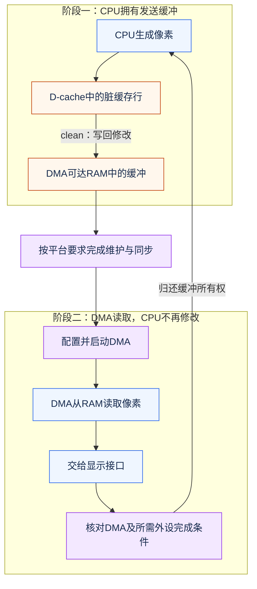

<!-- SPDX-License-Identifier: Apache-2.0 -->

# 第1章\_缓冲区所有权怎样穿过CPU缓存和DMA

CPU 与 DMA 都能访问某块 RAM，并不意味着它们此刻看到相同数据。缓存可能保存 CPU 的副本，DMA 则沿自己的路径访问内存。本专题用显示发送缓冲解释所有权，再把方向反转到接收。

图例：**蓝色节点表示一般参与者，紫色突出处理或决策，橙色表示保存的数据或状态。** 实线是数据或所有权交接顺序；两个阶段共享同一缓冲，不是复制出两份应用数组。`D-cache(Data Cache-数据缓存)：保留 CPU 数据访问的缓存副本。` clean 将需要写回的修改送向内存；invalidate 丢弃缓存副本，使后续读取重新获得内存内容。

发送方向是 CPU 写、DMA 读。如果 CPU 只改了缓存，RAM 仍可能保留旧像素。正确交接需要让 DMA 可见的数据先到达内存，再发布启动动作；启动后 CPU 不能在 DMA 尚未读取完时修改同一缓冲，否则一帧可能混入两个版本。单独执行缓存维护不能代替所有权纪律。

接收方向是 DMA 写、CPU 读。DMA 完成后，CPU 还可能读到旧缓存，所以需要按接收协议失效相关缓存行。接收前也必须处理可能存在的脏行，防止它们稍后写回覆盖 DMA 新数据；开始前、完成后各自的维护与同步需按平台要求安排。不能只记住“DMA之后invalidate”这一句口号。

M7 数据缓存行按32字节组织。维护 API 的范围扩展可能涉及缓冲两侧同一行的邻居；如果邻居保存别的重要脏数据，失效可能破坏它。**对齐缓冲首地址还不够，分配长度与相邻对象也要隔离。** 不可缓存区域可以简化一致性，却仍需可达性、顺序与所有权保证。

继续：[原理与实现](P002_原理与实现.md)。返回：[专题大纲](大纲.md)。
